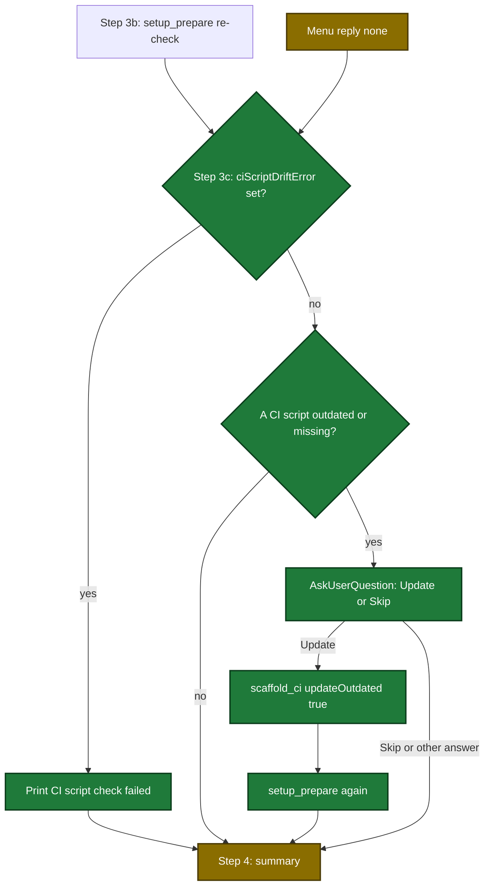

# Proposal

## Why

- Problem: `/setup` never updates an outdated CI script. Its summary prints `scaffold_ci({ force: true })`, which overwrites all 8 CI scripts, current ones too, and loses local edits.
- Evidence: `internal/tools/setup_write.go:713-718` only creates missing files and warns for outdated ones. `docs/versioning.md:212` says that `/setup` "offers CI scaffolding", but no setup step does it.
- Why now: a trace of the setup flow found the gap.

## What Changes

| Area | Before | After |
|---|---|---|
| `scaffold_ci` input | `force` only | New optional `updateOutdated`: updates outdated files, migrates legacy `.js` files, creates missing files, keeps current files. `force` plus `updateOutdated` is a `DomainError`. |
| `scaffold_ci` writes and reads | `os.WriteFile` in place, reads with no size limit | Temp file plus rename. An installed file above 1 MiB is a `DataError` in every mode. |
| `/setup` flow | Step 3b, then Step 4 | Step 3b, then new Step 3c (list outdated or missing CI scripts, ask, update on confirm, check again), then Step 4 |
| `setup_prepare` drift error | `ciScriptDrift: []` with no other signal | `ciScriptDrift: []` plus `ciScriptDriftError` with the error and its Suggestion |
| Fix text in summary, warnings and `validate` | `scaffold_ci({force:true})` and `--force` | `scaffold_ci({updateOutdated:true})` |
| Docs | claim a CI scaffolding offer | describe Step 3c and both inputs |

## Flow after the change

The `/setup` flow from the post-write check to the summary, with the new Step 3c:

## Capabilities

### New Capabilities

None.

### Modified Capabilities
- `skill-setup`: new Step 3c, the menu `none` route, the summary fix line and the drift error line.
- `tool-scaffold-ci`: `updateOutdated` input, conflict error, atomic writes, size limit, fix texts.
- `tool-setup-prepare`: `ciScriptDriftError` output and the remediation text.
- `tool-validate`: `ci_script_drift` messages and the size `DataError`.

## Impact

| Path | Kind | Change |
|---|---|---|
| `internal/tools/scaffold.go` | MCP tool | New input, action rules, atomic write, read limit, size error helper, texts, description |
| `internal/tools/setup.go` | MCP tool | New output field `ciScriptDriftError`, description |
| `internal/tools/validators.go` | MCP tool | Two finding messages, description line |
| `internal/tools/*_test.go` | MCP tool | New and changed tests |
| `plugins/sdlc/skills/setup/SKILL.md` | skill | New Step 3c, routes, summary text |
| `plugins/sdlc/skills/setup/setup-openspec.md` | skill | Return line names Step 3c |
| `internal/skillcheck/skillcheck_setup_test.go` | skill | Expected tool list, Step 3c rule test |
| `docs/versioning.md`, `docs/skills/setup.md`, `docs/skills/setup/config-files.md` | doc | Step 3c and the two inputs |
