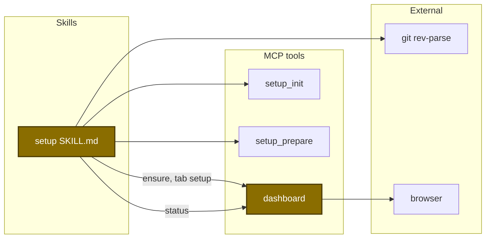
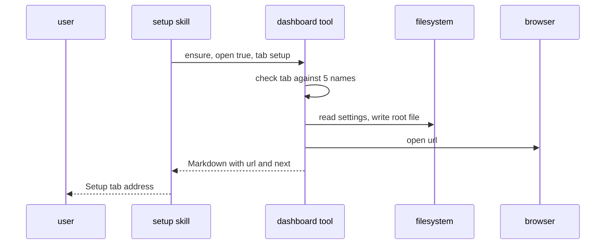

# Design

## Context

- See proposal.md - Why.
- The dashboard page already opens a tab from the address suffix (`internal/dashboard/web/static/view.js:80`, `TAB_NAMES`).
- `setup_init` returns `created[]`. `setup_prepare` returns `needsMigration` and `sections[]` with `delegatedTo`.
- The dashboard and the Setup tab save resolve the main worktree root (`internal/tools/dashboard.go:50-54`).

## Goals / Non-Goals

**Goals:**
- One new tool input. No new tool and no new output field.
- The skill writes no config in Step 1b or Step 4.

**Non-Goals:**
- No capture script for screenshots.
- No change to the Step 1 menu.

## Architecture

Touched parts and their calls:

Main runtime flow of the tab answer:

No persisted state changes, so no state diagram.

## Data contract

| Field | Type | Encoding | Example |
|---|---|---|---|
| `DashboardIn.Tab` | string | plain text, `ensure` only, one of 5 tab names | `setup` |

## Decisions

| Decision | Chosen | Rejected alternatives | Reason |
|---|---|---|---|
| Tab selection | `tab` input on `ensure` | new output field | an output field changes every caller |
| Question place | after the Step 1 menu | before the menu | a question before the menu needs a second menu shape |
| End pointer | `status` at Step 4 | `ensure` at Step 4 | `status` writes nothing |
| Step 0 values | skill computes `mainWorktree` and `formIds` | new `setup_prepare` fields | one read-only git call and one filter |
| Owner table | Go test pins it to `setupmeta.Sections()` | no test | the table is a copy of the Go table |

## Risks / Trade-offs

| Risk | Impact | Mitigation |
|---|---|---|
| Step 1b route skips the migration | legacy config not migrated | condition 5: no `needsMigration` and no `--migrate` |
| Page tab list and tool list differ | `ensure` accepts a tab that the page ignores | `TestDashboardTabsMatchPage` |
| Gallery images slow the home page | Lighthouse score under 0.95 | images load only when they scroll into view |
| Line keys of the worktree test go stale | `TestSkillsNoBareSdlcPaths` fails | find each key with `grep -n` after the edit |
