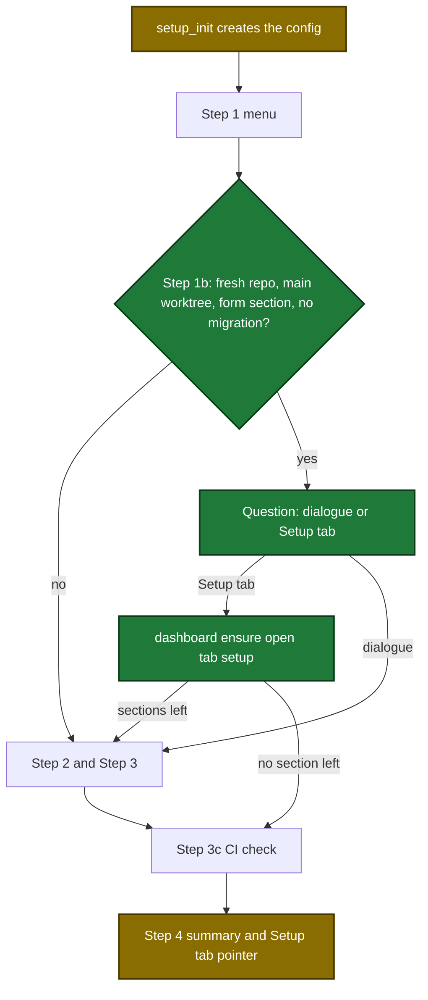

# Proposal

## Why

- **Problem:** the setup knowledge is split between `/sdlc:setup`, the dashboard Setup tab and the docs. No source gives the order of the steps or the owner of each section.
- **Evidence:** `docs/getting-started.md:56-97` names only `/setup` and has no dashboard text. The setup skill drops the `created[]` list of `setup_init` (`internal/tools/setup.go:951-967`). The 4 site images show v0.4.12 (`site/src/data/assets.json`).
- **Why now:** the Setup tab shipped in v0.6.0. The skill, the guide and the site do not name it.

## What Changes

| Area | Before | After |
|---|---|---|
| `dashboard` MCP tool | `ensure` with `open:true` opens the first tab | new optional `tab` input, `ensure` only. `open:true` opens `<url>#<tab>`. An unknown tab is a `DomainError`. |
| `/sdlc:setup` Step 1b | absent | on a fresh repo in the main worktree, with no migration and a form section selected, asks: dialogue or Setup tab |
| `/sdlc:setup` Step 4 | summary only | summary, then a pointer to the Setup tab from `dashboard({action:"status"})` |
| `docs/getting-started.md` | one command, no order | ordered fresh-repo path, 2 start points, 19-row owner table pinned by a Go test |
| Site home page | 1 screenshot at v0.4.12 | setup block with 3 steps and a Setup tab image, gallery of 4 images at v0.6.0 |
| Site dashboard page | 1 image | 9 images at v0.6.0 |

Fresh-repo setup flow after the change:

## Capabilities

### New Capabilities

- `product-site`: added requirements for the setup block and the current screenshots. The capability becomes a main spec when the `github-pages-site` change is archived (plan Task 1).

### Modified Capabilities

- `tool-dashboard`: the `tab` input of `ensure`.
- `skill-setup`: the Step 1b question and the Step 4 pointer.

## Impact

| Path | Kind | Change |
|---|---|---|
| `internal/tools/dashboard.go` | MCP tool | `Tab` input, check, `<url>#<tab>`, description |
| `internal/tools/dashboard_test.go` | MCP tool | tab cases, page tab parity test |
| `plugins/sdlc/skills/setup/SKILL.md` | skill | Step 0 values, Step 1b, Step 4 pointer, Tool map |
| `internal/skillcheck/skillcheck_setup_test.go` | skill | dashboard in the registry, 3 text tests |
| `internal/skillcheck/skillcheck_worktree_test.go` | skill | 4 line keys move |
| `docs/skills/setup.md` | doc | Step 1b row, Step 4 and Run facts rows |
| `docs/getting-started.md` | doc | ordered path, start points, owner table |
| `docs/dashboard.md` | doc | `#setup` link, section name fix, guide link |
| `internal/skillcheck/skillcheck_getting_started_test.go` | doc | owner table test |
| `site/src/pages/index.astro` | doc | setup block, gallery |
| `site/src/data/home.mjs`, `assets.json`, `features.mjs` | doc | asset ids, 9 entries, 1 claim |
| `site/src/assets/*.png` | doc | 9 images at v0.6.0 |
