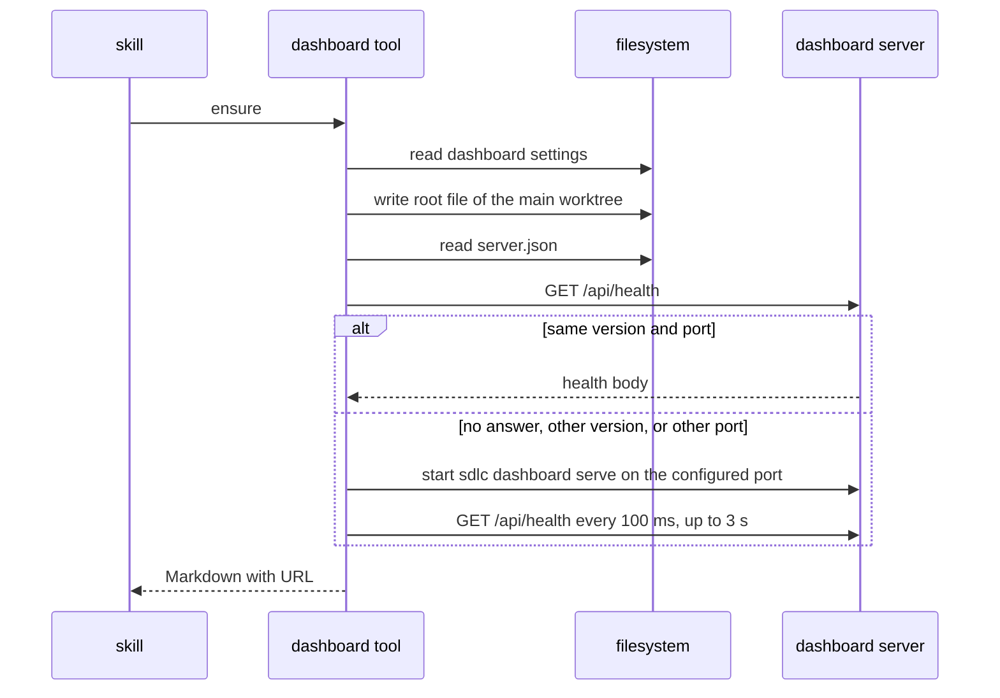

# Spec Delta

## MODIFIED Requirements

### Requirement: Actions and inputs
The tool SHALL select its operation from `action`, one of `ensure`, `status`, `stop`, and SHALL read `open` and `tab` only for `ensure`.

| Input | Encoding | Example |
|---|---|---|
| `action` | plain text, `ensure`, `status`, or `stop` | `ensure` |
| `open` | JSON bool, `ensure` only | `true` |
| `tab` | plain text, `ensure` only, one of `pipelines`, `activity`, `history`, `preplans`, `setup` | `setup` |

#### Scenario: Unknown action
- **WHEN** the call passes `action:"restart"`
- **THEN** the result is a `DomainError` that lists `ensure`, `status`, `stop`
- **AND** the error has a Suggestion

#### Scenario: Unknown tab
- **WHEN** the call passes `action:"ensure"` and `tab:"bogus"`
- **THEN** the result is a `DomainError` that lists `pipelines, activity, history, preplans, setup`
- **AND** the error has a Suggestion
- **AND** no server starts

#### Scenario: Tab with status or stop
- **WHEN** the call passes `action:"status"` or `action:"stop"` with a `tab` that is not empty
- **THEN** the result is a `DomainError` with the message `dashboard: tab is for action ensure only, got action "<action>"`
- **AND** no server starts or stops

### Requirement: Ensure
The `ensure` action SHALL register the main worktree root of the repo, SHALL use the `port` of the `[dashboard]` settings, SHALL reuse an active server of the same version and port, SHALL replace a server of another version or port, and SHALL wait up to 3 s for the health answer of a new server.

#### Scenario: Server already active
- **WHEN** the health answer has the same version and port
- **THEN** the result has `started:false`, `running:true`, and the URL

#### Scenario: Call from a linked worktree
- **WHEN** `ensure` runs in a linked worktree of the repo at `/r`
- **THEN** the registered root is `/r`

#### Scenario: Configured port
- **WHEN** `[dashboard]` has `port = 7400`
- **AND** no server is active
- **THEN** the new server listens on port 7400
- **AND** the result URL is `http://127.0.0.1:7400`

#### Scenario: Port change
- **WHEN** a server is active on port 7385
- **AND** `[dashboard]` has `port = 7400`
- **THEN** the tool stops the server on port 7385 and starts a server on port 7400

#### Scenario: Version change
- **WHEN** the active server reports another version
- **THEN** the tool stops it and starts a new server
- **AND** the result has `started:true`

#### Scenario: Settings error
- **WHEN** `[dashboard]` has `port = 80`
- **THEN** the result is a `DomainError` with the settings error text
- **AND** no server starts

#### Scenario: Open the browser
- **WHEN** the call passes `action:"ensure"` and `open:true`
- **THEN** the tool opens the URL with `open` on macOS or `xdg-open` on Linux

#### Scenario: Open a tab
- **WHEN** the call passes `action:"ensure"`, `open:true` and `tab:"setup"`
- **THEN** the tool opens `http://127.0.0.1:<port>#setup`
- **AND** the result URL stays `http://127.0.0.1:<port>`

#### Scenario: Name a tab without open
- **WHEN** the call passes `action:"ensure"` and `tab:"setup"` with no `open`
- **THEN** the tool opens no browser
- **AND** `next` names `<url>#setup`
