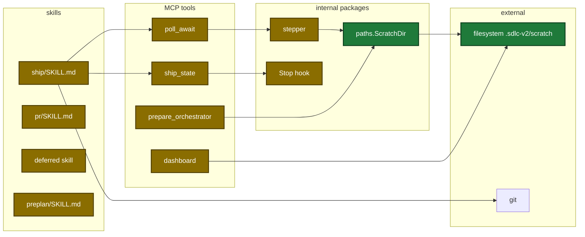
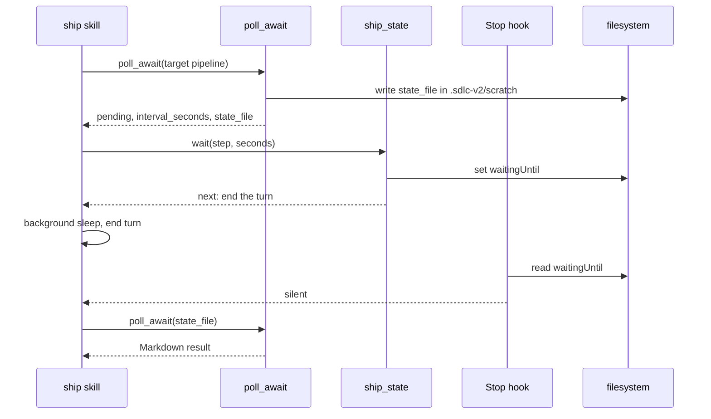
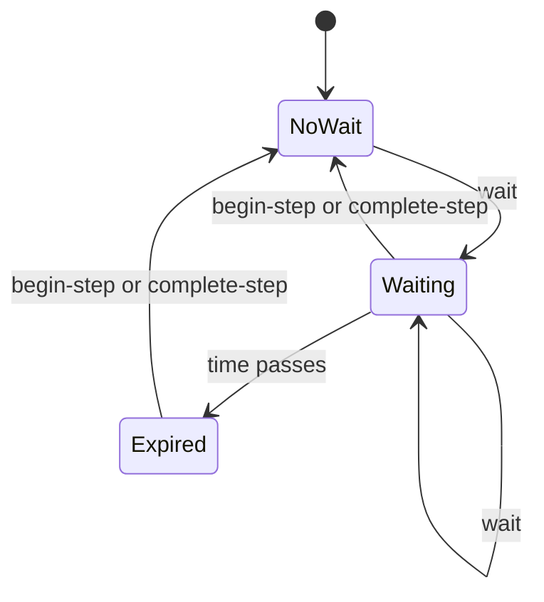

# Design

## Context

- See proposal.md - Why.
- `ship_state` is one MCP tool with many actions in `internal/tools/ship_state.go`. The Stop hook reads the ship state file.
- Tools that need a short-lived file call `os.MkdirTemp("", ...)` today.

## Goals / Non-Goals

- Goal: each fix is small and has its own test.
- Goal: no tool writes to the system temp folder.
- Non-goal: entry 2a (stale-binary warning).
- Non-goal: a site page change; no `features.mjs` claim names a changed behavior.

## Architecture

Touched parts, new and changed marked:



## Main runtime flow

The CI wait of the ship skill:



## State

Step field `waitingUntil` of the ship state:



## Data contracts

```go
// wait input and output
// input:  {action:"wait", step:"<name>", detail:{seconds:<1..3600>, branch?}}
// output: {step, waitingUntil, narration, next}

type ShipRunReportWrittenOut struct {
    Branch        string   `json:"branch"`
    RunID         string   `json:"runId"`
    Format        string   `json:"format"`
    StepCount     int      `json:"stepCount"`
    FixedCount    int      `json:"fixedCount"`
    DeferredCount int      `json:"deferredCount"`
    IssueCount    int      `json:"issueCount"`
    GuardrailHits []string `json:"guardrailHits"`
    Display       string   `json:"display" render:"raw"`
    Path          string   `json:"path"`
    Written       bool     `json:"written"`
    Next          string   `json:"next"`
}
```

| Field | Type | Encoding | Example |
|---|---|---|---|
| `detail.seconds` (wait) | int | JSON integer, 1 to 3600 | `90` |
| `detail.ids` (deferred_list) | array | JSON array of 1 to 50 non-empty strings (a blank or whitespace-only id is refused) | `["review-deferred-x-1"]` |
| `detail.text` (decide) | string | plain text, 1 to 2000 runes | `user declined archive` |

## Decisions

| Decision | Chosen | Rejected alternatives | Reason |
|---|---|---|---|
| Wait signal | skill calls `ship_state` `wait` | `poll_await` writes the wait | one writer; works for any step |
| Wait limit | 1 to 3600 seconds | no limit | a lost wait hides a real stall for at most one hour |
| Trigger match | prefix of at least 100 runes | exact match | stored triggers are cut copies |
| Archive commit | inside `archive-openspec` | a separate step | one step owns the archive result |
| Stage scope | archive paths only | `git add -- openspec/` | drafts of other changes stay unstaged |
| Scratch place | `.sdlc-v2/scratch/` of the main worktree | system temp folder | the folder is gitignored and visible to Clear cache |
| Scratch cleanup | 24-hour sweep at each create | no cleanup | the OS no longer removes the files |
| Follow-up titles | 80 runes in Go | cut in skill text | deterministic work belongs in the tool |

## Risks / Trade-offs

| Risk | Impact | Mitigation |
|---|---|---|
| A lost wait hides a stall | Stop hook stays silent | 3600-second limit; `begin-step` and `complete-step` remove the wait |
| A sweep fails | old files stay | Clear cache lists and deletes them |
| Extra calls per poll cycle | 3 calls instead of 1 | each call is small; the foreground sleep was blocked anyway |
| An old poll `state_file` in the system temp folder | the poll continues there | the path comes from the input, so it still works |

## Migration Plan

- No migration. A state file with no `waitingUntil` has no wait.
- Rollback: revert the commit; the scratch folder stays gitignored.
