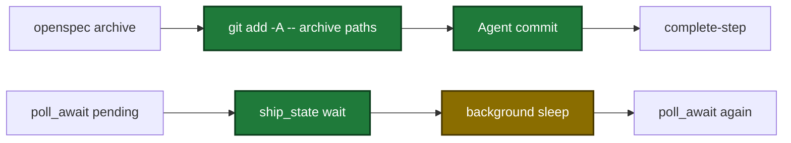

# Proposal

## Why

- Problem: 12 of the 13 entries in `tmp/issues.md` each cost a manual fix in a pipeline run. Examples: the Stop hook blocks a declared wait, a deferred issue title is a full paragraph, the archive step leaves uncommitted files.
- Evidence: tools write to the system temp folder (`/var/folders/.../sdlc-plan-snapshot-*`); `gh pr checks --watch` stops early on a skipped job (`tmp/issues.md:43`); `decide` accepts an empty `detail.text`.
- Why now: each entry is small, and one batch removes them at a low cost.

## What Changes

| Area | Before | After |
|---|---|---|
| Hardened triggers | exact key match | equal, or a prefix of at least 100 runes |
| `decide` | `detail.text` optional | `detail.text` required, at most 2000 runes |
| `history_record` error | Suggestion with no example | Suggestion with a full example call |
| Deferred follow-ups | full items, long titles | `title` of at most 80 runes; full items by `deferred_list` `detail.ids` |
| Report write | full Markdown in the result | path, counts and a one-line `display` |
| Ship waits | foreground `sleep`, Stop hook counts a wait as a stall | `ship_state` `wait` plus a background sleep; the Stop hook stays silent until `waitingUntil` |
| `archive-openspec` | archive files stay uncommitted | the step stages the archive paths and commits them |
| pr step in ship | the pr Agent drafts again | an approved draft is published unchanged |
| Preplan handoff | three options | a fourth option: Check against OpenSpec |
| Tool short-lived files | system temp folder | `.sdlc-v2/scratch/` of the main worktree, 24-hour cleanup |
| Dashboard review queue | 4 findings vanish after the first fix row | one row per finding |

Pipeline flow after the change (archive and wait steps):

## Capabilities

### New Capabilities
- `tool-scratch-folder`: where MCP tools keep short-lived files, and how old files go away.

### Modified Capabilities
- `tool-ship-state`: `decide` text check, new `wait` action, trigger prefix match, short report result, compact deferred output.
- `skill-ship`: archive commit, wait rule between probes, approved PR draft, short report print.
- `skill-pr`: publish an approved draft unchanged.
- `skill-deferred`: short titles, full items by id.
- `skill-preplan`: Check against OpenSpec option at the handoff.
- `pipeline-dashboard`: review queue keeps one row per finding.

## Impact

| Path | Kind | Change |
|---|---|---|
| `internal/tools/ship_state.go` | MCP tool | `decide`, `wait`, `history_record`, deferred actions |
| `internal/tools/ship_harden_clusters.go` | MCP tool | prefix match of triggers |
| `internal/tools/ship_report.go` | MCP tool | short write result |
| `internal/hooks/stop_hooks.go` | hook | silent during a declared wait |
| `plugins/sdlc/schemas/ship-state.schema.json` | schema | step field `waitingUntil` |
| `internal/paths/paths.go`, `internal/tools/fsseam.go` | MCP tool | scratch folder helper |
| `internal/stepper/stepper.go`, `internal/openspec/stage.go`, `internal/state/gc.go` | MCP tool | scratch folder callers and sweeps |
| `internal/tools/dashboard_review_queue.go` | MCP tool | missing finding rows |
| `plugins/sdlc/skills/ship/SKILL.md`, `plugins/sdlc/skills/ship/reference.md` | skill | archive commit, waits, PR draft block |
| `plugins/sdlc/skills/pr/SKILL.md` | skill | approved draft rule |
| `plugins/sdlc/skills/deferred/` | skill | titles, fetch by id |
| `plugins/sdlc/skills/preplan/SKILL.md` | skill | handoff option |
| `docs/` | doc | ship, review, harden, dashboard pages |
