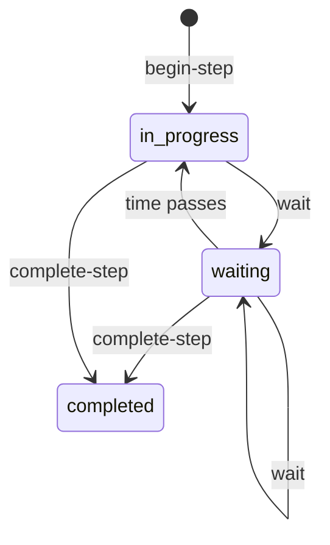

# Spec Delta

## MODIFIED Requirements

### Requirement: decide
The `decide` action SHALL append `{step, decision, at}` to `decisions[]`, with `decision` taken from `detail.text` and `at` set to the call time (RFC 3339 UTC), without checking `step` against `steps[]`. A blank, absent or longer than 2000 runes `detail.text` SHALL return a DomainError and write nothing.

#### Scenario: Decision for a step with no entry
- **WHEN** the call passes `action:"decide"`, `step:"received-review"`, `detail.text:"fixed 3"`
- **THEN** `decisions[]` ends with `{step:"received-review", decision:"fixed 3", at:<now>}`

#### Scenario: Blank text
- **WHEN** the call passes `action:"decide"`, `step:"pr"` and no `detail.text`
- **THEN** the call returns a DomainError with the message `decide: detail.text is required`
- **AND** `decisions[]` does not change

#### Scenario: Text over the limit
- **WHEN** `detail.text` has 2001 runes
- **THEN** the call returns a DomainError that names the limit 2000

## ADDED Requirements

### Requirement: wait action
The `wait` action SHALL set `waitingUntil` (RFC 3339 UTC) on an `in_progress` step to now plus `detail.seconds` (1 to 3600). `begin-step` and `complete-step` SHALL remove `waitingUntil`. Bad input SHALL return a DomainError and write nothing.

#### Scenario: Valid wait
- **WHEN** the call passes `action:"wait"`, `step:"verify-pipeline"`, `detail.seconds:60` on an `in_progress` step
- **THEN** the step has `waitingUntil` 60 seconds after the call time

#### Scenario: Seconds out of range
- **WHEN** `detail.seconds` is 0 or 3601
- **THEN** the call returns a DomainError with the message `wait: detail.seconds must be a whole number from 1 to 3600, got <v>`

#### Scenario: Step not in progress
- **WHEN** the step status is `completed`
- **THEN** the call returns a DomainError that names the status

#### Scenario: Stop hook during a wait
- **WHEN** a turn ends and the current step has `waitingUntil` after now
- **THEN** the Stop hook does not block and does not count the turn end

#### Scenario: Invalid waitingUntil
- **WHEN** `waitingUntil` is not an RFC 3339 time
- **THEN** the Stop hook blocks and counts as for a step with no wait

### Requirement: Hardened trigger prefix match
A recorded hardened trigger key SHALL match a failure key when the two are equal, or when the recorded key is a prefix of the failure key with at least 100 runes. `harden_clusters` and `healing_record` SHALL use this match.

#### Scenario: Cut trigger
- **WHEN** the recorded key is the first 191 runes of a failure key
- **THEN** the cluster of that failure has `alreadyHardened: true`

#### Scenario: Short key
- **WHEN** the recorded key has 99 runes and is a prefix of the failure key
- **THEN** the keys do not match

### Requirement: history_record missing skill Suggestion
When `history_record` gets no `detail.skill`, the Suggestion SHALL show a full example call with `detail.skill`, `detail.branch` and `detail.outcome`.

#### Scenario: Missing skill
- **WHEN** the call passes `action:"history_record"` with no `detail.skill`
- **THEN** the Suggestion contains `ship_state({action:"history_record", detail:{skill:"ship"`

### Requirement: Short report result on write
With `detail.write:true`, `report` SHALL write the full report file and return only `branch`, `runId`, `format`, counts, `guardrailHits` (`[]` when none), a one-line `display`, `path`, `written` and `next`. Without `write`, the result SHALL not change.

#### Scenario: Large report
- **WHEN** a run with 500 findings calls `report` with `detail.write:true`
- **THEN** the result is under 5,000 characters
- **AND** the written file is byte-equal to the full Markdown

### Requirement: Compact deferred follow-ups
`deferred_propose_followups` SHALL return each group item as `{id, priority, source, created, title}`, with `title` the first non-blank line of the description cut to at most 80 runes; an item with an empty description SHALL get the title `Deferred follow-up <id>`, which is not cut. `deferred_list` with `detail.ids` (1 to 50 ids, each a non-empty string) SHALL return only those items, in full.

#### Scenario: Long description
- **WHEN** an open item has a 400-character first line
- **THEN** its `title` has at most 80 runes and ends with `…`

#### Scenario: Too many ids
- **WHEN** `deferred_list` gets 51 ids
- **THEN** the call returns a DomainError with the message `deferred_list: detail.ids has 51 ids, the limit is 50`

#### Scenario: Unknown id
- **WHEN** `deferred_list` gets an id that is not in `.sdlc-v2/history/deferred.json`
- **THEN** the call returns a DomainError that names the id
