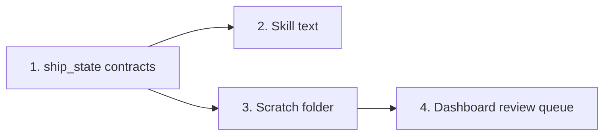

# Tasks

Group order:

## 1. ship_state contracts

- [x] 1.1 Add the trigger prefix match, the decide text check and the history_record Suggestion in internal/tools/ship_harden_clusters.go and internal/tools/ship_state.go — verify: go test -tags integration ./internal/tools/ -run 'TestHarden|TestShipState|TestHealing' <!-- ref:1-1-add-the-trigger-prefix-match-the-dec-fa6362 -->
- [x] 1.2 Add deferred titles and deferred_list detail.ids in internal/tools/ship_state.go and internal/history/ — verify: go test ./internal/history/ ./internal/tools/ -run 'Deferred' <!-- ref:1-2-add-deferred-titles-and-deferred-lis-bdd95d -->
- [x] 1.3 Return the short report result on write in internal/tools/ship_report.go — verify: go test -tags integration ./internal/tools/ -run ShipReport <!-- ref:1-3-return-the-short-report-result-on-wr-ab14cb -->
- [x] 1.4 Add the wait action and the Stop hook wait check in internal/tools/ship_state.go and internal/hooks/stop_hooks.go — verify: go test -tags integration ./internal/hooks/ ./internal/tools/ -run 'Stop|ShipStateWait|Payloads' <!-- ref:1-4-add-the-wait-action-and-the-stop-hoo-15b580 -->

## 2. Skill text

- [x] 2.1 Publish an approved draft unchanged in plugins/sdlc/skills/pr/SKILL.md — verify: go test ./internal/skillcheck/ -run PR <!-- ref:2-1-publish-an-approved-draft-unchanged-ca070d -->
- [x] 2.2 Use short titles and fetch items by id in plugins/sdlc/skills/deferred/ — verify: go test ./internal/skillcheck/ -run Deferred <!-- ref:2-2-use-short-titles-and-fetch-items-by-a6b5b1 -->
- [x] 2.3 Add the archive commit and the decide text shapes in plugins/sdlc/skills/ship/SKILL.md — verify: go test ./internal/skillcheck/ -run Ship <!-- ref:2-3-add-the-archive-commit-and-the-decid-32598f -->
- [x] 2.4 Add the wait rule, short report print, follow-up titles and PR draft block in plugins/sdlc/skills/ship/ — verify: go test ./internal/skillcheck/ -run Ship <!-- ref:2-4-add-the-wait-rule-short-report-print-879daf -->
- [x] 2.5 Add Check against OpenSpec to the handoff in plugins/sdlc/skills/preplan/SKILL.md — verify: go test ./internal/skillcheck/ -run Preplan <!-- ref:2-5-add-check-against-openspec-to-the-ha-4bfd41 -->

## 3. Scratch folder

- [x] 3.1 Add ScratchDir and scratchMkdirTemp and move commit, explore and snapshot files in internal/paths/paths.go and internal/tools/ — verify: go test ./internal/paths/ ./internal/tools/ -run 'Scratch|Commit|MaterialSnapshot|Explore' <!-- ref:3-1-add-scratchdir-and-scratchmkdirtemp-62e9ff -->
- [x] 3.2 Move harden, error-report and review manifests in internal/tools/ — verify: go test -tags integration ./internal/tools/ -run 'Harden|ErrorReport|PrepareOrchestrator|ReviewPrepare' <!-- ref:3-2-move-harden-error-report-and-review-0fc120 -->
- [x] 3.3 Move poll state and the OpenSpec validation copy in internal/stepper/ and internal/openspec/ — verify: go test ./internal/stepper/ ./internal/openspec/ ./internal/tools/ -run 'Stepper|Poll|Stage' <!-- ref:3-3-move-poll-state-and-the-openspec-val-fab5f4 -->
- [x] 3.4 Sweep the scratch folder in gc and Clear cache and add the guard test in internal/state/gc.go and internal/tools/no_system_temp_test.go — verify: go test ./internal/state/ ./internal/tools/ -run 'GC|ClearCache|NoSystemTemp' <!-- ref:3-4-sweep-the-scratch-folder-in-gc-and-c-f4fc0b -->

## 4. Dashboard review queue

- [x] 4.1 Add an open row for each finding with no row in internal/tools/dashboard_review_queue.go — verify: go test ./internal/tools/ -run DashboardReviewQueue <!-- ref:4-1-add-an-open-row-for-each-finding-wit-c499dd -->

## Workflow follow-up

- Run `task check` before ship.
- `/sdlc:ship` archives the change after validation passes.
