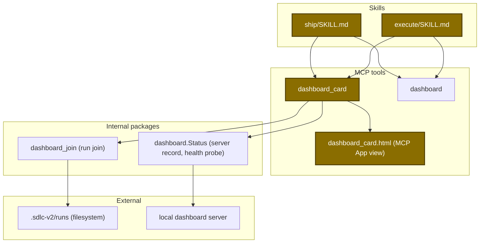
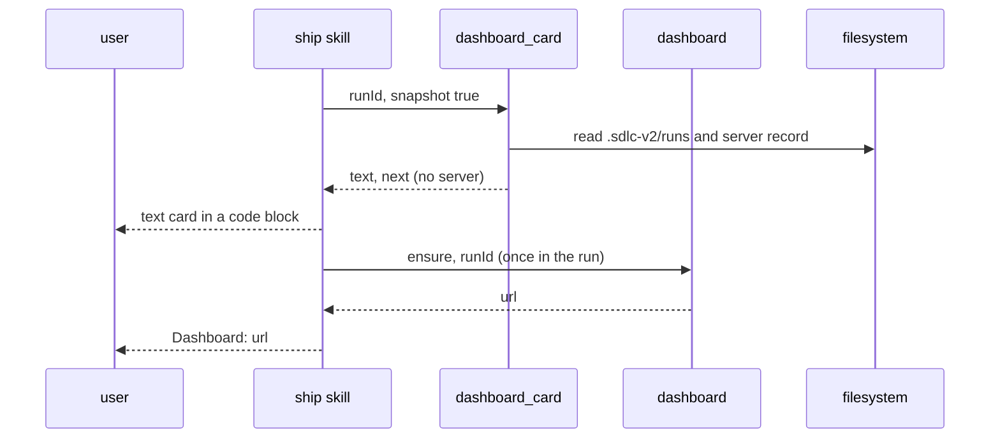

# Design

## Context

- See `proposal.md` - Why.
- The card tool reads run state files only. It reads the list of all runs once for each call (`internal/tools/dashboard_card.go:122-125`).
- The dashboard page already joins a ship run to its execute run by branch and time window (`internal/tools/dashboard_join.go:397-469`).
- Ship runs execute as a separate agent (`plugins/sdlc/skills/ship/SKILL.md:233`). Ship cannot call the card between waves.

Touched parts:

## Goals / Non-Goals

**Goals:**
- One card point for each ship step and each execute wave boundary, in every client.
- The same run data on the card, in the text card and on the dashboard page.

**Non-Goals:**
- No automatic browser window.
- No card between waves in a ship run for a text client: execute runs as a separate agent.
- No change to run state files.

## Decisions

| Decision | Chosen | Rejected alternatives | Reason |
|---|---|---|---|
| Middle card mode | new `snapshot` input | reuse `final` | `final` shows a running run as stopped |
| Ship waves source | join rule of the dashboard page | a stored ship-to-execute link | the page and the card agree. No state file changes shape. |
| Done task | status `completed` only | count `skipped` as done | matches the page counter |
| Dashboard link | read the server status only | start the server in the card tool | the card tool stays read-only |
| Server start | skill calls `ensure` at most once in each run | an ensure at each card point | a second call after a failure fails again |
| `final` with `snapshot` | `final` wins | refuse the call | the end card must always show |
| Card errors | one warning for each run | one warning for each error | more card points repeat the same warning |
| Wave type | flat `DashboardCardWave` | nested `[]DashboardCardStep` | a recursive type breaks the schema inference |

Data contract changes:

| Field | Type | Encoding | Example |
|---|---|---|---|
| `DashboardCardIn.snapshot` | bool | plain JSON bool | `true` |
| `DashboardCardOut.snapshot` | bool | plain JSON bool | `true` |
| `DashboardCardOut.text` | string | fixed-width text | `SHIP  [running]` ... |
| `DashboardCardOut.dashboardUrl` | string | plain text URL | `http://127.0.0.1:55551#ship-feat-x-20261116T175538Z` |
| `DashboardCardStep.tasksDone` | int | plain JSON number | `3` |
| `DashboardCardStep.tasksTotal` | int | plain JSON number | `5` |
| `DashboardCardStep.waves` | array of `{name, status, tasksDone, tasksTotal}` | JSON | `[{"name":"wave 1","status":"completed","tasksDone":2,"tasksTotal":2}]` |

Main runtime flow in a client with no card:

## Risks / Trade-offs

| Risk | Impact | Mitigation |
|---|---|---|
| Two ship runs of one branch overlap in time | the card can join another execute run than the page | the card gives the join only the ship run and the execute runs of its branch. The limit is in the docs. |
| Many live cards poll at the same time | more reads of the runs folder | middle cards are snapshots. Only the start card is live. |
| Text clients see ship waves only after execute ends | less detail during the execute step | the start card in a card client is live, and it shows the execute step, the first step of the run |
| A dashboard server record that cannot be read | no link | the text card says `Dashboard: link unavailable`, and `next` orders no ensure: a server can run while only its record read fails. The call does not fail. |
