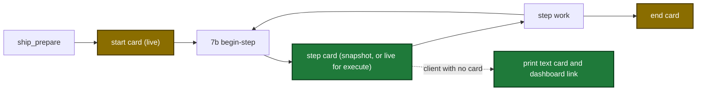

# Proposal

## Why

- Problem: a ship or execute run shows its state in the chat only at the start and at the end. The start card goes out of view in a few minutes.
- Evidence: a client with no MCP App support gets a short summary once (`internal/tools/dashboard_card.go:140`), then the skills stop all card calls. The ship card shows no waves and no task counts.
- Why now: ship and execute runs are long. Users of every client need the run state during the whole run.

## What Changes

| Area | Before | After |
|---|---|---|
| `dashboard_card` in a client with no card | Markdown summary, then "do not call again" | A fixed-width text card and a dashboard link, at every card point |
| `dashboard_card` input | `runId`, `final` | `runId`, `final`, `snapshot` (middle card, no refresh) |
| Execute wave rows | name and status | name, status, done and total task counts |
| Ship `execute` step | one row | wave rows with task counts, from the run join of the dashboard page |
| Ship card points | start, end | start, a card at each later step, end |
| Execute card points | start, end | start, a card after each wave except the last, end |
| Card errors | a warning at each error | a warning at the first error of the run |
| Dashboard link outside T3 Code | never printed | printed with the text card. The skill starts the server at most once, with no browser. |
| Docs and site | one claim about cards | card kinds, text card, 4 Chrome screenshots |

Flow of a ship run after the change:

## Capabilities

### New Capabilities

(none)

### Modified Capabilities

- `tool-dashboard-card`: text card, dashboard link, snapshot input, wave task counts, ship waves.
- `skill-ship`: step cards, text card, dashboard link, one warning for each run.
- `skill-execute`: wave cards, text card, dashboard link, one warning for each run.

## Impact

| Path | Kind | Change |
|---|---|---|
| `internal/tools/dashboard_card.go` | MCP tool | snapshot, waves, counters, text, dashboardUrl, next texts |
| `internal/tools/dashboard_card.html` | MCP App view | snapshot mode, wave rows |
| `plugins/sdlc/skills/ship/SKILL.md`, `plugins/sdlc/skills/ship/entry-modes.md` | skill | step cards, text card rule |
| `plugins/sdlc/skills/execute/SKILL.md` | skill | wave cards, text card rule |
| `docs/dashboard.md`, `docs/skills/ship.md`, `docs/skills/execute.md` | doc | card kinds, text card |
| `site/scripts/card-shots.html`, `site/scripts/card-shots-text.html` | doc | screenshot pages |
| `site/src/data/features.mjs`, `site/src/data/assets.json` | doc | claims and screenshots |
