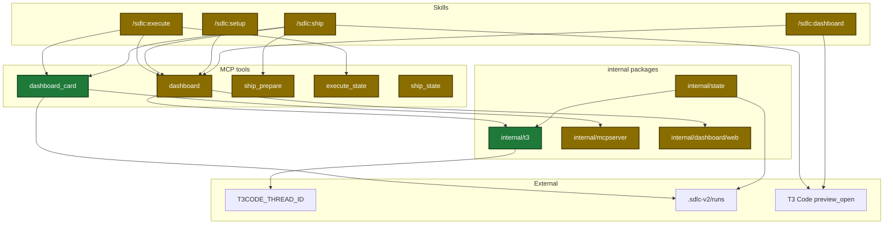
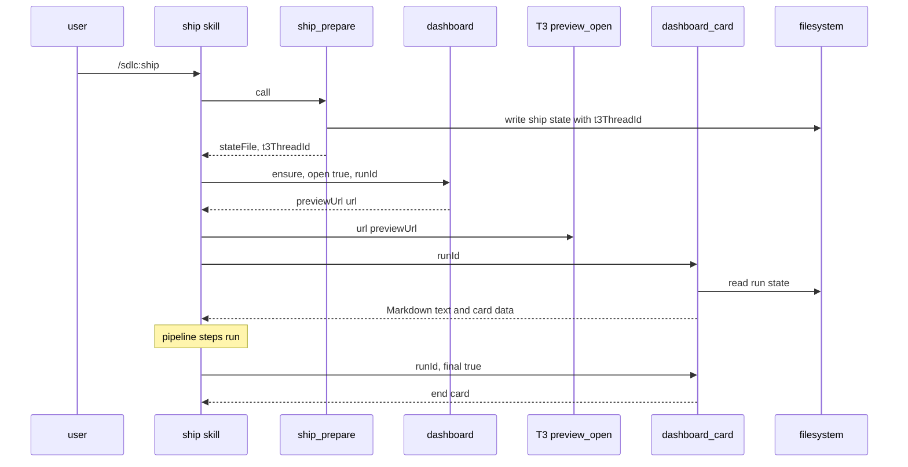
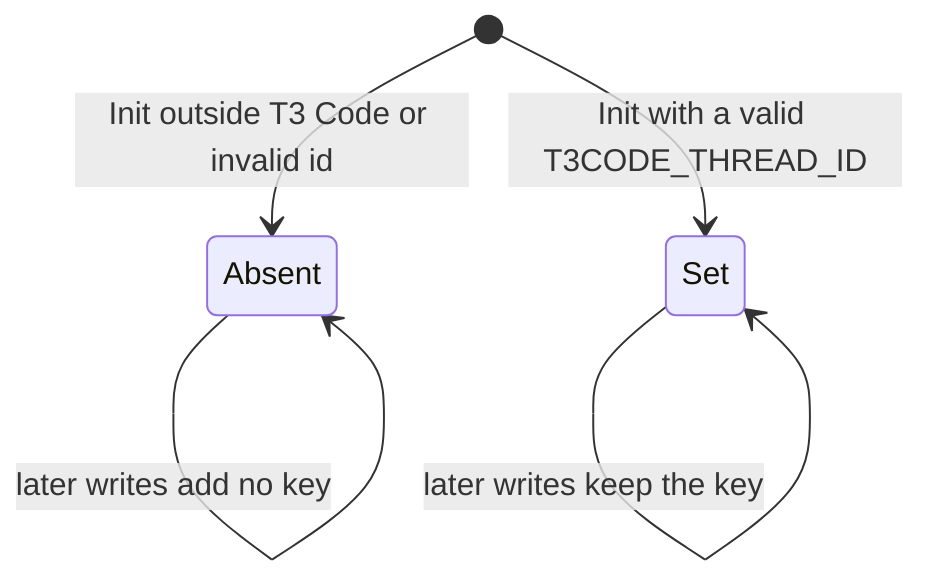

# Design

## Context

- Motivation: see proposal.md - Why.
- Only the MCP server process can read the environment. Skills cannot, so the tools return the thread facts.
- The dashboard page has no run detail view. `#<runId>` selects the Pipelines tab and scrolls to the block of the run.
- The page fills the T3 right panel, so the viewport width is the panel width (checked by plan Task 11).

## Goals / Non-Goals

- Goals:
  - the same binary works in and outside T3 Code, with no config
  - a failed T3 call never stops a run
- Non-Goals:
  - a T3 Code plugin, panel or mod pane
  - the full dashboard page inside an MCP App frame
  - a card for an execute run that ship starts

Architecture of the touched parts:

Main runtime flow of a ship run in a T3 thread:

The `t3ThreadId` key of a run state file:

## Data contracts

| Field | Type | Encoding | Example |
|---|---|---|---|
| `DashboardIn.RunID` (`runId`) | string | plain text, `ensure` only | `ship-feat-x-20261116T175538Z` |
| `DashboardOut.PreviewURL` (`previewUrl`) | string | plain text, absent outside T3 | `http://127.0.0.1:55551/#ship-feat-x-20261116T175538Z?thread=t-1` |
| `DashboardCardIn.RunID` (`runId`) | string | plain text, required | `execute-feat-x-20261116T175538Z` |
| `DashboardCardIn.Final` (`final`) | bool | JSON bool | `true` |
| `ShipPrepareOut.T3ThreadID` (`t3ThreadId`) | string | plain text, omitted when empty | `t-1` |
| `ExecuteResolveConfigOut.ShipDispatched` (`shipDispatched`) | bool | JSON bool | `false` |
| `read` output `runId` (ship_state, execute_state) | string | plain text | `ship-feat-x-20261116T175538Z` |

## Decisions

| Decision | Chosen | Rejected alternatives | Reason |
|---|---|---|---|
| Source of the thread id | server process reads `T3CODE_THREAD_ID` | skills pass the id | skills cannot read the environment |
| Valid thread id | `^[A-Za-z0-9._-]{1,128}$`, else absent | any text | the id goes into a URL and a state file |
| Card tool | new read-only tool `dashboard_card` | `card` action on `dashboard` | `dashboard` is not read-only, and T3 asks approval without the read-only mark. Departs from warning `mcp-tool-count-discipline` for this reason |
| MCP App path | `RegisterUI` next to `Register` | change `Register` | the existing tools keep their text-only output |
| Card run selector | `runId` from the skill, a run of another thread is refused | newest run of the thread | one thread holds many runs |
| Ship-dispatch signal | ship `execute` step is `in_progress` | ship run in flight | a failed ship is also in flight |
| Run panel address | `<url>#<runId>?thread=<id>` | `#pipelines?thread=<id>` | the user chose the run of the thread |
| Narrow form | one 640 px media query | container queries | the page fills the panel |
| Failed T3 tab | print the address and one warning | open the system browser | the user chose this |

## Risks / Trade-offs

| Risk | Impact | Mitigation |
|---|---|---|
| T3 Code does not draw the MCP App card | no card in the chat | plan Task 11 checks it in T3 before the skill work. The text result stays the run summary |
| A compaction drops `runId` or `t3ThreadId` | no end card | `read` returns `runId` and `t3ThreadId`. If the skill cannot tell that it started the run, it skips the end card |
| A stale ship state with `execute` in progress | a standalone execute shows no card | accepted, the run still works |
| The viewport width is not the panel width | the 640 px rule does not fire | plan Task 11 row 7 checks it. Task 14 depends on it |

## Migration Plan

- No migration. Older state files have no `t3ThreadId` key, and every reader treats it as absent.
- Rollback: revert the change. The extra key in new state files is ignored by older readers.
