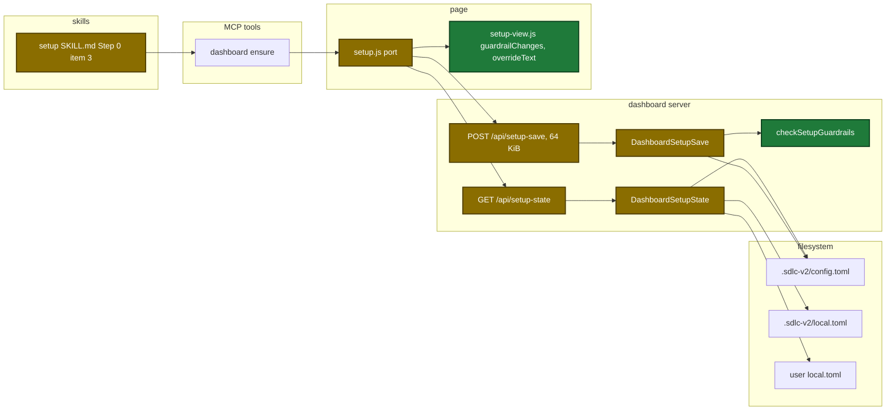
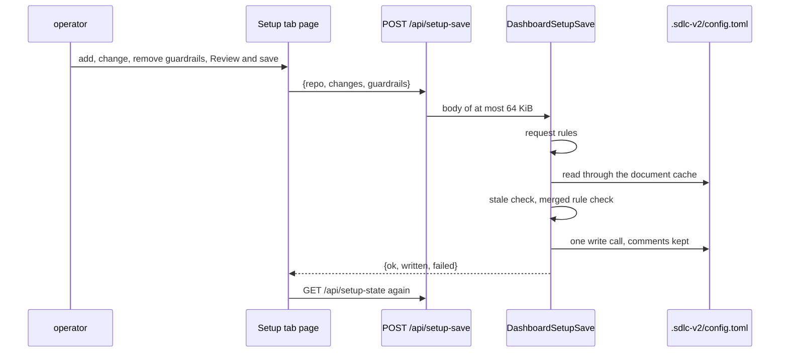
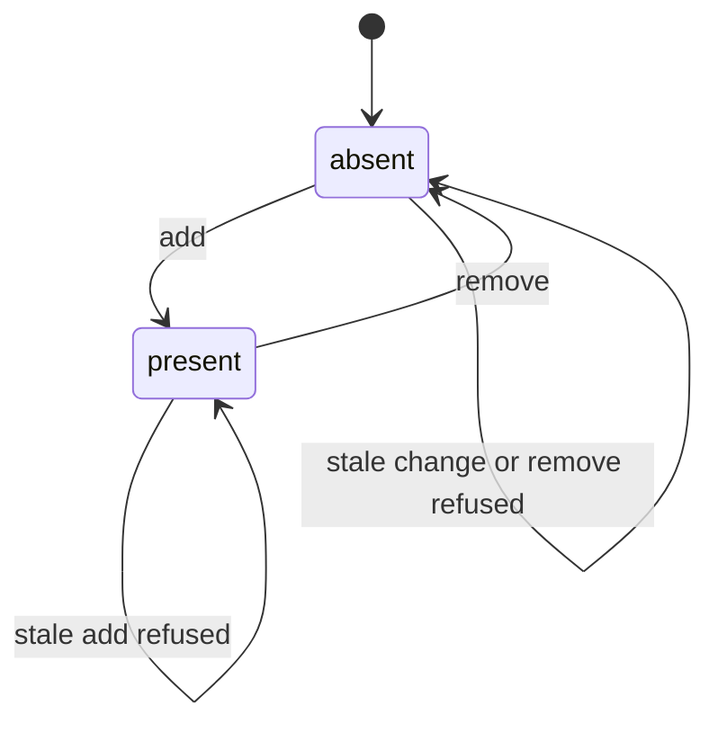

# Design

## Context

- See proposal.md - Why.
- The state function parses each config file one time. All per-file values are in memory, but a first-wins loop drops the overridden values.
- The config writer `setup_write_sections` replaces one key at a time and keeps comment lines. A `null` value on `plan.guardrails.<id>` deletes that table.
- `/sdlc:setup` Step 0 makes about 10 calls before the menu. The Setup tab question needs only `needsMigration`, `mainWorktree` and `formIds`, and the first 2 calls give them.

## Goals / Non-Goals

**Goals:**
- One state call gives the page all data: the value of each file and the full guardrail lists.
- One save call checks every field change and every guardrail change before any write.
- `/sdlc:setup` offers the Setup tab as its first question.

**Non-Goals:**
- No file lock and no version check on a save. The last save wins, as today.
- No conversion of an array-form guardrail list.
- No file order for guardrails.
- No change to the harden rule that never lowers a severity.

## Decisions

| Decision | Chosen | Rejected alternatives | Reason |
|---|---|---|---|
| Guardrail order | sorted by id | file order | The decoded TOML table has no order. Plan and harden see the ids sorted. |
| Flag-set field (`ship.steps`) | raw table of each file, label `merged with <file>` | struck through as overridden | The runtime merges these tables key by key. |
| State fields | add `layers` and `guardrails` | replace `values` | Additive. Old readers still work. |
| Save request | optional `guardrails` field with `add`, `change`, `remove` | the validator shape `{id, remove}` | That shape has no add and no change, so a stale check is not possible. |
| Severity lowering | allowed | refuse as harden does | The requirements file asks for it. Only harden refuses it. |
| Body limit | 64 KiB for setup save only | 64 KiB for every POST route | Only guardrail changes need the larger body. |
| Changes per list | at most 100 | no limit | The limit bounds the merged rule check and the error list. |
| Read path | one document cache for both saves | a second read of `config.toml` | One read gives the same outcome for each file state. |
| Setup tab question | in Step 0, before the snapshot, on every plain run | after the menu, on a fresh config only | The question needs only the first 2 calls. The tab edits an existing config too. |

Touched parts (new parts in green, changed parts in amber):



Main runtime flow of a guardrail save:



State of one guardrail table in `config.toml`:



Data contracts:

```go
// GET /api/setup-state adds:
Layers     map[string]map[string]any       `json:"layers"`     // "<section id>.<field>" -> {"config"|"project"|"user": value}
Guardrails map[string][]DashboardGuardrail `json:"guardrails"` // "plan.guardrails", "execute.guardrails" -> sorted by id

// POST /api/setup-save adds:
Guardrails map[string][]DashboardSetupGuardrailChange `json:"guardrails,omitempty"` // "plan-guardrails" | "execution-guardrails"
type DashboardSetupGuardrailChange struct {
	ID          string `json:"id"`
	Op          string `json:"op"`                    // add | change | remove
	Severity    string `json:"severity,omitempty"`    // error | warning
	Description string `json:"description,omitempty"` // 1 to 1024 bytes
}
```

Config result of one save (add `new-rule`, change `dry`, remove `old-rule`):

```diff
 # team rules
 [plan.guardrails.dry]
 description = "Keep code DRY."
-severity = "error"
+severity = "warning"
-
-[plan.guardrails.old-rule]
-description = "Old rule."
-severity = "error"
+
+[plan.guardrails.new-rule]
+description = "New rule."
+severity = "error"
```

## Risks / Trade-offs

| Risk | Impact | Mitigation |
|---|---|---|
| A bad guardrail write | plan and execute check the wrong rules | every rule runs before any write. A refused save writes no file |
| Two saves at the same time | the last save wins | stale check refuses a change of an id that changed on disk. No lock (non-goal) |
| A tab save while `/sdlc:setup` runs | the skill snapshot misses the tab save | the skill writes only the keys of the sections it asks. Step 3b reads the config again |
| A guardrail table with a comment line inside | the writer refuses the remove | the save lists the id in `failed` with the writer message |
| A larger body limit | a larger request reaches the decoder | only the setup save route gets 64 KiB. The other routes keep 8 KiB |
