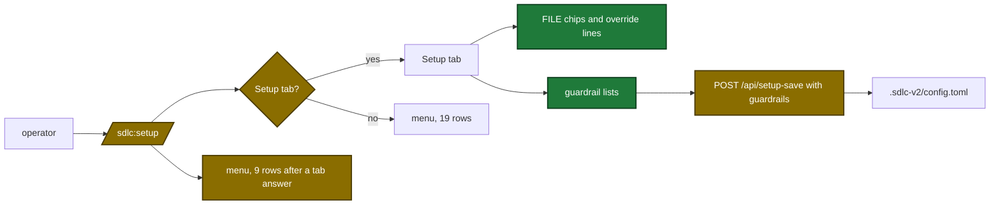

# Proposal

## Why

- The dashboard Setup tab shows only the value that wins for each field. It does not show the file of the value or the values that another file overrides.
- The tab shows only a count of the plan and execute guardrails. To change a guardrail, the operator edits `.sdlc-v2/config.toml` by hand or runs `/sdlc:setup`.
- `/sdlc:setup` offers the Setup tab late: after about 10 pre-flight calls and the 19-row menu, and only on a run that created a config file.
- Evidence: the approved draft and `design/dashboard/requirements.md` (base commit `cec40a3`), and Step 1b of `plugins/sdlc/skills/setup/SKILL.md`.

## What Changes

| Area | Before | After |
|---|---|---|
| Setup tab filter | VIEW chips only | VIEW chips and FILE chips with value counts: `Any file`, `config.toml`, `local.toml`, `~/.sdlc/local.toml`, `Default`, `Other files` |
| Field card | the winning value | the winning value, and one line for each overridden value with its file |
| Guardrail sections | a read-only count | 2 editable lists: add, edit and remove guardrails, with the validator rules |
| Section index | the highlight follows the field-list order | the highlight follows the page order |
| `GET /api/setup-state` | `values`, `delegated` | adds `layers` (the value of each file) and `guardrails` (the full lists) |
| `POST /api/setup-save` | `{repo, changes, targets}`, 8 KiB body | adds the optional `guardrails` field, 64 KiB body |
| `/sdlc:setup` hand-off | the Setup tab question after the menu, on a fresh config only | the Setup tab question before the config snapshot and the menu, on every plain run |

Flow of the Setup tab after the change (new steps in green, changed steps in amber):

## Capabilities

### Modified Capabilities
- `pipeline-dashboard`: the Setup tab, the Setup state route and the Setup save route change. New requirements for the file filter, the override lines, the guardrail lists and the section index.
- `skill-setup`: the Setup tab question moves before the config snapshot and the menu, and runs on every plain run. The menu lists only the sections that need the assistant after a tab answer.

## Impact

| Path | Kind | Change |
|---|---|---|
| `internal/tools/dashboard_setup.go` | MCP tool code (dashboard route logic) | state adds `layers` and `guardrails` |
| `internal/tools/dashboard_setup_write.go` | MCP tool code (dashboard route logic) | save takes `guardrails`, request rules, stale check, write |
| `internal/dashboard/web/server.go`, `setup_routes.go` | dashboard server | per-route body limit, 64 KiB for setup save |
| `internal/dashboard/web/static/setup.js`, `setup-view.js`, `setup.css` | dashboard page | port of the approved draft |
| `plugins/sdlc/skills/setup/SKILL.md` | skill | Setup tab question in Step 0 item 3 |
| `internal/skillcheck/skillcheck_setup_test.go` | test | Step 0, Step 1, Step 4 text checks |
| `docs/dashboard.md`, `docs/skills/setup.md`, `docs/getting-started.md`, `docs/skills/setup/flags-and-sections.md` | doc | new behavior |
| `site/src/data/features.mjs` | doc | 2 claims |
