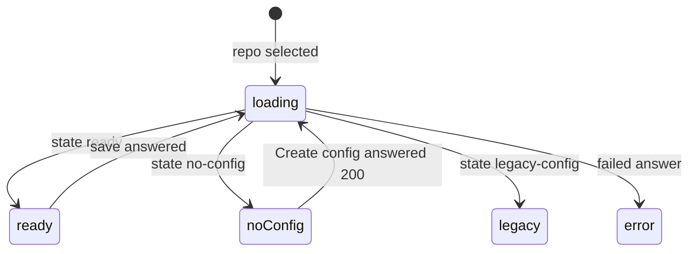

# Spec Delta

## MODIFIED Requirements

### Requirement: Setup tab
The page SHALL have a Setup tab that shows one form for the config of one selected repo. The form SHALL be built from the field list of `GET /api/setup-fields`, with one card for each form section, 2 guardrail section cards, an index of the sections, a filter, the views All, Changed and Not set, the FILE chips, and a save bar. The tab SHALL have its own repo bar that selects exactly one repo. The tab count SHALL be the number of unsaved changes of the selected repo.

Form states of the selected repo:

#### Scenario: Repo with a config
- **WHEN** the user opens the Setup tab and the selected repo has `.sdlc-v2/config.toml`
- **THEN** the tab shows 10 form section cards, the `plan-guardrails` and `execution-guardrails` cards, and 7 read-only cards for the other delegated sections

#### Scenario: Effect of each option
- **WHEN** a field has a list of options
- **THEN** the field shows one row for each option with its effect on the plugin

#### Scenario: Hidden step fields
- **WHEN** a pipeline step is off in the `ship.steps` field of the form
- **THEN** the fields of that step are hidden
- **AND** the section shows how many fields are hidden and for which steps

#### Scenario: Save to switch
- **WHEN** a local section has the Save to switch on `All my projects` and the user changes one field
- **THEN** the save writes only that field to the user file

#### Scenario: Review before a save
- **WHEN** the user selects `Review and save`
- **THEN** a dialog lists each change as the old value and the new value, grouped by file
- **AND** the dialog lists each guardrail change as NEW, CHANGED or REMOVED

#### Scenario: Saved note
- **WHEN** the server answers a save of 2 changes with `ok` true
- **THEN** the save bar note reads `Saved 2 changes.`
- **AND** the form loads the state of the repo again

#### Scenario: Refused value
- **WHEN** the server answers `400 SETUP_INVALID` with one field
- **THEN** the field shows the message of the server
- **AND** the save bar note reads `Not saved. The config check refused 1 field. No file changed.`

#### Scenario: Body too large
- **WHEN** the server answers a save with `413 BODY_TOO_LARGE`
- **THEN** the save bar note reads `Not saved. The save is larger than the server accepts. Save fewer fields or guardrails at one time.`

#### Scenario: Pipeline runs
- **WHEN** a pipeline of the selected repo has the status `running`
- **THEN** the notice `PIPELINE RUNS` shows above the form and in the review dialog
- **AND** the save stays possible

#### Scenario: Repo with no config
- **WHEN** the selected repo has the state `no-config`
- **THEN** the tab shows the Create config button and the command `/sdlc:setup`

#### Scenario: Old JSON config
- **WHEN** the selected repo has the state `legacy-config`
- **THEN** the tab shows the command `/sdlc:setup --migrate` and no Create config button

### Requirement: Setup state route
The server SHALL serve `GET /api/setup-state?repo=<root>` with no Origin check and no token. It SHALL answer 200 `{root, state, configError, files, values, delegated, layers, guardrails}`. `state` SHALL be `ready`, `no-config`, or `legacy-config`. Each value SHALL name its source file: `config`, `project`, or `user`. `layers` SHALL map `<section id>.<field>` to the value of each file that sets it. `guardrails` SHALL map `plan.guardrails` and `execute.guardrails` to lists of `{id, severity, description}` sorted by id. A repo that the page does not show SHALL get `404 REPO_NOT_FOUND`.

#### Scenario: Value source
- **WHEN** both `.sdlc-v2/local.toml` and the user file hold `ship.bump`
- **THEN** the value of `ship.bump` has the source `project`

#### Scenario: Value of each file
- **WHEN** `.sdlc-v2/local.toml` holds `ship.bump = "minor"` and the user file holds `ship.bump = "patch"`
- **THEN** `layers["ship.bump"]` is `{"project": "minor", "user": "patch"}`

#### Scenario: Guardrail lists
- **WHEN** `config.toml` has `[plan.guardrails.dry]` with `severity = "warning"` and no `execute.guardrails`
- **THEN** `guardrails["plan.guardrails"]` has one entry with `id` `dry` and `severity` `warning`
- **AND** `guardrails["execute.guardrails"]` is `[]`

#### Scenario: Guardrail with no severity
- **WHEN** a guardrail table has no `severity` key and no `description` key
- **THEN** its entry has `severity` `error` and `description` `""`

#### Scenario: Config problem
- **WHEN** the config check of the whole config fails
- **THEN** the state stays `ready`
- **AND** `configError` holds the error text

### Requirement: Setup save route
The server SHALL serve `POST /api/setup-save` `{repo, changes, targets, guardrails}` behind the Origin and token checks, with a body of at most 64 KiB. Each change SHALL be `{section, field, op, value}` with `op` `set` or `reset`. Each guardrail change SHALL be `{id, op, severity, description}` with `op` `add`, `change` or `remove`. The server SHALL check every change before any write, keep every key that the request does not name, and write through the setup write code. A refused change SHALL write no file.

#### Scenario: Version save creates missing CI files
- **WHEN** a save writes the `version` section
- **THEN** each missing CI script file is created
- **AND** an existing CI script file does not change
- **AND** `ciFiles` lists the created files

#### Scenario: Refused value writes nothing
- **WHEN** a save sets `ship.verifyPipelineMaxIterations` to `0`
- **THEN** the answer is `400 SETUP_INVALID` with a `fields` list
- **AND** no file changes

#### Scenario: Comments stay
- **WHEN** a save changes one key of a file that holds comment lines
- **THEN** every comment line and the key order stay

#### Scenario: Too many changes
- **WHEN** a save holds more than 64 changes
- **THEN** the answer is `400 BAD_REQUEST` and no file changes

#### Scenario: Wrong repo state
- **WHEN** a save names a repo with the state `no-config`
- **THEN** the answer is `409 SETUP_NOT_READY`

#### Scenario: Guardrail changes
- **WHEN** a save adds `new-rule`, changes `dry` to `warning` and removes `old-rule` in `plan-guardrails`
- **THEN** `config.toml` has `[plan.guardrails.new-rule]`, `dry` has `severity = "warning"`, and `[plan.guardrails.old-rule]` is gone
- **AND** every comment line outside the removed table stays

#### Scenario: Lower severity accepted
- **WHEN** a save changes a guardrail from `error` to `warning`
- **THEN** the save writes the change

#### Scenario: Stale guardrail change
- **WHEN** a save removes a guardrail id that `config.toml` no longer holds
- **THEN** the answer is `400 SETUP_INVALID` with a field entry for the id
- **AND** no file changes

#### Scenario: Guardrail request rules
- **WHEN** a save has an empty `changes` list and an empty `guardrails` field
- **THEN** the answer is `400 BAD_REQUEST` with the message `changes and guardrails are empty`

#### Scenario: Array form refused
- **WHEN** `config.toml` holds `[[plan.guardrails]]` and a save changes `plan-guardrails`
- **THEN** the answer is `400 BAD_REQUEST`
- **AND** the suggestion is `Change the list in config.toml to [plan.guardrails.<id>] tables manually, then reload the page.`

#### Scenario: Mixed save with one refused side
- **WHEN** a save has a valid field change and a guardrail change that breaks a rule
- **THEN** the answer is `400 SETUP_INVALID`
- **AND** no file changes

#### Scenario: Body limit
- **WHEN** a `POST /api/setup-save` body has 64 KiB plus 1 byte
- **THEN** the answer is `413 BODY_TOO_LARGE`
- **AND** a `POST /api/setup-create` body over 8 KiB still gets `413 BODY_TOO_LARGE`

## ADDED Requirements

### Requirement: Setup file filter
The Setup tab SHALL show FILE chips with a value count: `Any file`, `config.toml`, `local.toml`, `~/.sdlc/local.toml`, `Default`, and `Other files` for the sections that the assistant handles. A file chip SHALL show only the fields that its file sets. The counts of `config.toml`, `local.toml`, `~/.sdlc/local.toml` and `Default` SHALL add up to the `Any file` count. The FILE label and its chips SHALL wrap as one unit.

#### Scenario: Pick a file
- **WHEN** the user picks the `local.toml` chip
- **THEN** the form shows only the fields that `.sdlc-v2/local.toml` sets

#### Scenario: Counts add up
- **WHEN** the form shows the FILE chips
- **THEN** the counts of `config.toml`, `local.toml`, `~/.sdlc/local.toml` and `Default` add up to the count of `Any file`

### Requirement: Setup override lines
Each field card SHALL list the value of each file that another file overrides, with the file name, the value struck through and the name of the file that overrides it. A `ship.steps` value SHALL show the table of each file with the label `merged with <file>`, not struck through. The `local.toml` and `~/.sdlc/local.toml` chips SHALL count the overridden values of their file.

#### Scenario: User value overridden
- **WHEN** `.sdlc-v2/local.toml` and the user file both set `ship.bump`
- **THEN** the `ship.bump` card shows the user value struck through, with `overridden by local.toml`

#### Scenario: Merged flag set
- **WHEN** both files set `ship.steps`
- **THEN** the card shows each table with `merged with <file>` and no strike-through

### Requirement: Setup guardrail lists
The Setup tab SHALL show the plan and execute guardrails as 2 lists that start closed. Each row SHALL show a severity badge, the id and 2 lines of the description. The user SHALL add, edit and remove guardrails in the form. An id SHALL be kebab-case and unique in its list, and a description SHALL have 1 to 1024 bytes. A row error SHALL block the save. Each list SHALL show the panels `IN THIS FORM` and `WITH THE ASSISTANT` with the command `/sdlc:setup --only <section>`.

#### Scenario: List opens
- **WHEN** the user selects the guardrail section in the section index
- **THEN** the page scrolls to the section
- **AND** the list stays closed

#### Scenario: Bad id
- **WHEN** the user types the id `Bad Id`
- **THEN** the row shows an error
- **AND** the save stays blocked

#### Scenario: Server error on a row
- **WHEN** the server refuses a guardrail change of the id `dry`
- **THEN** the `dry` row shows the server message after the form draws again

#### Scenario: Undo changes
- **WHEN** the user selects `Undo changes` on a changed row
- **THEN** the row has its loaded values again
- **AND** the editor closes

### Requirement: Setup section index follows page order
The highlight of the Setup section index SHALL follow the order of the sections on the page.

#### Scenario: Scroll past a section
- **WHEN** the user scrolls the form from the `ship` card to the next card on the page
- **THEN** the index highlights the next card of the page, not the next section of the field list
