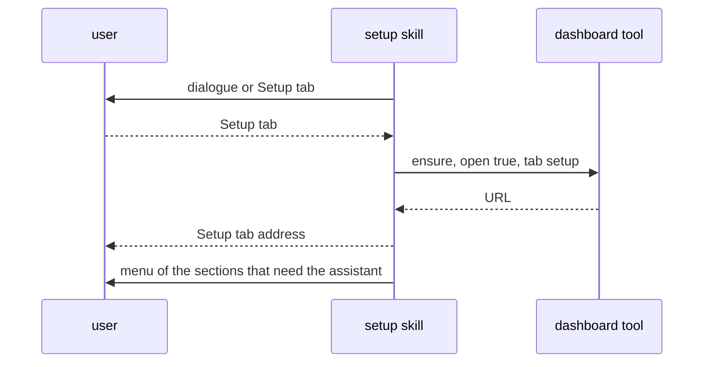

# Spec Delta

## MODIFIED Requirements

### Requirement: Main flow and pre-flight order
The skill SHALL call `setup_prepare({ skipConfigCheck: false })` first, then `setup_init({})` once, then ask the Setup tab question when its conditions hold, then take a config snapshot, before it shows the menu.

Main `/setup` flow without direct-entry flags:

```mermaid
sequenceDiagram
    participant User
    participant Skill as setup skill
    participant P as setup_prepare
    participant I as setup_init
    participant B as dashboard
    participant D as dimensions_render_instructions
    participant M as migrate
    participant W as setup_write_sections
    participant S as scaffold_ci
    participant FS
    Skill->>P: skipConfigCheck false
    P-->>Skill: needsMigration, sections, defaultBranch, remoteOwner, ciScriptDrift, ciScriptDriftError, localValues, userConfigPath
    Skill->>I: scaffold mode, no input
    opt main worktree, no migration
        Skill->>User: AskUserQuestion Setup tab or Dialogue
        opt Setup tab
            Skill->>B: ensure, open true, tab setup
        end
    end
    Skill->>FS: Read .sdlc-v2/config.toml
    Skill->>D: listDimensions true
    Skill->>I: checkPRTemplate true, then checkPlanTemplate true
    Skill->>FS: Read openspec/config.yaml if present
    Skill->>User: status block and numbered menu, plain chat
    User-->>Skill: selection
    opt needsMigration true or --migrate
        Skill->>User: AskUserQuestion migrate?
        Skill->>M: import, then config, then layout
    end
    opt a local section is selected
        Skill->>User: AskUserQuestion save target
    end
    loop each selected section in canonical order
        Skill->>User: section header, then questions or sub-flow
    end
    Skill->>User: diff preview with save target file, AskUserQuestion confirm
    Skill->>W: sectionsJson and target
    Skill->>P: re-snapshot and check written sections
    opt Step 3c: a CI script is outdated or missing
        Skill->>User: CI script table, AskUserQuestion Update or Skip
        opt Update
            Skill->>S: updateOutdated true
            Skill->>P: skipConfigCheck true, fresh drift
        end
    end
    Skill->>User: summary
```

Snapshot contents:

| Item | Source |
|---|---|
| `projectConfig` | Read `.sdlc-v2/config.toml` (absent = `{}`) |
| `localValues`, `userConfigPath` | `setup_prepare` output; the skill does not read `.sdlc-v2/local.toml` or the user file itself |
| Installed dimension count and names | `dimensions_render_instructions({ listDimensions: true })` |
| PR template exists | `setup_init({ checkPRTemplate: true })` |
| Plan template exists | `setup_init({ checkPlanTemplate: true })` |
| Managed-block version | Line `# BEGIN MANAGED BY sdlc-v2 (v<N>)` in `openspec/config.yaml` — the same begin marker `openspec_enrich` writes |

Version detection for the `version` section:

- First existing file in this order sets `versionFile` and `fileType`: `package.json`, `Cargo.toml`, `pyproject.toml`, `pubspec.yaml`, `plugin.json`.
- `tagPrefix` is the common leading non-digit part of recent `git tag --list` tags; default `v` when there are no tags or no common prefix.

#### Scenario: Migration flag read before scaffold
- **WHEN** `.sdlc-v2/config.json` exists without `config.toml`
- **THEN** the skill receives `needsMigration: true` from `setup_prepare`
- **AND** only then calls `setup_init({})`

#### Scenario: Setup tab question before the snapshot
- **WHEN** a plain `/sdlc:setup` run starts in the main worktree with no migration
- **THEN** the skill asks the Setup tab question after `setup_init({})`
- **AND** the skill reads `.sdlc-v2/config.toml` for the snapshot after the answer

#### Scenario: No version file
- **WHEN** none of the five version files exist
- **AND** the repo has no tags
- **THEN** no `versionFile` is detected
- **AND** `tagPrefix` is `v`

#### Scenario: Local values from setup_prepare
- **WHEN** the skill takes the snapshot
- **THEN** it gets the local values from `localValues` of `setup_prepare`
- **AND** it does not read `.sdlc-v2/local.toml`

### Requirement: Menu is plain chat
Without `--only`, `--force`, or a direct-entry flag, the skill SHALL print a status block and a numbered menu as plain chat, then end its turn. It SHALL NOT use AskUserQuestion for the menu.

- Status rows: `[set]` or `[not set]`, the section id, and the row summary (or `—`).
- Menu line: `<N>. [<state>] <label> — <first sentence of purpose>`, `<state>` is `set` or `not-set`.
- 19 lines in canonical order, numbered from 1. After a `Setup tab` answer whose `dashboard` call returned, only the 9 rows of the sections that need the assistant, numbered from 1.
- Labels and purposes come from `setup_prepare`'s `sections`, never hard-coded.
- When `needsMigration` is `true`, one line is printed above the status block: `⚠ Legacy or outdated config detected — see Step 2 (migration) before configuring sections below.`
- The reply prompt lists `all`, `not-set`, `none`, `cancel` and says `Default: all`.

#### Scenario: Menu turn ends
- **WHEN** the skill prints the menu
- **THEN** its turn ends
- **AND** the user's next message is parsed as the reply

#### Scenario: Menu after a tab answer
- **WHEN** the user answered `Setup tab` and the `dashboard` call returned
- **THEN** the status block and the menu list only the rows whose section has a `delegatedTo` value
- **AND** the rows are numbered from 1

### Requirement: Menu reply parsing
The skill SHALL resolve the reply to a set of section ids of the listed menu rows as below, and SHALL allow at most 3 retries on invalid input.

| Reply | Selected ids |
|---|---|
| empty | all listed rows |
| `all` | all listed rows |
| `not-set` | listed rows with state `not-set` |
| `none` or `cancel` | none; prints `No sections selected — no config changes.` and goes to the CI script update step, then the summary |
| Numbers and `M-N` ranges, comma- or space-separated | union of the listed rows at those positions |

- Invalid token: print `Invalid input: "<token>" is not a number, range, or known keyword. Try again.`, then re-print the menu and prompt.
- After 3 failed retries: print `No valid input after 3 attempts — no changes made.` and exit.

#### Scenario: Range reply
- **WHEN** the user replies `1-3,7`
- **THEN** the selected ids are rows 1, 2, 3, and 7

#### Scenario: Out of range
- **WHEN** the user replies `42`
- **THEN** the skill prints `Invalid input: "42" is not a number, range, or known keyword. Try again.`
- **AND** re-prints the menu

#### Scenario: All after a tab answer
- **WHEN** the menu lists only the 9 rows of the sections that need the assistant
- **AND** the user replies `all`
- **THEN** the selected ids are the ids of these 9 rows

#### Scenario: No section selected with an outdated CI script
- **WHEN** the user replies `none`
- **AND** one `ciScriptDrift` entry has `action: "outdated"`
- **THEN** the skill prints `No sections selected — no config changes.`
- **AND** the skill asks `Update the CI scripts listed above?` before the summary

## REMOVED Requirements

### Requirement: Setup tab question on a fresh repo
**Reason**: The question moves before the config snapshot and the menu, and runs on every plain run, not only on a run that created a config file.
**Migration**: See the requirement `Setup tab question before the section menu`.

## ADDED Requirements

### Requirement: Setup tab question before the section menu
The skill SHALL ask once, after `setup_init({})` and before the config snapshot and the menu, whether to change the form sections in the dialogue or in the dashboard Setup tab, only when all 3 conditions hold: no `--only`, `--force` or direct-entry flag, the main worktree is active, and no migration runs.

#### Scenario: Tab answer
- **WHEN** the user answers `Setup tab`
- **THEN** the skill calls `dashboard` with `action:"ensure"`, `open:true` and `tab:"setup"`
- **AND** the menu lists only the sections that need the assistant

#### Scenario: Existing config
- **WHEN** both config files already exist before the run
- **THEN** the skill asks the question

#### Scenario: Dialogue answer
- **WHEN** the user answers `Dialogue`, answers with free text, or dismisses the question
- **THEN** the menu lists all 19 sections

#### Scenario: Dashboard error
- **WHEN** the `dashboard` call returns an error
- **THEN** the skill prints the error in a `text` fence
- **AND** the menu lists all 19 sections

#### Scenario: Legacy config
- **WHEN** a JSON-era config needs migration, or `--migrate` is passed
- **THEN** the skill does not ask the question

#### Scenario: Direct-entry flag
- **WHEN** `--only`, `--force` or a direct-entry flag is passed
- **THEN** the skill does not ask the question

#### Scenario: Linked worktree
- **WHEN** the run is in a linked worktree
- **THEN** the skill does not ask the question
