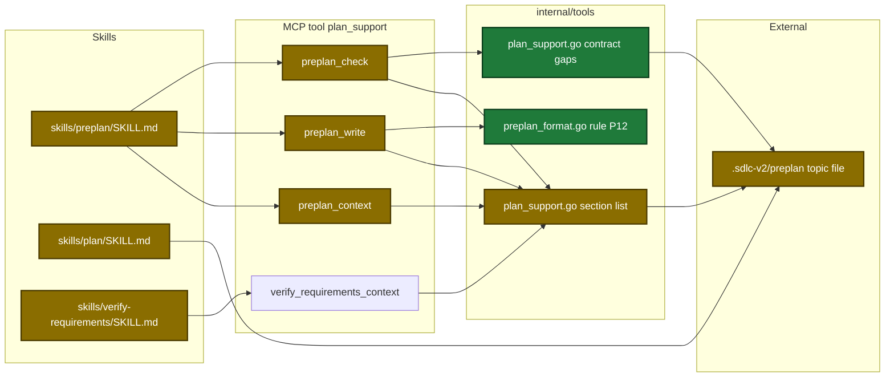
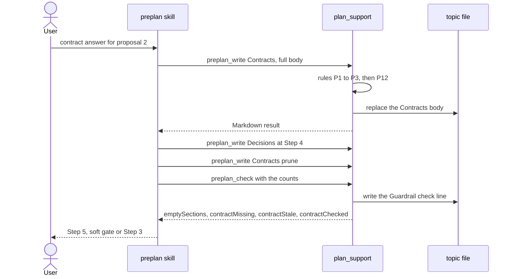
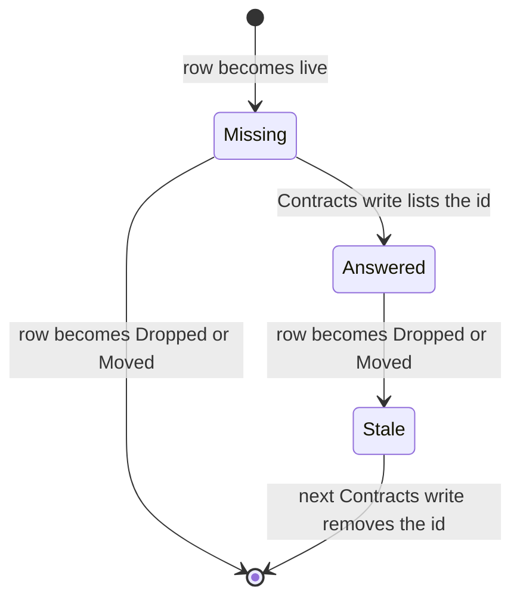

# Design

## Context

See proposal.md - Why for the motivation.

- One section list in `internal/tools/plan_support.go` feeds the skeleton, the heading repair, `emptySections` and the `preplan_write` allow-list.
- Some descriptions, tests and docs copy that list by hand. Each reader finds a section by its name.
- Rules P1-P11 live in `internal/tools/preplan_format.go`. P10 (Flows) and P7 (cut line ids) are the models for P12.
- The plan render catalog has a pinned SHA-256 hash. A text edit fails its test, so this change does not edit it.
- The main spec `tool-plan-support` described 4 skeleton sections while the code has 7. The delta rewrites `Preplan context` with 8, and moves its name rules and its repair into their own requirements to meet the 500-character limit of `openspec validate --strict`.
- The dashboard reads Goal, Decisions and Open questions only. Each other section counts toward Gaps, so Gaps follows the list with no page change.

## Goals / Non-Goals

**Goals:**

- One fixed section that each reader parses the same way.
- The tool computes the contract gaps. The skill only routes on them.
- Each live block reaches the plan task that builds its surface.

**Non-Goals:**

| Not built | Reason |
|---|---|
| new plan gate, or an edit of the plan render catalog | the catalog has a pinned hash |
| new verify structure rule | `empty-section` covers an absent section |
| dashboard page change | Gaps already follows the list |
| default body in older files | the user must answer the question |
| contract check of a proposal without the user | each proposal needs an explicit user answer |

## Architecture

Touched parts and their links:



Main runtime flow of one contract answer and the Step 4 gate:



State of the contract answer of one proposal in the topic file:



## Data contracts

`PlanSupportOut`, new fields after `EmptySections`:

```go
// Pointers, so an empty list renders (none) for preplan_check
// while every other action omits them.
ContractMissing *[]string `json:"contractMissing,omitempty"`
ContractStale   *[]string `json:"contractStale,omitempty"`
// Pointer, so false renders. false when an open fence, an absent
// ## Decisions heading or a P4/P5 break stops the check.
ContractChecked *bool `json:"contractChecked,omitempty"`
```

`preplan_check` output, after:

```text
- emptySections: (none)
- contractMissing:
  - #3
- contractStale:
  - #5
- contractChecked: true
```

Contracts body grammar (P12):

```text
body        = part { blank-line } part ...     at least one block or one no-contract line
part        = block | no-contract
block       = label-line { blank-line } ( fence | table )
label-line  = "**" id-list " " kind ": " name "**"
kind        = "Endpoint" | "Data" | "Config" | "Message"
id-list     = "#" n { ", #" n }               unique ids, n = positive whole number
fence       = ``` or ~~~ fence that closes (P3)
table       = run of lines that start with "|" after leading spaces
no-contract = "No contract: " id-list "."     at most one, ids ascending
```

- No config change.

## Decisions

| Decision | Chosen | Rejected alternatives | Reason |
|---|---|---|---|
| Section form | fixed 8th section between Flows and Decisions | optional section | Decisions must stay last. The model can miss an optional section, which is the problem today |
| Contract kinds | `Endpoint`, `Data`, `Config`, `Message`, one label line above each block | free form | the label ties each block to its proposals |
| Coverage | each live proposal has one answer: a label that lists its `#`, or its `#` in one `No contract:` line | model judgement of what adds a contract | a fixed list gives Step 4 a tool answer that a test can pin |
| Enforcement | P12 checks the body form. `preplan_check` returns `contractMissing` and `contractStale`. Step 5 and the soft gate need `contractMissing` = `(none)` | soft gate only | a missed contract still passes a soft gate |
| P12 scope | body-local: no compare with the Decisions table | P12 reads the Decisions table | a Decisions drop then blocks the Contracts write. `preplan_check` reports the drift |
| Lines outside blocks | refused | free prose | one parse for the tool, the plan and verify |
| Route of a contract answer | not a proposal change. The next Step 4 pass checks each proposal with its blocks | Step 4 after each contract answer | no extra guardrail pass for each answer |
| Step 4 write order | Open questions, Decisions, Contracts, then `preplan_check` | Contracts first | a failed Contracts call leaves only ids that are not live, and `contractStale` lists them |
| Blank prune result | send no Contracts call | a default body | P12 refuses a blank body. A default body records an answer the user did not give |
| Decisions table that breaks P4 or P5 | both lists `(none)`, and `next` says the contract check did not run | skip the bad rows | a repeated id then answers or hides two rows |
| Contracts prune | the skill edits the body | a tool-side prune action | the prune is rare, and the check needs only a read |
| Plan use | each live block gives a Key Decision and an R-item. The task copies the shape | context only | shapes can drift |
| Plan gate | no new gate, no edit of the pinned plan files | a new gate | wider change |
| Verify rule | no new structure rule | a `contracts-format` rule | `empty-section` covers an absent section |
| Waves | Tasks 1 to 6 in one wave, Task 7 checks the claims | Task 1 first | the parity tests fail between waves |

- No design decision departs from a guardrail.

## Risks / Trade-offs

| Risk | Impact | Mitigation |
|---|---|---|
| Older topic files have no Contracts body | the dashboard and verify report a gap until a preplan run fills it | accepted. `preplan_context` adds the heading. No default body |
| Step 3: Decisions call ok, Contracts call fails | a live row has no contract answer | the Step 3 gap order and `contractMissing` find it |
| Step 4: Decisions call ok, Contracts call fails | labels list ids that are not live | `contractStale` lists them, readers skip them, the next Contracts write removes them |
| Step 4: Contracts call ok, `preplan_check` fails | pruned file with the old check line | the error route goes to the cancel step. The next run does Step 4 again |
| Bad Decisions table | the contract check cannot run | both lists `(none)` and `next` says so. `preplan_write` refuses such a table |
| Hand copies of the section list drift | tests fail | Tasks 1 to 6 land in one wave. Task 7 runs a sweep grep |
| The old line `No contract change.` | P12 refuses it | no topic file holds it, because the section is new |

## Migration Plan

- No migration code. `preplan_context` adds the `## Contracts` heading to an older file on its next call.
- Deploy: `task deploy`, then a plugin reload.
- Rollback: revert the change. A topic file with a `## Contracts` section then shows a heading that the old tool does not know.
