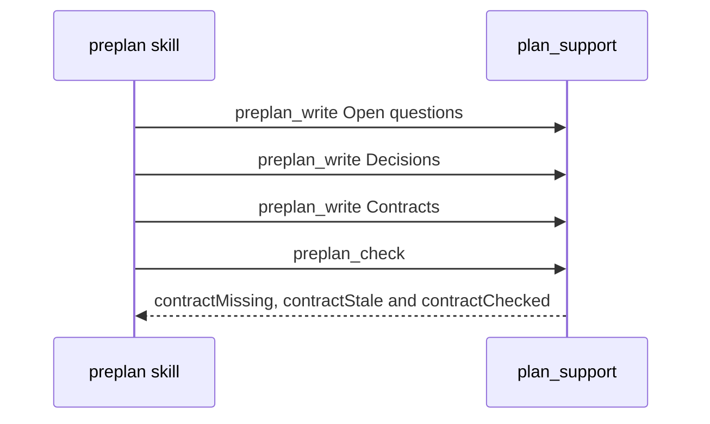

# Spec Delta

## MODIFIED Requirements

### Requirement: One question at a time
The skill SHALL ask one question in each AskUserQuestion call and SHALL update the topic file after each answer.

- Questions ask about function and effect, not about code. The one exception is the contract shapes of `## Contracts`: URLs, payload fields, data fields, config keys and message fields.
- A vague answer gets one follow-up question.

#### Scenario: Answer recorded
- **WHEN** the user answers a question with a new decision
- **THEN** the topic file `## Decisions` table has one more row before the next question

#### Scenario: Contract shape question
- **WHEN** the skill asks the contract question for a live proposal
- **THEN** the question asks for the exact URL, payload fields, data fields, config keys or message fields of that proposal

## ADDED Requirements

### Requirement: Contract answer for each live proposal
In Step 3, the skill SHALL ask for one contract answer for each live proposal that has none, and SHALL send the full new `## Contracts` body with `preplan_write` after each contract answer.

- A contract answer is a label line that lists the `#` value of the proposal, or that `#` value in the one `No contract:` line.
- The skill asks this after a missing `## Flows` entry and before the next proposal, lowest `#` value first.

#### Scenario: Contract question
- **WHEN** `## Flows` has an entry and the live proposals 1 and 2 have no contract answer
- **THEN** the next question restates proposal 1 and asks which endpoints, data shapes, config keys or flags, and messages it adds or changes, with the exact shape of each
- **AND** the options are give the shapes, `no contract`, `done` and `cancel`

#### Scenario: Block answer
- **WHEN** the user gives the shape of `POST /api/topics` for proposal 2
- **THEN** the skill calls `preplan_write` with `section: "Contracts"` and a body that holds `**#2 Endpoint: POST /api/topics**` above an `http` code fence
- **AND** the body keeps each other block and the `No contract:` line

#### Scenario: No contract answer
- **WHEN** the user answers `no contract` for proposal 3 and `## Contracts` holds `No contract: #5.`
- **THEN** the new `## Contracts` body holds `No contract: #3, #5.`

#### Scenario: Answer moves an id to the other form
- **WHEN** `## Contracts` holds `No contract: #3, #5.` and the user gives a shape for proposal 3
- **THEN** the new body holds the block of proposal 3 and `No contract: #5.`

#### Scenario: One answer changes Decisions and Contracts
- **WHEN** one answer changes `## Decisions` and `## Contracts`
- **THEN** the skill sends the Decisions call before the Contracts call

#### Scenario: Stop between the two calls
- **WHEN** the Decisions call succeeds, the session stops before the Contracts call, and the user runs `/sdlc:preplan` with the same topic again
- **THEN** Step 3 asks the contract question for the proposal with no contract answer

### Requirement: Contract block forms
Each `## Contracts` block SHALL have one label line `**#<id>[, #<id>] <Kind>: <name>**` above a code fence or a table in the form of its kind.

| Kind | Body |
|---|---|
| `Endpoint` (HTTP or RPC call) | `http` fence: method, URL, request, each response |
| `Data` (stored shape) | table `Field \| Type \| Change \| Notes` |
| `Config` (key, flag, env var) | table `Op \| Key \| Type \| Default \| Values` |
| `Message` (event or tool fields) | `json` fence with every field |

#### Scenario: Data block
- **WHEN** proposal 3 adds a `topics` table with the fields `id` and `owner`
- **THEN** the block is the label line `**#3 Data: topics table**` above a table with the header `| Field | Type | Change | Notes |`
- **AND** each Change cell is `+`, `−` or `~`

#### Scenario: One block for two proposals
- **WHEN** proposals 1 and 3 change the same table
- **THEN** one block has the label line `**#1, #3 Data: topics table**`

#### Scenario: Note about a block
- **WHEN** a block needs the note `Errors are 4xx.`
- **THEN** the skill writes the note inside the code fence or in a table cell, not as a line of its own

### Requirement: Contract blocks in the guardrail check
At each Step 4, the skill SHALL check each live proposal together with its `## Contracts` blocks against each plan guardrail.

#### Scenario: Contract block in the check
- **WHEN** proposal 3 is live and `## Contracts` holds the block `**#3 Config: preplan.maxTopics**`
- **THEN** the Step 4 check of proposal 3 checks that block against each guardrail together with the proposal

### Requirement: Step 4 write order
At the end of Step 4, the skill SHALL send `preplan_write` for `## Open questions`, then for `## Decisions`, then for `## Contracts`, then `preplan_check`.

Step 4 calls of the preplan skill, in order:

#### Scenario: Contracts call fails after the Decisions call
- **WHEN** the Decisions call drops proposal 2 and the Contracts call then fails
- **THEN** the next `preplan_check` lists `#2` in `contractStale`
- **AND** the next Contracts write that keeps another block removes `#2`

#### Scenario: Decisions call fails
- **WHEN** the Decisions call of Step 4 fails
- **THEN** the skill sends no Contracts call

### Requirement: Contracts prune at Step 4
After the `## Decisions` write of Step 4, the skill SHALL remove from `## Contracts` each `#` value whose row is not live, and SHALL send the pruned body in one `preplan_write` call.

- A block whose label line then lists no `#` value is deleted, and so is a `No contract:` line that lists none.
- A rework that changes a shape writes the new shape into its block in the same body.
- When the pruned body is blank or unchanged, the skill sends no Contracts call.

#### Scenario: Block of a dropped proposal
- **WHEN** proposal 2 is dropped in this pass and `## Contracts` holds `**#2 Endpoint: POST /x**` and its fence
- **THEN** the pruned body has no such block

#### Scenario: Shared label
- **WHEN** proposal 2 is dropped and `## Contracts` holds `**#1, #2 Data: topics**` and its table
- **THEN** the pruned body holds `**#1 Data: topics**` and the same table

#### Scenario: No-contract line
- **WHEN** proposal 2 is dropped and `## Contracts` holds `No contract: #2, #4.`
- **THEN** the pruned body holds `No contract: #4.`

#### Scenario: Blank prune result
- **WHEN** proposal 2 is dropped and `## Contracts` holds only `No contract: #2.`
- **THEN** the skill sends no Contracts call
- **AND** `preplan_check` lists `#2` in `contractStale`

#### Scenario: Rework changes a shape
- **WHEN** a rework changes the URL of the endpoint of proposal 1
- **THEN** the pruned body holds the new URL in the block of proposal 1

### Requirement: Contract gate before the handoff
Step 4 SHALL go to Step 5 or to the soft gate only when `preplan_check` returns `contractChecked` as true and `contractMissing` as `(none)`, and SHALL go back to Step 3 when `contractMissing` lists 1 or more `#` values.

- The first matching route row applies, so the cut question comes first.
- `contractStale` routes nothing. The skill tells the user its ids in one line.

#### Scenario: Missing contract answer
- **WHEN** `final` is set, 1 proposal is live, `## Flows` has an entry and `contractMissing` lists `#3`
- **THEN** the skill goes back to Step 3
- **AND** the skill tells the user that proposal 3 has no contract answer, then asks about it

#### Scenario: Each contract answer present
- **WHEN** `final` is set, 1 proposal is live, `## Flows` has an entry, `contractMissing` is `(none)` and `emptySections` is `(none)`
- **THEN** the skill goes to Step 5

#### Scenario: Empty sections remain
- **WHEN** `final` is set, 1 proposal is live, `## Flows` has an entry, `contractMissing` is `(none)` and `emptySections` lists `## Risk if wrong`
- **THEN** the skill goes to the soft gate

#### Scenario: Cut question first
- **WHEN** `final` is set, 2 proposals are live, the file has no `Smallest cut:` line and `contractMissing` lists `#2`
- **THEN** the skill goes to Step 3 with the cut question

#### Scenario: Stale ids
- **WHEN** `contractStale` lists `#5`
- **THEN** the skill prints one line that names `#5`
- **AND** the route is the same as with `contractStale` `(none)`

### Requirement: Contract check that did not run
When `preplan_check` returns `contractChecked` as false, the skill SHALL repair the cause that `next` names with tool calls, SHALL call `preplan_check` once more, and SHALL go to the cancel step when `contractChecked` is still false.

#### Scenario: Open fence at the check
- **WHEN** `final` is set, 1 proposal is live, `## Flows` has an entry and `preplan_check` returns `contractChecked` false because a code fence is still open
- **THEN** the skill runs the open-fence repair and calls `preplan_check` again
- **AND** the skill does not go to Step 5 or the soft gate while `contractChecked` is false
