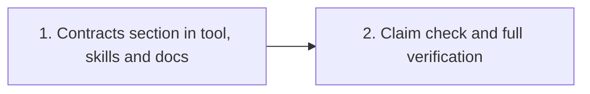

# Tasks

Group order: group 2 checks the work of group 1.

## 1. Contracts section in tool, skills and docs

- [x] 1.1 Add the `## Contracts` section, rule P12 and the `contractMissing` and `contractStale` fields in internal/tools/plan_support.go and internal/tools/preplan_format.go, with P12 cases in internal/tools/preplan_format_test.go (plan Task 1) — verify: `go test ./internal/tools/ -run 'TestPreplanFormatRules|TestPreplanContractIDs|TestPreplanStructureFindingsRealTopicFile|TestPreplanFormatClassDefParity'` <!-- ref:1-1-add-the-contracts-section-rule-p12-a-e630a3 -->
- [x] 1.2 Update the 8-section fixtures and add `TestPreplanCheckContractGaps` in internal/tools/plan_support_test.go, internal/tools/plan_support_write_integration_test.go, internal/tools/verify_requirements_context_test.go, internal/tools/dashboard_preplans_test.go and tests/integration/preplan_context_test.go (plan Task 2) — verify: `go test -tags integration ./internal/tools/ ./tests/integration/` <!-- ref:1-2-update-the-8-section-fixtures-and-ad-cf0330 -->
- [x] 1.3 Add the contract question, the Contracts rule, the Step 4 prune and the new route table in plugins/sdlc/skills/preplan/SKILL.md (plan Task 3) — verify: `go test ./internal/tools/ -run 'TestPreplanSkillSectionTableParity|TestPreplanFormatClassDefParity' && go test ./internal/skillcheck/...` <!-- ref:1-3-add-the-contract-question-the-contra-3d309d -->
- [x] 1.4 Add the Contracts bullet to the topic file block in plugins/sdlc/skills/plan/SKILL.md and pin it in internal/skillcheck/skillcheck_plan_test.go (plan Task 4) — verify: `go test ./internal/tools/ -run TestPlanSkillPreplanSectionParity && go test ./internal/skillcheck/...` <!-- ref:1-4-add-the-contracts-bullet-to-the-topi-d7f7ae -->
- [x] 1.5 Add the contract statement rules in plugins/sdlc/skills/verify-requirements/SKILL.md and docs/skills/verify-requirements/checks.md, with `TestVerifyRequirementsSkillContracts` in internal/skillcheck/skillcheck_verify_requirements_test.go (plan Task 5) — verify: `go test ./internal/skillcheck/ -run 'TestVerifyRequirementsSkill'` <!-- ref:1-5-add-the-contract-statement-rules-in-aa3a66 -->
- [x] 1.6 Name the Contracts section in docs/skills/preplan/topic-file.md, docs/skills/preplan/dialogue.md, docs/skills/preplan.md, docs/skills/plan/topic-file.md and .claude/skills/dashboard-design/SKILL.md (plan Task 6) — verify: `grep -rn "seven sections\|seven empty sections\|seven skeleton\|7-section\|P1 to P11\|P1-P11" docs/skills/preplan/ docs/skills/preplan.md docs/skills/plan/topic-file.md .claude/skills/dashboard-design/` returns no line <!-- ref:1-6-name-the-contracts-section-in-docs-s-fab978 -->

## 2. Claim check and full verification

- [x] 2.1 Check the P12, field and section-order claims against the finished code, and fix the comment in internal/dashboard/web/browser_e2e_test.go (plan Task 7) — verify: `task check && go test ./internal/skillcheck/...`, then the live `preplan_context`, `preplan_write` and `preplan_check` check after `task deploy` and a plugin reload <!-- ref:2-1-check-the-p12-field-and-section-orde-9d01db -->
