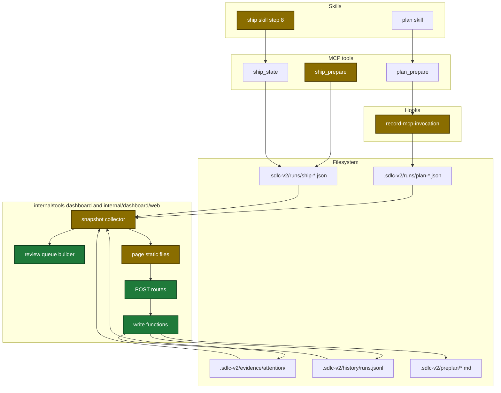
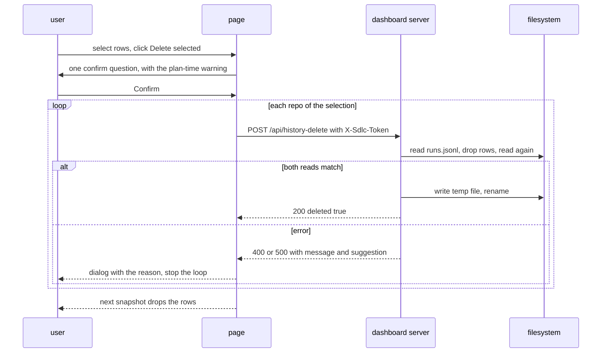
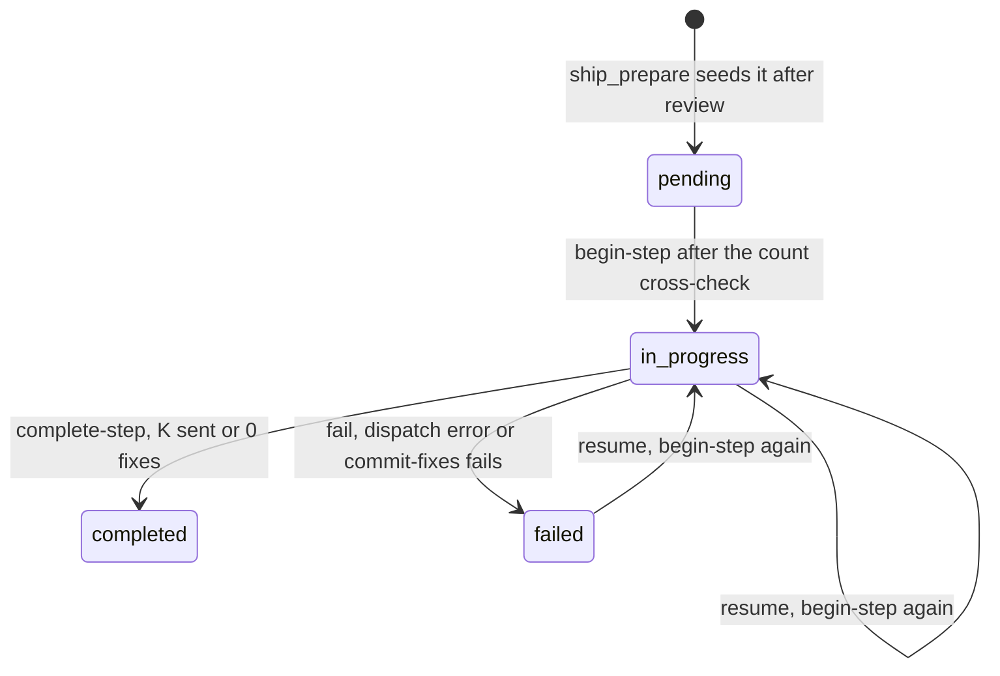
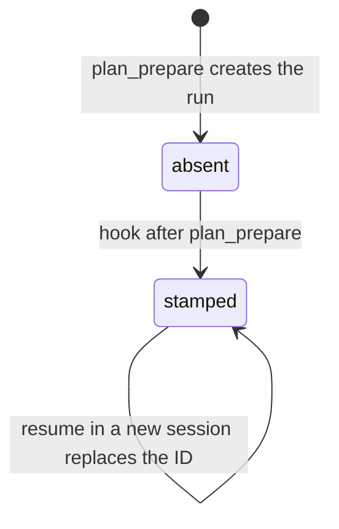

# Design

## Context

- Motivation: see proposal.md - Why.
- The dashboard collector builds the snapshot from state files, evidence files and `runs.jsonl` of each repo. The page reads only the snapshot.
- The draft page in `design/dashboard/static/` exists only in this worktree (`.gitignore:50`). Its base is HEAD, so a copy has no drift.
- The plan model does not know its own session ID. Only a hook gets the real ID.
- A fix record has no link key to a review finding (`internal/tools/ship_state.go:2387`).

## Goals / Non-Goals

**Goals:**
- The server sends every fact that the draft page shows with sample data.
- The page keeps the draft visuals and texts, except where the decisions table says otherwise.
- Each page write changes one file safely, or shows a reason and a recovery step.
- One browser test proves the three writes and the queue panel end to end.

**Non-Goals:**
- Session ID for ship and execute runs from the hook.
- A GitHub call for PR comments.
- A version check before a page write (the newest write wins).
- A delete of wait records older than 24 hours.

## Architecture

The touched parts and their links:



## Main runtime flow

A History delete from the click to the next snapshot:



## State transitions

The seeded `received-review` entry of the ship state:



The `sessionId` of the plan state:



## Data contracts

```go
type DashboardWait struct {
    Kind      string `json:"kind"`      // question | permission
    SessionID string `json:"sessionId"`
    ToolUseID string `json:"toolUseId"` // "" for a permission wait
    Branch    string `json:"branch"`
    Header    string `json:"header"`
    Text      string `json:"text"`
    AskedAt   string `json:"askedAt"`   // RFC3339 UTC
}

type DashboardReviewQueue struct {
    Threshold string              `json:"threshold"`
    Rows      []DashboardQueueRow `json:"rows"`     // never null, max 200
    Unrouted  int                 `json:"unrouted"`
    Reason    string              `json:"reason"`   // "" | no-findings | all-below-threshold
}

type DashboardQueueRow struct {
    Title, Severity, File, Line, Status, Origin, Dimension, Text string
}
```

| Struct | Field | Type | Encoding | Example |
|---|---|---|---|---|
| `DashboardRepo` | `loneWaits` | list | JSON array, `[]` when empty | `[{"kind":"question",...}]` |
| `DashboardRun` | `planPaired` | bool | omitted when false | `true` |
| `DashboardRun` | `planEndedAt` | string | RFC3339, omitted when empty | `2026-10-01T10:20:00Z` |
| `DashboardFix` | `origin` | string | plain text | `local-review` |
| `DashboardStepDetail` | `reviewQueue` | object | omitted when absent | see above |

| Route | Body | 200 body |
|---|---|---|
| `POST /api/preplan-status` | `{repo, slug, status}` | `{changed, status, message}` |
| `POST /api/history-delete` | `{repo, rows:[{kind, branch, endedAt}]}` | `{deleted, alreadyGone, message}` |
| `POST /api/wait-dismiss` | `{repo, kind, sessionId, toolUseId}` | `{deleted, alreadyGone, message}` |

No config key changes.

## Decisions

| Decision | Chosen | Rejected alternatives | Reason |
|---|---|---|---|
| Session ID source | the PostToolUse hook stamps the active plan run after each `plan_prepare` call | a `plan_prepare` input from the skill | the model does not know its session ID; a resume gets the new ID |
| Queue rows | fix records and `deferredFindings`; review findings as `open` before the first record | match each finding to a fix by file and line | no link key exists |
| Queue row panel | a new `queue-row` panel | the draft finding panel with Fix and Fix title rows | a row from fix data has no dimension index |
| History pairing rule | the draft rule D3: each ship row of a branch uses up the plan row before it, so a retry ship gets no plan time | pair every ship with the newest earlier plan row | the approved draft defines the rule |
| Delete question text | the draft text, plus one plan-time warning line when ship rows are paired | a new shorter text | the approved draft defines the text |
| received-review step kind | `ship_prepare` seeds the entry with a `condition` key | add `received-review` to `ValidSteps` | a `ValidSteps` name is a config switch; off would stop the fix pass |
| Zero-fix status | `completed` | `skipped` | preplan decision 15 |
| History delete key | kind, branch and raw `ts`; one unknown key rejects all | skip unknown keys | the page must not delete rows that the user did not see |
| Lost append | read again before the rename, one retry | a file lock | no lock exists; the Clear cache action accepts the same risk |
| Wait delete | new `attention.Remove` that reports a removed flag | `DeleteQuestion` | an empty `toolUseId` there deletes every question of the session |
| Snapshot fields | one struct task first | each task adds its field | tasks of one execute wave must not share a file |
| Docs of `docs/dashboard.md` | one doc task after the server tasks | each task edits the doc | six tasks change the same file; one task prevents edit conflicts in a wave |
| Browser test | chromedp behind the `integration` tag | no browser test | user decision; only a test file imports it |

## Risks / Trade-offs

| Risk | Impact | Mitigation |
|---|---|---|
| A parallel tool call writes the plan state while the hook stamps it | the stamp is lost until the next `plan_prepare` | the plan skill calls `plan_prepare` alone |
| Another process appends to `runs.jsonl` during a delete | a lost History row | read again before the rename, one retry, then an error |
| A rewrite gives the topic file or `runs.jsonl` mode 0600 | other users cannot read the file | same as the existing deferred and learnings deletes |
| `ubuntu-latest` has no Chrome | the browser test fails in CI | the test fails with an install hint; a Chrome install action needs user approval |
| A stop between review `complete-step` and `begin-step received-review` | findings stay unrouted | the same gap exists today; `next` skips the pending entry |
| The lone-wait card and the unrouted line have no draft visual | the look can differ from the approved draft | the card copies the wait banner style; the unrouted line uses the draft `generic-line` style |
