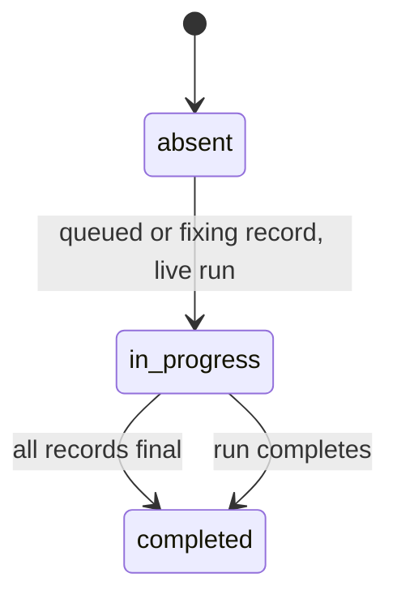

# Spec Delta

## ADDED Requirements

### Requirement: Plan run session ID
After each `plan_prepare` tool call with a non-empty session ID, the `record-mcp-invocation` hook SHALL write that ID as `sessionId` of the active plan state of the branch. The hook SHALL make no write when the stored ID is the same or when no plan run is active. A state read or write error SHALL leave the hook silent with exit code 0.

#### Scenario: First call
- **WHEN** `plan_prepare` runs in session `s-1` and the active plan state has no `sessionId`
- **THEN** the plan state has `sessionId` `s-1`

#### Scenario: Resume in a new session
- **WHEN** `plan_prepare` runs in session `s-2` and the plan state has `sessionId` `s-1`
- **THEN** the plan state has `sessionId` `s-2`

#### Scenario: No active plan run
- **WHEN** `plan_prepare` runs and no plan run is active on the branch
- **THEN** no state file changes

#### Scenario: Write error
- **WHEN** the state folder is read-only
- **THEN** the hook exits 0 and writes one stderr line that starts with `sdlc hook: plan session stamp:`

### Requirement: Lone waits
Each repo of the snapshot SHALL carry `loneWaits`: every open wait record of the 24-hour window that no shown running pipeline took, newest `askedAt` first, at most 50. The list SHALL be `[]` when it is empty. An unreadable attention folder SHALL give `loneWaits: []` and one repo warning, and SHALL NOT set the repo error.

#### Scenario: Wait with no run
- **WHEN** a question record of session `s9` matches no shown running pipeline
- **THEN** `loneWaits` has one entry with `kind` `question`, `sessionId` `s9` and the record `toolUseId`, `branch`, `header`, `text` and `askedAt`

#### Scenario: Matched wait
- **WHEN** a record matches a shown running plan pipeline by session and branch
- **THEN** the pipeline has `attention` and `loneWaits` has no entry for the record

#### Scenario: Older record of a matched session
- **WHEN** two records of session `s1` on branch `feat/x` match one running pipeline
- **THEN** `loneWaits` has no entry for either record

#### Scenario: Unreadable folder
- **WHEN** the attention folder cannot be read
- **THEN** `loneWaits` is `[]` and `warnings` has one entry that starts with `attention folder unread:`

### Requirement: Lone-wait card
The Pipelines feed SHALL show one card at the top for each lone wait of a repo in scope, with the kind, header, text, branch, wait age and a Dismiss button. With lone waits and no runs, the feed SHALL show the cards and no empty-feed text.

#### Scenario: Cards first
- **WHEN** a repo in scope has one lone wait and two runs
- **THEN** the feed shows the card first, then the runs

#### Scenario: Dismiss
- **WHEN** the user clicks Dismiss on a card
- **THEN** the page sends `POST /api/wait-dismiss` with no confirm question

#### Scenario: Failed dismiss
- **WHEN** the dismiss answers 500
- **THEN** a dialog shows the message and the suggestion
- **AND** the card stays

### Requirement: Waiting counts with lone waits
The header waiting count SHALL add the lone waits of all repos. The tab title count SHALL add the lone waits of the repos in the repo filter.

#### Scenario: Repo outside the filter
- **WHEN** a repo outside the repo filter has one lone wait and no other wait exists
- **THEN** the header shows `1 waiting`
- **AND** the tab title has no `(1)` prefix

### Requirement: Wait dismiss route
The server SHALL serve `POST /api/wait-dismiss` `{repo, kind, sessionId, toolUseId}` and SHALL delete only the record file of that wait. It SHALL answer 200 `{deleted, alreadyGone, message}`. A question wait SHALL need a non-empty `toolUseId`, and a permission wait SHALL need an empty one.

#### Scenario: Question dismissed
- **WHEN** a valid request names `kind` `question`, `sessionId` `s1` and `toolUseId` `t1`
- **THEN** the file `s1-t1.json` is gone and the other record files of `s1` stay

#### Scenario: Already gone
- **WHEN** the named record file does not exist
- **THEN** the response is 200 with `alreadyGone:true`

#### Scenario: Question with no toolUseId
- **WHEN** a request has `kind` `question` and an empty `toolUseId`
- **THEN** the response is 400 with code `BAD_REQUEST` and message `A question wait needs its toolUseId`
- **AND** no file is removed

### Requirement: Preplan status route
The server SHALL serve `POST /api/preplan-status` `{repo, slug, status}`. It SHALL replace only the first `**Status:**` line of the topic file through a temp file and a rename, and SHALL answer 200 `{changed, status, message}`. The status SHALL be one of `in progress`, `ready for plan` and `paused`. The newest write SHALL win, with no version check.

#### Scenario: Status changed
- **WHEN** a valid request sets `paused` on a topic file with status `ready for plan`
- **THEN** the file has `**Status:** paused` and every other byte is the same

#### Scenario: Same status
- **WHEN** the request status equals the file status
- **THEN** the response has `changed:false` and the file is not written

#### Scenario: Unknown status
- **WHEN** the request status is `done`
- **THEN** the response is 400 with the suggestion `Pick one of: in progress, ready for plan, paused.`

#### Scenario: Symlinked topic file
- **WHEN** the topic file is a symlink
- **THEN** the response is 400 and the link stays

### Requirement: History delete route
The server SHALL serve `POST /api/history-delete` `{repo, rows}`, where each row is `{kind, branch, endedAt}`. Each key SHALL remove every `runs.jsonl` line with the same `skill`, `branch` and raw `ts`, and no other line. One key that matches no line, an empty list, a duplicate key, or more than 50 keys SHALL reject the whole request with no change.

#### Scenario: One row deleted
- **WHEN** a valid request names a plan row of `feat/x` that ended at `2026-10-01T10:00:00Z`
- **THEN** the line is gone, every other line keeps its bytes, and the message is `Deleted 1 History row.`

#### Scenario: Unknown key
- **WHEN** one of two keys matches no line
- **THEN** the response is 400 with code `BAD_REQUEST` and the file is unchanged

#### Scenario: File changed during the delete
- **WHEN** another process appends a line to `runs.jsonl` during each of two tries
- **THEN** the response is 500 with code `DELETE_FAILED` and the file keeps the appended lines

### Requirement: History plan time pairing
A ship History row with no stored plan fields SHALL get `planDurationMs`, `planStartedAt`, `planPaired:true` and `planEndedAt` from the newest plan row of the same branch that ended before the ship ended and after the previous ship row of that branch ended. Its `totalMs` SHALL be ship end minus plan start. The pairing SHALL read every row before the 50-row cut.

#### Scenario: Unlinked ship row
- **WHEN** a plan row of `feat/x` runs 10:00 to 10:20 and a ship row of `feat/x` with no plan fields runs 11:00 to 11:30
- **THEN** the ship row has `planDurationMs` 1200000, `totalMs` 5400000 and `planPaired:true`

#### Scenario: Retry ship
- **WHEN** a plan row of `feat/x` ends at 10:20, a ship row of `feat/x` ends at 11:30, and a second ship row of `feat/x` ends at 12:10
- **THEN** the 11:30 ship row has `planPaired:true`
- **AND** the 12:10 ship row has no `planPaired` key

#### Scenario: Stored plan fields
- **WHEN** a ship row already has plan fields
- **THEN** the row keeps them and has no `planPaired` key

#### Scenario: No branch
- **WHEN** a ship row has no branch
- **THEN** the row stays unchanged

### Requirement: History row delete
Each History row SHALL have a checkbox, with a select-all-shown box and an `N selected` count. Delete selected SHALL ask one confirm question, then send one `POST /api/history-delete` for each repo of the selection, one after another, and SHALL stop at the first failed repo. A selected plan row with paired ship rows SHALL add a plan-time warning line that does not block the delete.

#### Scenario: Question with no paired row
- **WHEN** the user selects 1 row and no ship row is paired to it
- **THEN** the question is `Delete 1 run from the history?` followed by the line `This removes the rows from .sdlc-v2/history/runs.jsonl for good. The History tab and the run times lose them.`

#### Scenario: Plan-time warning
- **WHEN** the user selects 3 rows and 1 unselected ship row is paired to a selected plan row
- **THEN** the question starts with `Delete 3 runs from the history?` and ends with the line `1 ship row loses its plan time.`

#### Scenario: Failure in the second repo
- **WHEN** the delete succeeds in repo 1 and fails in repo 2
- **THEN** the dialog shows `Deleted the selected rows of <repo 1>.` followed by the repo 2 message and suggestion
- **AND** no request is sent for repo 3

### Requirement: Review queue data
The `review` step of a ship pipeline with a review ledger SHALL carry `detail.reviewQueue` `{threshold, rows, unrouted, reason}`. `threshold` SHALL be `flags.reviewThreshold`, or `info` when it is absent or not a severity. `rows` SHALL hold at most 200 rows and SHALL be `[]` when empty.

#### Scenario: No findings
- **WHEN** the review total is 0 and the queue has no rows
- **THEN** `reason` is `no-findings`

#### Scenario: All below threshold
- **WHEN** every row has status `below`
- **THEN** `reason` is `all-below-threshold`

#### Scenario: Default threshold
- **WHEN** the ship state has no `flags.reviewThreshold`
- **THEN** `threshold` is `info`

#### Scenario: No review ledger
- **WHEN** the ship state has no review total
- **THEN** the `review` step has no `reviewQueue` key

### Requirement: Review queue row status
Queue rows SHALL come from the fix records, then from `deferredFindings`, with the fix status as the row status. A deferred finding with reason `below-threshold` or no reason SHALL get status `below`, and any other reason SHALL get `deferred`. With no fix record and no deferred finding, the rows SHALL be the review findings with status `open`.

#### Scenario: Deferred twin of a fix
- **WHEN** a deferred finding has the same file, line and title as a fix record
- **THEN** the queue has one row for the fix record only

#### Scenario: Below threshold
- **WHEN** a deferred finding has reason `below-threshold`
- **THEN** its row has status `below`

#### Scenario: Disagree
- **WHEN** a deferred finding has reason `disagree`
- **THEN** its row has status `deferred`

#### Scenario: Before the first fix record
- **WHEN** the ship state has no fix record and no deferred finding, and review reported 2 findings
- **THEN** the queue has 2 rows with status `open`

### Requirement: Review queue tile
When the `review` step has `reviewQueue`, the page SHALL show one review queue tile with the threshold, `F of Q fixed` (Q counts the rows that are not `below`), a progress bar and one row for each queue row. Rows SHALL sort fixing, queued, failed, open, deferred, fixed, below. `below` rows SHALL be dimmed. A click on a row SHALL open the `queue-row` right panel.

#### Scenario: Source chips
- **WHEN** the queue has 2 rows with origin `pr-comment` and 3 with `local-review`
- **THEN** the chips show `PR comments 2` and `local review 3`
- **AND** a click on `PR comments` shows only the 2 rows

#### Scenario: No findings
- **WHEN** `reason` is `no-findings`
- **THEN** the tile shows `No findings.` exactly one time

#### Scenario: Reason line
- **WHEN** `reason` is `all-below-threshold` and `reviewTotals.found` is 4
- **THEN** the tile shows `All 4 findings below threshold`

#### Scenario: Unrouted findings
- **WHEN** `unrouted` is 2
- **THEN** the tile shows `2 findings not routed yet`

#### Scenario: Row detail
- **WHEN** the user clicks a queue row
- **THEN** the right panel shows the title, status, origin, file, line and text of the row

## MODIFIED Requirements

### Requirement: Received-review step
The snapshot SHALL show a `received-review` step right after the first `review` step of a ship pipeline when the ship state stores a `received-review` step or when `healing.fixProgress` holds at least one valid record, and SHALL show no such step otherwise. A stored step SHALL keep its own status and times.

The status of the step built from fix records:

#### Scenario: No fix records
- **WHEN** a ship state has no `healing.fixProgress` key and no stored `received-review` step
- **THEN** the ship pipeline has no `received-review` step

#### Scenario: Damaged fix records
- **WHEN** `healing.fixProgress` is not a list, or is a list with records and no valid record
- **AND** the ship state has no stored `received-review` step
- **THEN** the ship pipeline has no `received-review` step
- **AND** the pipeline has one `state` issue with severity `medium` that names `healing.fixProgress`

#### Scenario: Fix in progress
- **WHEN** a live ship run has one record with status `fixing`
- **THEN** the `received-review` step has status `in_progress` and no `completedAt` key

#### Scenario: All fixes final
- **WHEN** every record has status `fixed`, `failed` or `deferred`
- **THEN** the `received-review` step has status `completed`
- **AND** its `startedAt` is the earliest `firstAt` and its `completedAt` is the latest `updatedAt`

#### Scenario: Stopped fix pass
- **WHEN** a ship run has `pipelineCompletedAt` set and one record still has status `queued`
- **THEN** the `received-review` step has status `completed`
- **AND** the row keeps status `queued`

#### Scenario: Inserted completed step
- **WHEN** the step is inserted with status `completed` into a pipeline with progress 4 of 6
- **THEN** the progress is 5 of 7

#### Scenario: Stored received-review step
- **WHEN** the ship pipeline already has a step named `received-review` with status `skipped`
- **THEN** that step gets the `fixes` detail and keeps status `skipped`

#### Scenario: Seeded step with 0 fixes
- **WHEN** the ship state stores a `received-review` step with status `completed` and has no `healing.fixProgress` key
- **THEN** the ship pipeline has one `received-review` step right after `review` with status `completed` and the stored times

### Requirement: Fix rows
Each `fixes` row SHALL carry `title` (redacted, at most 120 characters), `severity`, `file`, `status`, and `origin`, and SHALL carry `line` only when it is not 0. The snapshot SHALL skip a record with an unknown status, severity or origin, or with no title. A record with no origin SHALL get origin `local-review`.

| Field | Values |
|---|---|
| `status` | `queued`, `fixing`, `fixed`, `failed`, `deferred` |
| `severity` | `critical`, `high`, `medium`, `low`, `info` |
| `origin` | `local-review`, `pr-comment` |

#### Scenario: Unknown status
- **WHEN** a record has status `paused`
- **THEN** the `fixes` list has no row for that record

#### Scenario: No line
- **WHEN** a record has no `line`
- **THEN** its row has no `line` key

#### Scenario: No origin
- **WHEN** a record has no `origin`
- **THEN** its row has `origin` `local-review`

#### Scenario: Unknown origin
- **WHEN** a record has origin `email`
- **THEN** the `fixes` list has no row for that record

### Requirement: Received-review tile
When the `review` step of the same pipeline has no `reviewQueue`, the page SHALL show the received-review tile with a progress line, a progress bar, and one row for each fix with severity, title, file and status. The tile SHALL show `No fixes yet.` when the list is empty. When the `review` step has a `reviewQueue`, the received-review station SHALL have no tile and no section button.

#### Scenario: Three fixes
- **WHEN** the step has 3 fixes with status `fixed`, `fixing` and `queued`
- **AND** the `review` step has no `reviewQueue`
- **THEN** the progress line is `1 of 3 fixed · 1 fixing · 1 queued`
- **AND** the progress bar has `max=3` and `value=1`

#### Scenario: No fixes
- **WHEN** the step has `detail` `{kind:"fixes"}` and no `fixes` key
- **AND** the `review` step has no `reviewQueue`
- **THEN** the tile shows `No fixes yet.`

#### Scenario: Review queue present
- **WHEN** the `review` step has a `reviewQueue`
- **THEN** the received-review station has no tile

### Requirement: History filter and sort
The History tab SHALL show outcome chips with counts (all and each outcome) and four sort buttons: finished, plan, ship and total. At page load no sort button SHALL be active and rows SHALL show newest first. A first click SHALL sort newest or longest first, and the next click SHALL turn the order. A row with no value SHALL sort last.

#### Scenario: Outcome chip
- **WHEN** the user clicks the `failure` chip
- **THEN** the table shows only rows with outcome `failure`

#### Scenario: Total sort
- **WHEN** the user clicks `total` once
- **THEN** the longest row is first and rows with `totalMs` 0 are last

#### Scenario: Plan sort
- **WHEN** the user clicks `plan` twice
- **THEN** the shortest plan time is first and rows with no plan time are last

#### Scenario: Data refresh
- **WHEN** a new snapshot arrives after a chip click
- **THEN** the same chip stays active

#### Scenario: Reload
- **WHEN** the user reloads the page
- **THEN** the chip is `all` and no sort button is active

### Requirement: Preplans tab
The Preplans tab SHALL list `preplans` of the repos in scope, newest first, with status chips (all, in progress, ready for plan, paused, unknown) with counts. A status that is not in that list SHALL show as `unknown`. Each row SHALL have a status menu with `in progress`, `ready for plan` and `paused`. A change in the menu SHALL send `POST /api/preplan-status` with no confirm question. A failed write SHALL show the message and the suggestion in a dialog, and the menu SHALL show the status of the last snapshot.

#### Scenario: Status chip
- **WHEN** the user clicks the `paused` chip
- **THEN** only topic files with status `paused` show

#### Scenario: Chip with no rows
- **WHEN** the chosen status has no rows after a refresh
- **THEN** the chip stays active with count `0` and the tab shows `No preplans match this filter`

#### Scenario: Status menu change
- **WHEN** the user picks `paused` in the menu of a topic file
- **THEN** the page sends `POST /api/preplan-status` with the slug, the repo and `paused`

#### Scenario: Failed status write
- **WHEN** the status write answers 500
- **THEN** a dialog shows the message and the suggestion
- **AND** the menu shows the old status
