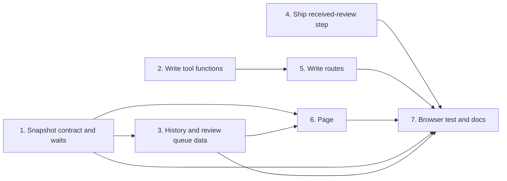

# Tasks

The order of the task groups. Groups with no path between them can run in parallel.

## 1. Snapshot contract and waits

- [ ] 1.1 Add the snapshot structs, fields and queue constants in internal/tools/dashboard_snapshot.go — verify: go test ./internal/tools/ -run 'TestDashboardContract|TestDashboardFixture' <!-- ref:1-1-add-the-snapshot-structs-fields-and-3e40cc -->
- [ ] 1.2 Stamp the plan run session ID after plan_prepare in internal/hooks/mcp_invocation_record.go and add the sessionId row in plugins/sdlc/skills/plan/state-format.md — verify: go test ./internal/hooks/ -run 'TestRecordMCPInvocation' <!-- ref:1-2-stamp-the-plan-run-session-id-after-d60984 -->
- [ ] 1.3 Add loneWaits and the attention read warning in internal/tools/dashboard_snapshot.go — verify: go test ./internal/tools/ -run 'TestDashboardAttachAttention|TestDashboardSnapshot_Attention|TestDashboardSnapshot_LoneWaits|TestDashboardLoneWaits' <!-- ref:1-3-add-lonewaits-and-the-attention-read-102d2e -->

## 2. Write tool functions

- [ ] 2.1 Add attention.Remove and DashboardDismissWait in internal/attention/attention.go and internal/tools/dashboard_wait_dismiss.go — verify: go test ./internal/attention/ ./internal/tools/ -run 'TestRemove|TestDashboardDismissWait' <!-- ref:2-1-add-attention-remove-and-dashboarddi-cb6eeb -->
- [ ] 2.2 Add DashboardSetPreplanStatus in internal/tools/dashboard_preplan_status.go and the status text in plugins/sdlc/skills/preplan/SKILL.md — verify: go test ./internal/tools/ -run 'TestDashboardSetPreplanStatus|TestDashboardPreplans' && go test ./internal/skillcheck/... <!-- ref:2-2-add-dashboardsetpreplanstatus-in-int-d82fac -->
- [ ] 2.3 Add DashboardDeleteRuns with the re-read and one retry in internal/tools/dashboard_delete_runs.go — verify: go test ./internal/tools/ -run 'TestDashboardDeleteRuns' <!-- ref:2-3-add-dashboarddeleteruns-with-the-re-690600 -->

## 3. History and review queue data

- [ ] 3.1 Pair ship History rows with plan rows by the draft rule D3 before the 50-row cut in internal/tools/dashboard_activity.go — verify: go test ./internal/tools/ -run 'TestDashboardActivity|TestDashboardRecentRuns' <!-- ref:3-1-pair-ship-history-rows-with-plan-row-b8894d -->
- [ ] 3.2 Read and check the fix record origin in internal/tools/dashboard_join.go — verify: go test ./internal/tools/ -run 'TestDashboardReceivedReview' <!-- ref:3-2-read-and-check-the-fix-record-origin-3b53d8 -->
- [ ] 3.3 Build reviewQueue from fix records, deferredFindings and review findings in internal/tools/dashboard_review_queue.go — verify: go test ./internal/tools/ -run 'TestDashboardReviewQueue|TestDashboardReceivedReview' <!-- ref:3-3-build-reviewqueue-from-fix-records-d-930e2e -->

## 4. Ship received-review step

- [ ] 4.1 Seed the received-review entry after review in internal/tools/ship.go and describe condition in plugins/sdlc/schemas/ship-state.schema.json — verify: go test -tags integration ./... <!-- ref:4-1-seed-the-received-review-entry-after-e94c0e -->
- [ ] 4.2 Record received-review with begin-step and complete-step in plugins/sdlc/skills/ship/SKILL.md, state-format.md, entry-modes.md and reference.md — verify: go test ./internal/skillcheck/... <!-- ref:4-2-record-received-review-with-begin-st-ca3e9a -->

## 5. Write routes

- [ ] 5.1 Add POST /api/preplan-status, /api/history-delete and /api/wait-dismiss in internal/dashboard/web/server.go and wire them in cmd/sdlc/main.go — verify: go test ./internal/dashboard/web/ ./cmd/sdlc/ <!-- ref:5-1-add-post-api-preplan-status-api-hist-415621 -->

## 6. Page

- [ ] 6.1 Add the plan wait, lone waits, review queue and paired rows to internal/dashboard/web/testdata/snapshot.fixture.json — verify: go test ./internal/tools/ -run 'TestDashboardFixture' && node --test internal/dashboard/web/testdata/view.test.cjs <!-- ref:6-1-add-the-plan-wait-lone-waits-review-4491bd -->
- [ ] 6.2 Copy the draft page and draw the review queue tile in internal/dashboard/web/static/ — verify: node --test internal/dashboard/web/testdata/view.test.cjs && go test ./internal/dashboard/web/ <!-- ref:6-2-copy-the-draft-page-and-draw-the-rev-23f296 -->
- [ ] 6.3 Send the status menu and History delete writes, with the draft delete question text, in internal/dashboard/web/static/app.js — verify: node --test internal/dashboard/web/testdata/view.test.cjs && go test ./internal/dashboard/web/ <!-- ref:6-3-send-the-status-menu-and-history-del-50e3ab -->
- [ ] 6.4 Draw the lone-wait cards, the Dismiss call and the wait counts in internal/dashboard/web/static/ — verify: node --test internal/dashboard/web/testdata/view.test.cjs && go test ./internal/dashboard/web/ <!-- ref:6-4-draw-the-lone-wait-cards-the-dismiss-376b1a -->

## 7. Browser test and docs

- [ ] 7.1 Add the chromedp browser test in internal/dashboard/web/browser_e2e_test.go — verify: CI=1 go test -tags integration -run TestBrowserE2E -v ./internal/dashboard/web/ <!-- ref:7-1-add-the-chromedp-browser-test-in-int-6db951 -->
- [ ] 7.2 Document the new fields, routes and page actions in docs/dashboard.md and docs/skills/ship.md — verify: grep -rni 'six .POST. routes' docs/ README.md returns no line <!-- ref:7-2-document-the-new-fields-routes-and-p-f99593 -->
