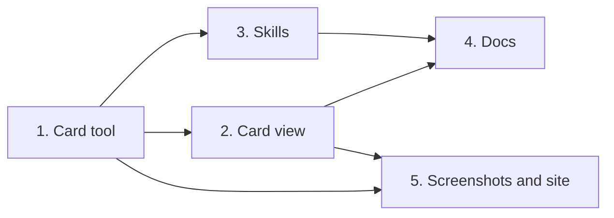

# Tasks

Group order:

## 1. Card tool

- [ ] 1.1 Add snapshot input, wave counters and the ship-to-execute join in internal/tools/dashboard_card.go — verify: go test ./internal/tools/ -run 'TestDashboardCard|TestEveryToolMatchesItsAnnotationDecision|TestReadOnlyToolsWriteNothingTracked' <!-- ref:1-1-add-snapshot-input-wave-counters-and-a8ef66 -->
- [ ] 1.2 Add the text card, dashboardUrl, the no-card next texts and the description in internal/tools/dashboard_card.go — verify: go test ./internal/tools/ -run 'TestDashboardCard|TestReadOnlyToolsWriteNothingTracked' <!-- ref:1-2-add-the-text-card-dashboardurl-the-n-3a6660 -->

## 2. Card view

- [ ] 2.1 Add snapshot mode and wave rows in internal/tools/dashboard_card.html — verify: node --test internal/dashboard/web/testdata/card_view.test.cjs <!-- ref:2-1-add-snapshot-mode-and-wave-rows-in-i-51740e -->

## 3. Skills

- [ ] 3.1 Add step cards and the text card rule in plugins/sdlc/skills/ship/SKILL.md and plugins/sdlc/skills/ship/entry-modes.md — verify: go test ./internal/skillcheck/ <!-- ref:3-1-add-step-cards-and-the-text-card-rul-b689ee -->
- [ ] 3.2 Add wave cards and the text card rule in plugins/sdlc/skills/execute/SKILL.md — verify: go test ./internal/skillcheck/ <!-- ref:3-2-add-wave-cards-and-the-text-card-rul-e07552 -->

## 4. Docs

- [ ] 4.1 Describe card kinds and the text card in docs/dashboard.md, docs/skills/ship.md and docs/skills/execute.md — verify: cd site && bun run test && bun run build <!-- ref:4-1-describe-card-kinds-and-the-text-car-26e13c -->

## 5. Screenshots and site

- [ ] 5.1 Add screenshot pages for the card view and the text card in site/scripts/card-shots.html and site/scripts/card-shots-text.html — verify: open each page in Chrome and compare it with the golden text <!-- ref:5-1-add-screenshot-pages-for-the-card-vi-2bb3ed -->
- [ ] 5.2 Take 4 Chrome screenshots and add them in site/src/data/assets.json — verify: cd site && bun run build <!-- ref:5-2-take-4-chrome-screenshots-and-add-th-e61ad1 -->
- [ ] 5.3 Promote the run cards for every MCP Apps client in site/src/data/features.mjs — verify: cd site && bun run test && bun run build <!-- ref:5-3-promote-the-run-cards-for-every-mcp-c5cf9e -->

## Workflow follow-up

- `/sdlc:ship` validates and archives the change.
