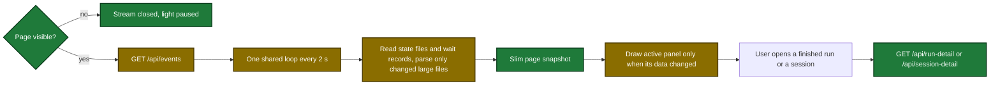
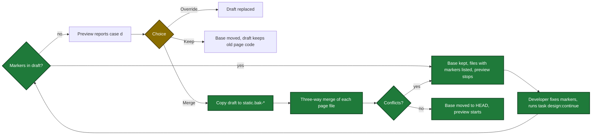

# Proposal

## Why

- Problem: the dashboard server keeps about 28% of one CPU core busy with no user action. Each open page adds one more full collect every 2 s.
- Evidence: 178 CPU minutes in 10.7 h on v0.4.11, a 3.9 MB snapshot, and 0.55 s for one collect (`.sdlc-v2/preplan/2026-10-30-dashboard-performance.md`). The page stops responding after long use.
- Why now: the cost grows with each session and each open tab. The design draft in `design/dashboard/` must get the new page code without loss of its own design work.

## What Changes

| Area | Before | After |
|---|---|---|
| Finished runs on the Pipelines tab | shown for 7 days after the last update | shown for 4 days after the last update |
| Archive of a finished run | accepted up to 7 days | accepted up to 4 days, older gives `RUN_NOT_FOUND` |
| Page snapshot | full, about 3.9 MB | slim, below 500 KB: no step detail and no issue list for a finished run, no `timeline` and no `commandGroups` for a session |
| Detail of a finished run or a session | in each snapshot | loaded on open from `GET /api/run-detail` or `GET /api/session-detail` |
| Event stream | one 2 s collect for each open page | one shared loop, only while at least one page is connected |
| Evidence, history, learnings and deferred files | parsed at each collect | parsed again only after a size or time change |
| State files and wait records | read at each collect | read at each collect (unchanged) |
| Hidden page | stream stays open, all four panels drawn | stream closed, the light shows `Paused while the page is hidden.` |
| Snapshot event on the page | draws all four panels | draws only the active panel, and only when its data changed |
| Server CPU priority | nice 0 | nice 10 on macOS and Linux |
| Design preview, case d | offers Override or Keep | also offers Merge (`task design:merge`), with a backup folder first |
| Design draft with conflict markers | accepted | `task design`, `task design:merge` and `task design:continue` refuse it |

Flow of a page after the change (green: new, amber: changed):

Flow of the design draft after a shipped page change (green: new, amber: changed):

## Capabilities

### New Capabilities

- `dashboard-design-preview`: the local design preview of the dashboard page, its read-only API proxy, and the merge of shipped page changes into the design draft.

### Modified Capabilities

- `pipeline-dashboard`: 4-day window for finished runs, shared event loop, fresh wait records, slim page snapshot, two read-only detail routes, detail on open, paused stream on a hidden page, panel draw on change, and a lower CPU priority.

## Impact

| Path | Kind | Change |
|---|---|---|
| `internal/tools/dashboard_parse_cache.go` | internal package | new parse cache |
| `internal/tools/dashboard_snapshot.go` | internal package | 4-day window, new fields, slim function |
| `internal/tools/dashboard_activity.go` | internal package | cached readers |
| `internal/tools/dashboard_detail.go` | internal package | run detail and session detail functions |
| `internal/dashboard/web/broadcast.go` | internal package | shared collect loop |
| `internal/dashboard/web/server.go` | internal package | two GET routes, stream subscribes to the loop |
| `internal/dashboard/priority_unix.go`, `internal/dashboard/priority_other.go` | internal package | nice 10 at serve start |
| `cmd/sdlc/main.go` | command | slim collect, priority call |
| `internal/dashboard/web/static/app.js`, `view.js`, `render.js`, `app.css` | page | pause, panel draw, detail on open |
| `cmd/design-preview/start.go`, `cmd/design-preview/main.go` | command | merge mode, marker check, exit 4 |
| `cmd/design-preview/proxy_test.go` | test | detail routes and stream reopen through the proxy |
| `Taskfile.yml` | CI | task `design:merge` |
| `.claude/skills/dashboard-design/SKILL.md` | skill | Merge option and Step 2b |
| `docs/dashboard.md` | doc | window, stream, routes, priority, detail on open |
