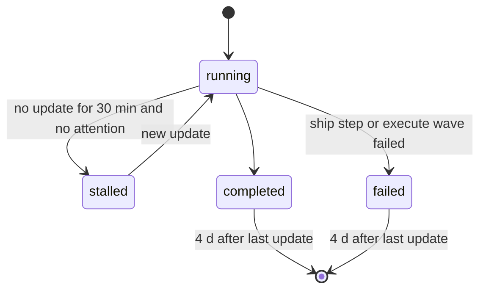
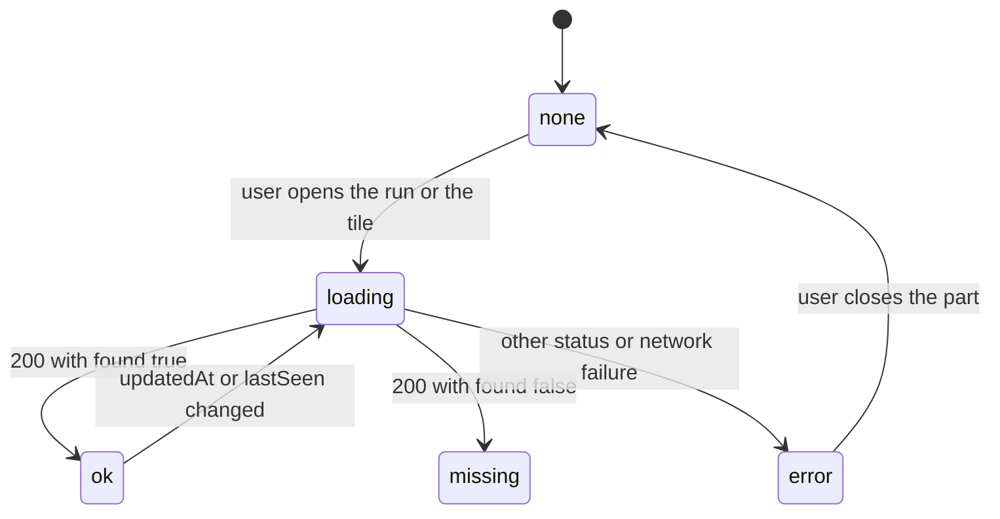

# Spec Delta

## MODIFIED Requirements

### Requirement: Endpoints
The server SHALL serve these endpoints and no others.

| Method | Path | Success |
|---|---|---|
| GET | `/` | 200, the page with the token of this server start in `<meta name="sdlc-token">` |
| GET | `/static/*` | 200, an embedded page file |
| GET | `/api/snapshot` | 200, the snapshot JSON |
| GET | `/api/events` | 200, a `text/event-stream` of snapshots |
| GET | `/api/health` | 200, `{"pid":<n>,"version":"<v>","startedAt":"<RFC3339>"}` |
| GET | `/api/learning` | 200, `{"found":<bool>,"body":"<redacted text>","truncated":<bool>}` |
| GET | `/api/run-detail` | 200, `{"found":<bool>,"id":"<id>","steps":[...],"issues":[...]}` |
| GET | `/api/session-detail` | 200, `{"found":<bool>,"id":"<id>","timeline":[...],"commandGroups":[...]}` |
| POST | `/api/stop` | 202, `{"stopping":true}` |
| POST | `/api/run-archive` | 200, `{"runId","dir","moved","deleted"}` |
| POST | `/api/cache-clear` | 200, `{"freedBytes","classes","skipped"}` |
| POST | `/api/preplan-delete` | 200, `{"deleted","alreadyGone","message"}` |
| POST | `/api/deferred-delete` | 200, `{"deleted","alreadyGone","message"}` |
| POST | `/api/learning-delete` | 200, `{"deleted","alreadyGone","message"}` |

#### Scenario: Health answer
- **WHEN** a GET request reaches `/api/health`
- **THEN** the body has the server `pid`, `version`, and `startedAt`
- **AND** the body does not hold the token

#### Scenario: Detail route method
- **WHEN** a POST request reaches `/api/run-detail`
- **THEN** the response status is 405

### Requirement: Event stream
The `/api/events` endpoint SHALL send `retry: 3000` and one `snapshot` event at connect, SHALL check the state files every 2 s through one loop that all open streams share, SHALL run that loop only while at least one stream is open, SHALL send a new `snapshot` event only when the snapshot changed, and SHALL send a `: ping` comment every 15 s.

#### Scenario: New connection
- **WHEN** a browser connects to `/api/events`
- **THEN** the stream starts with `retry: 3000`
- **AND** the next event is `event: snapshot` with the current page snapshot

#### Scenario: No change
- **WHEN** no state or evidence file changes for 2 s
- **THEN** no new `snapshot` event is sent

#### Scenario: Step changes
- **WHEN** a ship run changes its step
- **THEN** a new `snapshot` event with the new step is sent within 2 s

#### Scenario: Two open streams
- **WHEN** two streams are open and no file changes
- **THEN** the server does one collect every 2 s, not two

#### Scenario: No open stream
- **WHEN** the last stream closes
- **THEN** the server does no collect until a new stream opens

#### Scenario: Late stream
- **WHEN** a second stream opens while the loop runs
- **THEN** the second stream gets the current snapshot at once

### Requirement: Pipeline status
The snapshot SHALL give each ship, execute, plan, and review run one status of `running`, `stalled`, `completed`, or `failed`, and SHALL show a `completed` or `failed` run only when its last update is in the last 4 days. A `running` run with `attention` SHALL not turn `stalled`.

#### Scenario: Stalled run
- **WHEN** a ship run is in flight
- **AND** its last update is 31 min old
- **THEN** its status is `stalled`

#### Scenario: Old finished run
- **WHEN** an execute run has `runStatus:"completed"`
- **AND** its last update is 4 d 1 h old
- **THEN** the run is not in the snapshot

#### Scenario: Recent finished run
- **WHEN** an execute run has `runStatus:"completed"`
- **AND** its last update is 3 d 23 h old
- **THEN** the run is in the snapshot

#### Scenario: Waiting run
- **WHEN** a running pipeline has `attention`
- **AND** its last update is 31 min old
- **THEN** its status is `running`

## ADDED Requirements

### Requirement: Page snapshot
The snapshot that `/api/snapshot` and `/api/events` send SHALL omit the step `detail` and the `issues` items of each `completed` or `failed` run, and SHALL omit the `timeline` and `commandGroups` of each session. Each step with detail SHALL keep `detailKind`. Each run SHALL carry `issueCount` when it has issues. A run without its detail SHALL carry `detailDeferred:true`.

#### Scenario: Finished run
- **WHEN** a `completed` ship run has 12 issues and a review step with detail kind `dimensions`
- **THEN** the run has `"issues":[]`, `"issueCount":12` and `"detailDeferred":true`
- **AND** the review step has `"detailKind":"dimensions"` and no `detail`

#### Scenario: Running run
- **WHEN** a `running` ship run has 2 issues
- **THEN** the run keeps its step `detail` and its 2 `issues`
- **AND** the run has `"issueCount":2`

#### Scenario: Session
- **WHEN** a session has timeline events and command groups
- **THEN** its snapshot entry has no `timeline` key and no `commandGroups` key

### Requirement: Run detail route
The server SHALL answer `GET /api/run-detail?repo=<root>&id=<runId>` with the full steps and issues of one run that the page shows, with no token and no Origin check.

| Condition | Status | Code |
|---|---|---|
| `id` empty or longer than 256 bytes | 400 | `BAD_REQUEST` |
| `repo` empty or longer than 4096 bytes | 400 | `BAD_REQUEST` |
| `repo` not shown | 404 | `REPO_NOT_FOUND` |
| read failure | 500 | `DETAIL_READ_FAILED` |

#### Scenario: Shown run
- **WHEN** the page requests `/api/run-detail?repo=%2Fr&id=ship-main-1` for a shown run
- **THEN** the response is 200 with `"found":true`, the steps with `detail`, and the issues

#### Scenario: Unknown run
- **WHEN** `id` names no shown run
- **THEN** the response is 200 with `"found":false`, `"steps":[]` and `"issues":[]`

#### Scenario: Run past the window
- **WHEN** `id` names a `completed` run whose last update is 4 d 1 h old
- **THEN** the response is 200 with `"found":false`

#### Scenario: Empty id
- **WHEN** the request has `id=`
- **THEN** the response is 400 with code `BAD_REQUEST` and message `The id field is required`

#### Scenario: Long id
- **WHEN** `id` is 257 bytes long
- **THEN** the response is 400 with message `The id field is longer than 256 bytes`

### Requirement: Session detail route
The server SHALL answer `GET /api/session-detail?repo=<root>&id=<sessionId>` with the newest 50 timeline events and all command groups of one session, with the same field checks and error codes as the run detail route.

#### Scenario: Known session
- **WHEN** the page requests the detail of a session with 8 timeline events
- **THEN** the response is 200 with `"found":true` and 8 `timeline` items

#### Scenario: Session with no command
- **WHEN** a session has prompts only
- **THEN** the response has `"commandGroups":[]`

#### Scenario: Unknown session
- **WHEN** `id` names no session
- **THEN** the response is 200 with `"found":false`, `"timeline":[]` and `"commandGroups":[]`

### Requirement: Fresh wait records
Each collect SHALL read the state files, wait records, review ledgers and preplans again. Each collect SHALL parse an evidence, history, learnings or deferred file again only when its size or modification time changed.

#### Scenario: New wait record
- **WHEN** a run writes a wait record and no evidence file changes
- **THEN** the next snapshot shows the wait

#### Scenario: New evidence line
- **WHEN** a session appends one line to `cli-executions.jsonl`
- **THEN** the next snapshot counts the new command

### Requirement: Detail on open
The page SHALL load the detail of a finished run when the user opens its block or selects one of its steps, and SHALL load the detail of a session when the user opens its Session tile. The page SHALL send one request for each open part and SHALL show the step names, times and states before the load.

#### Scenario: Load in progress
- **WHEN** the user opens a finished run and the request is not done
- **THEN** each step tile with detail shows `Loading…`

#### Scenario: Run gone
- **WHEN** the response has `"found":false`
- **THEN** the tile shows `This run is no longer on disk.`

#### Scenario: Server error
- **WHEN** the response is 500 with no `message`
- **THEN** the tile shows `The detail cannot be loaded (HTTP 500).`

#### Scenario: Issue count before the load
- **WHEN** a finished run has `"issueCount":3`
- **THEN** the run head shows `3 issues` before any request

#### Scenario: Failed run
- **WHEN** the page shows a `failed` run, which starts expanded
- **THEN** the page loads its detail with no click

### Requirement: Paused stream on a hidden page
The page SHALL close the event stream while the page is hidden, and SHALL open a new stream when the page is visible again, except after a server stop.

| State | Light text |
|---|---|
| hidden | `Paused while the page is hidden.` |
| visible, before the first snapshot | `Connecting…` |

#### Scenario: Page hidden
- **WHEN** the page becomes hidden
- **THEN** the page closes the stream and shows `Paused while the page is hidden.`

#### Scenario: Page visible again
- **WHEN** a paused page becomes visible
- **THEN** the page opens a new stream and shows `Connecting…` until the first snapshot

#### Scenario: After a server stop
- **WHEN** the user stopped the server from the page and the page becomes visible
- **THEN** the page opens no stream

#### Scenario: Page opens hidden
- **WHEN** the page loads in a hidden tab
- **THEN** the page opens no stream and shows `Paused while the page is hidden.`

### Requirement: Panel draw on change
On a `snapshot` event, the page SHALL draw only the active panel tab, and only when the data of that panel changed. A user click or a tab select SHALL always draw the active panel. The header totals, chips, tab counts and title SHALL update at each `snapshot` event.

#### Scenario: Unchanged panel
- **WHEN** a `snapshot` event changes only the `history` of a repo and the Pipelines tab is active
- **THEN** the page does not draw the Pipelines panel again

#### Scenario: Tab select
- **WHEN** a new History row arrived while the Pipelines tab was active and the user selects History
- **THEN** the History panel shows the new row

### Requirement: Server CPU priority
On macOS and Linux, the dashboard server SHALL set the nice value 10 on its process group at start when it leads that group. A failure SHALL write one line `sdlc dashboard: lower priority: <error>` and SHALL not stop the start.

#### Scenario: Detached start
- **WHEN** `/sdlc:dashboard` starts the server
- **THEN** `ps -o ni= -p <pid>` shows 10

#### Scenario: Not a group leader
- **WHEN** the serve process does not lead its process group
- **THEN** its nice value stays the same

#### Scenario: Priority call fails
- **WHEN** the priority call returns an error
- **THEN** the server writes `sdlc dashboard: lower priority: <error>` and starts
