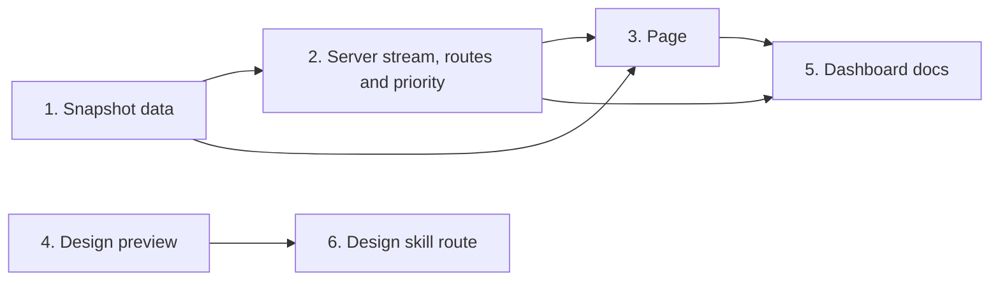

# Tasks

Group dependencies (groups with no path between them can run in parallel):

## 1. Snapshot data

- [ ] 1.1 Add the parse cache for large append-only files in internal/tools/dashboard_parse_cache.go — verify: go test -race ./internal/tools/ <!-- ref:1-1-add-the-parse-cache-for-large-append-028b87 -->
- [ ] 1.2 Change the finished-run window to 4 days in internal/tools/dashboard_snapshot.go — verify: go test ./internal/tools/ -run 'TestDashboardSnapshot|TestDashboardPlanTimes|TestArchive' <!-- ref:1-2-change-the-finished-run-window-to-4-f8303c -->
- [ ] 1.3 Add the slim page snapshot in internal/tools/dashboard_snapshot.go and cmd/sdlc/main.go — verify: go test ./internal/tools/ ./cmd/sdlc/ -run 'TestDashboardSlim|TestDashboardSnapshot|TestDashboardFixture|TestDashboardSessionCommandGroups|TestDashboardOptions' <!-- ref:1-3-add-the-slim-page-snapshot-in-intern-60f552 -->
- [ ] 1.4 Add the run detail and session detail functions in internal/tools/dashboard_detail.go — verify: go test ./internal/tools/ -run TestDashboardDetail <!-- ref:1-4-add-the-run-detail-and-session-detai-584638 -->

## 2. Server stream, routes and priority

- [ ] 2.1 Add the shared collect loop for the event stream in internal/dashboard/web/broadcast.go — verify: go test -race ./internal/dashboard/web/ -run 'TestBroadcast|TestEvents|TestServe' <!-- ref:2-1-add-the-shared-collect-loop-for-the-109a5d -->
- [ ] 2.2 Add the GET run-detail and session-detail routes in internal/dashboard/web/server.go — verify: go test -tags integration ./internal/dashboard/web/ ./cmd/sdlc/ -run 'TestHandler|TestE2E|TestWithToolRoutes|TestDashboardOptions' <!-- ref:2-2-add-the-get-run-detail-and-session-d-66ad14 -->
- [ ] 2.3 Lower the CPU priority at serve start in internal/dashboard/priority_pgrp.go and cmd/sdlc/main.go — verify: go test ./internal/dashboard/ ./cmd/sdlc/ -run 'TestLowerPriority|TestLowerServePriority' && GOOS=windows go build ./internal/dashboard/ <!-- ref:2-3-lower-the-cpu-priority-at-serve-star-210256 -->

## 3. Page

- [ ] 3.1 Stop the stream while hidden and draw only the changed visible panel in internal/dashboard/web/static/app.js — verify: node --test internal/dashboard/web/testdata/view.test.cjs && go test ./internal/dashboard/web/ <!-- ref:3-1-stop-the-stream-while-hidden-and-dra-0d6c92 -->
- [ ] 3.2 Load finished-run detail and session detail on open in internal/dashboard/web/static/app.js — verify: node --test internal/dashboard/web/testdata/view.test.cjs && go test ./internal/dashboard/web/ <!-- ref:3-2-load-finished-run-detail-and-session-df089b -->
- [ ] 3.3 Add browser steps for pause, reopen and detail load in internal/dashboard/web/browser_e2e_test.go — verify: CI=1 go test -tags integration ./internal/dashboard/web/ -run TestBrowserE2E <!-- ref:3-3-add-browser-steps-for-pause-reopen-a-81b056 -->

## 4. Design preview

- [ ] 4.1 Add proxy tests for the detail routes and the stream reopen in cmd/design-preview/proxy_test.go — verify: go test ./cmd/design-preview/ <!-- ref:4-1-add-proxy-tests-for-the-detail-route-f41722 -->
- [ ] 4.2 Add the merge mode and the conflict marker check in cmd/design-preview/start.go — verify: go test ./cmd/design-preview/ <!-- ref:4-2-add-the-merge-mode-and-the-conflict-363fcf -->

## 5. Dashboard docs

- [ ] 5.1 Document the window, stream, routes, priority and detail on open in docs/dashboard.md — verify: grep -nE "7 days|7-day|seven days|one week" docs/dashboard.md <!-- ref:5-1-document-the-window-stream-routes-pr-49509a -->

## 6. Design skill route

- [ ] 6.1 Add the design:merge task and the Step 2b route in Taskfile.yml and .claude/skills/dashboard-design/SKILL.md — verify: task --list <!-- ref:6-1-add-the-design-merge-task-and-the-st-1d2e7a -->

## Workflow follow-up

- Before Task 1.1, measure the baseline with the Manual measures table of the plan.
- After deploy, run `task build`, `/reload-plugins` and `/sdlc:dashboard --stop`, then `/sdlc:dashboard`, and check the 5 manual measures.
- After the commit, run `task design`, pick Merge in case d, and read the draft diff.
- Archive the change after the review requirements pass.
