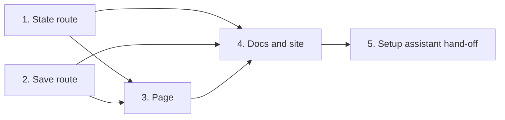

# Tasks

Group dependencies:

## 1. State route

- [ ] 1.1 Add `layers` and `guardrails` to the state answer in internal/tools/dashboard_setup.go — verify: go test ./internal/tools/ -run 'TestDashboardSetupState|TestSetupGuardrail' -v <!-- ref:1-1-add-layers-and-guardrails-to-the-sta-ee5b8d -->

## 2. Save route

- [ ] 2.1 Add the guardrail request field, request rules, stale check and rule check in internal/tools/dashboard_setup_write.go — verify: go test ./internal/tools/ -run 'TestDashboardSetupSave_GuardrailRequest|TestDashboardSetupSave_GuardrailInputStates' -v <!-- ref:2-1-add-the-guardrail-request-field-requ-f89218 -->
- [ ] 2.2 Write guardrail changes with the form changes in one call in internal/tools/dashboard_setup_write.go — verify: go test ./internal/tools/ -run 'TestDashboardSetupSave_GuardrailWrite' -v <!-- ref:2-2-write-guardrail-changes-with-the-for-fbeb25 -->
- [ ] 2.3 Set a 64 KiB body limit for setup save in internal/dashboard/web/server.go and setup_routes.go — verify: go test ./internal/dashboard/web/ -run 'TestHandler_SetupRoutes|TestHandler_GuardMutation|TestHandler_SetupPostGuards' -v <!-- ref:2-3-set-a-64-kib-body-limit-for-setup-sa-d70662 -->
- [ ] 2.4 Add HTTP tests for the state and save routes in internal/dashboard/web — verify: go test -tags integration ./internal/dashboard/web -run 'TestE2E_SetupGuardrails' -v <!-- ref:2-4-add-http-tests-for-the-state-and-sav-c72681 -->

## 3. Page

- [ ] 3.1 Add `guardrailChanges` and `overrideText` and the guardrail body in internal/dashboard/web/static/setup-view.js — verify: node --test internal/dashboard/web/testdata/setup-view.test.cjs <!-- ref:3-1-add-guardrailchanges-and-overridetex-2af10d -->
- [ ] 3.2 Port the approved Setup tab draft into internal/dashboard/web/static/setup.js and setup.css — verify: go test -tags integration ./internal/dashboard/web -run '^TestBrowserE2E_(Setup|VerticalRules)' -v <!-- ref:3-2-port-the-approved-setup-tab-draft-in-d9642b -->
- [ ] 3.3 Send guardrail changes and show server errors on the row in internal/dashboard/web/static/setup.js — verify: go test -tags integration ./internal/dashboard/web -run '^TestBrowserE2E_SetupGuardrails$' -v <!-- ref:3-3-send-guardrail-changes-and-show-serv-6c4a50 -->

## 4. Docs and site

- [ ] 4.1 Describe the FILE chips, override lines, guardrail lists and 64 KiB limit in docs/dashboard.md, site/src/data/features.mjs and docs/skills/setup/flags-and-sections.md — verify: grep -n '8 KiB' docs/dashboard.md <!-- ref:4-1-describe-the-file-chips-override-lin-e1bdbc -->

## 5. Setup assistant hand-off

- [ ] 5.1 Move the Setup tab question to Step 0 item 3 of plugins/sdlc/skills/setup/SKILL.md and update docs/skills/setup.md, docs/getting-started.md and site/src/data/features.mjs — verify: go test ./internal/skillcheck/ -run 'TestSetupSkills' -v <!-- ref:5-1-move-the-setup-tab-question-to-step-6fcc38 -->

## Workflow follow-up

- `/sdlc:ship` archives the change after the validation passes.
