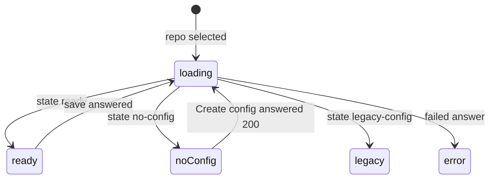

# Spec Delta

## ADDED Requirements

### Requirement: Setup tab
The page SHALL have a Setup tab that shows one form for the config of one selected repo. The form SHALL be built from the field list of `GET /api/setup-fields`, with one card for each form section, an index of the sections, a filter, the views All, Changed and Not set, and a save bar. The tab SHALL have its own repo bar that selects exactly one repo. The tab count SHALL be the number of unsaved changes of the selected repo.

Form states of the selected repo:

#### Scenario: Repo with a config
- **WHEN** the user opens the Setup tab and the selected repo has `.sdlc-v2/config.toml`
- **THEN** the tab shows 10 form section cards and 9 read-only cards for the delegated sections

#### Scenario: Effect of each option
- **WHEN** a field has a list of options
- **THEN** the field shows one row for each option with its effect on the plugin

#### Scenario: Hidden step fields
- **WHEN** a pipeline step is off in the `ship.steps` field of the form
- **THEN** the fields of that step are hidden
- **AND** the section shows how many fields are hidden and for which steps

#### Scenario: Save to switch
- **WHEN** a local section has the Save to switch on `All my projects` and the user changes one field
- **THEN** the save writes only that field to the user file

#### Scenario: Review before a save
- **WHEN** the user selects `Review and save`
- **THEN** a dialog lists each change as the old value and the new value, grouped by file

#### Scenario: Saved note
- **WHEN** the server answers a save of 2 changes with `ok` true
- **THEN** the save bar note reads `Saved 2 changes.`
- **AND** the form loads the state of the repo again

#### Scenario: Refused value
- **WHEN** the server answers `400 SETUP_INVALID` with one field
- **THEN** the field shows the message of the server
- **AND** the save bar note reads `Not saved. The config check refused 1 field. No file changed.`

#### Scenario: Pipeline runs
- **WHEN** a pipeline of the selected repo has the status `running`
- **THEN** the notice `PIPELINE RUNS` shows above the form and in the review dialog
- **AND** the save stays possible

#### Scenario: Repo with no config
- **WHEN** the selected repo has the state `no-config`
- **THEN** the tab shows the Create config button and the command `/sdlc:setup`

#### Scenario: Old JSON config
- **WHEN** the selected repo has the state `legacy-config`
- **THEN** the tab shows the command `/sdlc:setup --migrate` and no Create config button

### Requirement: Setup fields route
The server SHALL serve `GET /api/setup-fields` with no Origin check and no token. It SHALL answer 200 `{"sections":[...]}` with the 19 setup sections in the order of the field list. Each form field SHALL hold `details`, and each choice field SHALL hold `effects`, a list of `{option, text, before, after}`.

#### Scenario: Effects of a choice field
- **WHEN** a GET request reaches `/api/setup-fields`
- **THEN** the `bump` field of the `ship` section has one `effects` entry for each option

### Requirement: Setup state route
The server SHALL serve `GET /api/setup-state?repo=<root>` with no Origin check and no token. It SHALL answer 200 `{root, state, configError, files, values, delegated}`. `state` SHALL be `ready`, `no-config`, or `legacy-config`. Each value SHALL name its source file: `config`, `project`, or `user`. A repo that the page does not show SHALL get `404 REPO_NOT_FOUND`.

#### Scenario: Value source
- **WHEN** both `.sdlc-v2/local.toml` and the user file hold `ship.bump`
- **THEN** the value of `ship.bump` has the source `project`

#### Scenario: Config problem
- **WHEN** the config check of the whole config fails
- **THEN** the state stays `ready`
- **AND** `configError` holds the error text

### Requirement: Setup save route
The server SHALL serve `POST /api/setup-save` `{repo, changes, targets}` behind the Origin and token checks. Each change SHALL be `{section, field, op, value}` with `op` `set` or `reset`. The server SHALL build each section from its target file, keep every key that the request does not name, and write through the setup write code after the value check. A refused value SHALL write no file. A save that writes the `version` section SHALL create each missing CI script file, SHALL not change an existing one, and SHALL list the created files in `ciFiles`.

#### Scenario: Refused value writes nothing
- **WHEN** a save sets `ship.verifyPipelineMaxIterations` to `0`
- **THEN** the answer is `400 SETUP_INVALID` with a `fields` list
- **AND** no file changes

#### Scenario: Comments stay
- **WHEN** a save changes one key of a file that holds comment lines
- **THEN** every comment line and the key order stay

#### Scenario: Too many changes
- **WHEN** a save holds more than 64 changes
- **THEN** the answer is `400 BAD_REQUEST` and no file changes

#### Scenario: Wrong repo state
- **WHEN** a save names a repo with the state `no-config`
- **THEN** the answer is `409 SETUP_NOT_READY`

### Requirement: Setup create route
The server SHALL serve `POST /api/setup-create` `{repo}` behind the Origin and token checks. For a repo with the state `no-config`, it SHALL create `.sdlc-v2/config.toml` and `.sdlc-v2/local.toml` from the templates, each one only when it is absent, and answer 200 `{ok, created, changed, errors}`. Any other state SHALL get `409 SETUP_NOT_READY` with no change.

#### Scenario: First config
- **WHEN** a create names a repo with no `.sdlc-v2` folder
- **THEN** `.sdlc-v2/config.toml` exists
- **AND** the next state answer has the state `ready`

#### Scenario: Old backup kept
- **WHEN** a create names a repo with `.sdlc-v2/local.json` and `.sdlc-v2/local.json.bak`
- **THEN** both files stay as they are

## MODIFIED Requirements

### Requirement: Loopback access
The server SHALL listen on `127.0.0.1` only, SHALL reject a request whose `Host` header is not `127.0.0.1:<port>` or `localhost:<port>`, and SHALL accept GET only, except `POST /api/stop`, `POST /api/run-archive`, `POST /api/cache-clear`, `POST /api/preplan-delete`, `POST /api/deferred-delete`, `POST /api/learning-delete`, `POST /api/preplan-status`, `POST /api/history-delete`, `POST /api/wait-dismiss`, `POST /api/setup-save` and `POST /api/setup-create`.

#### Scenario: Foreign host header
- **WHEN** a request has `Host: evil.example:7385`
- **THEN** the response status is 403

#### Scenario: Write method on a read endpoint
- **WHEN** a POST request reaches `/api/snapshot`
- **THEN** the response status is 405

#### Scenario: Unknown path
- **WHEN** a GET request reaches `/nothing`
- **THEN** the response status is 404

#### Scenario: Read method on a delete route
- **WHEN** a GET request reaches `/api/deferred-delete`
- **THEN** the response status is 405

#### Scenario: Read method on the setup save route
- **WHEN** a GET request reaches `/api/setup-save`
- **THEN** the response status is 405

### Requirement: Endpoints
The server SHALL serve these endpoints and no others.

| Method | Path | Success |
|---|---|---|
| GET | `/` | 200, the page with the token of this server start in `<meta name="sdlc-token">` |
| GET | `/static/*` | 200, an embedded page file |
| GET | `/api/snapshot` | 200, the snapshot JSON |
| GET | `/api/events` | 200, a `text/event-stream` of snapshots |
| GET | `/api/health` | 200, `{"pid":<n>,"version":"<v>","startedAt":"<RFC3339>"}` |
| GET | `/api/learning` | 200, `{"found":<bool>,"body":"<redacted text>","truncated":<bool>}` |
| GET | `/api/run-detail` | 200, `{"found":<bool>,"id":"<id>","steps":[...],"issues":[...]}` |
| GET | `/api/session-detail` | 200, `{"found":<bool>,"id":"<id>","timeline":[...],"commandGroups":[...]}` |
| GET | `/api/setup-fields` | 200, `{"sections":[...]}` |
| GET | `/api/setup-state` | 200, `{"root","state","configError","files","values","delegated"}` |
| POST | `/api/stop` | 202, `{"stopping":true}` |
| POST | `/api/run-archive` | 200, `{"runId","dir","moved","deleted"}` |
| POST | `/api/cache-clear` | 200, `{"freedBytes","classes","skipped"}` |
| POST | `/api/preplan-delete` | 200, `{"deleted","alreadyGone","message"}` |
| POST | `/api/deferred-delete` | 200, `{"deleted","alreadyGone","message"}` |
| POST | `/api/learning-delete` | 200, `{"deleted","alreadyGone","message"}` |
| POST | `/api/preplan-status` | 200, `{"changed","status","message"}` |
| POST | `/api/history-delete` | 200, `{"deleted","alreadyGone","message"}` |
| POST | `/api/wait-dismiss` | 200, `{"deleted","alreadyGone","message"}` |
| POST | `/api/setup-save` | 200, `{"ok","written","failed","warnings","ciFiles","next"}` |
| POST | `/api/setup-create` | 200, `{"ok","created","changed","errors"}` |

#### Scenario: Health answer
- **WHEN** a GET request reaches `/api/health`
- **THEN** the body has the server `pid`, `version`, and `startedAt`
- **AND** the body does not hold the token

#### Scenario: Detail route method
- **WHEN** a POST request reaches `/api/run-detail`
- **THEN** the response status is 405

#### Scenario: Setup fields with no token
- **WHEN** a GET request with no token reaches `/api/setup-fields`
- **THEN** the response status is 200

### Requirement: Page layout
The page SHALL have the title `sdlc signal room`, with a `(N) ` prefix when N pipelines in the repos in scope wait for a person, and a header with the tabs Pipelines, Activity, History, Preplans, and Setup, each with a count. Under the header a sticky repo filter SHALL serve the first four tabs. The Setup tab SHALL hide the repo filter and show its own repo bar. The page SHALL have no left rail.

#### Scenario: Tabs by keyboard
- **WHEN** the Pipelines tab has focus and the user presses the right arrow key
- **THEN** the Activity tab opens

#### Scenario: End key
- **WHEN** a tab has focus and the user presses `End`
- **THEN** the Setup tab opens

#### Scenario: Narrow page
- **WHEN** the page is narrower than 1420 px
- **THEN** the header counts are hidden

#### Scenario: Waiting title
- **WHEN** 1 pipeline in scope has `attention`
- **THEN** the title is `(1) sdlc signal room`

#### Scenario: Repo filter on the Setup tab
- **WHEN** the user selects the Setup tab
- **THEN** the repo filter is hidden

### Requirement: Repo filter
The filter SHALL show `All` and one chip for each repo with its pipeline count. Many chips SHALL be able to be on. No chip on SHALL mean all repos. The filter SHALL hide the blocks, activity rows, and history rows of other repos. The counts of the Pipelines, Activity, History, and Preplans tabs SHALL use the filter. Header counts SHALL not. The count of the Setup tab SHALL not use the filter.

#### Scenario: Two chips on
- **WHEN** the chips `sdlc-plugin` and `payments-service` are on
- **THEN** the Pipelines tab shows only the blocks of those two repos

#### Scenario: Failed run count
- **WHEN** the repo `identity-service` has a failed run
- **THEN** its chip shows the pipeline count in red

#### Scenario: Header counts
- **WHEN** a chip is on
- **THEN** the header counts running, stalled, and failed still count all repos

### Requirement: Panel draw on change
On a `snapshot` event, the page SHALL draw only the active panel tab, and only when the data of that panel changed. A user click or a tab select SHALL always draw the active panel. The header totals, chips, tab counts and title SHALL update at each `snapshot` event. A `snapshot` event SHALL not build the Setup form again while the list of repos stays the same. It SHALL update only the pipeline notice of the Setup tab.

#### Scenario: Unchanged panel
- **WHEN** a `snapshot` event changes only the `history` of a repo and the Pipelines tab is active
- **THEN** the page does not draw the Pipelines panel again

#### Scenario: Tab select
- **WHEN** a new History row arrived while the Pipelines tab was active and the user selects History
- **THEN** the History panel shows the new row

#### Scenario: Typed value stays
- **WHEN** the user typed a value in the Setup form and a `snapshot` event arrives
- **THEN** the typed value and the focus stay
