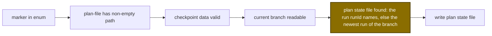

# Spec Delta

## MODIFIED Requirements

### Requirement: Input and output fields
The tool SHALL accept the input fields below and SHALL return the output fields below on success.

| Field | Type | Required | Encoding | Meaning |
|---|---|---|---|---|
| `marker` | string enum | yes | plain text | One of `plan-file`, `skillInvoked`, `guardrailsEvaluated`, `critiqueRan`, `done`, `guardrailResults`, `criticalDecisions`, `checkpoint`, `review-round`, `review-outcome` |
| `path` | string | only for `plan-file` | plain text | Plan document path to record |
| `data` | object | only for `checkpoint` and `review-round` | JSON | Payload for `guardrailResults`, `criticalDecisions`, `checkpoint` and `review-round`; ignored otherwise |
| `runId` | string | no | plain text | Run ID that `plan_prepare` returned, e.g. `plan-main-20261026T084445Z`. The marker goes to that run. Without it, the newest plan run of the current branch is used |

| Field | Meaning |
|---|---|
| `ok` | `true` on success |
| `marker` | The marker that was written |
| `path` | Path of the plan state file that was written |
| `next` | Set only for `checkpoint`, `review-outcome` and `done` |
| `warnings` | `checkpoint`: the step time was not recorded; `done`: the history append failed, or the timing report skipped data |
| `timing` | Set only for `done`: the Step 7 timing report as raw text |
| `stepTime` | Set only for `checkpoint`: `{step, iteration, at, status}`; `status` is `added` (this call stored the entry), `kept` (an earlier entry owns the time; `at` is its time) or `not recorded` (see `warnings`; `at` is empty) |

#### Scenario: Successful timestamp marker
- **WHEN** `plan_mark({marker: "critiqueRan"})` succeeds
- **THEN** the output has `ok: true`, `marker: "critiqueRan"` and `path` set to the plan state file
- **AND** `next` is empty

#### Scenario: Marker with runId
- **WHEN** `plan_mark({marker: "critiqueRan", runId: "plan-main-20261026T084445Z"})` succeeds
- **THEN** `path` ends with `plan-main-20261026T084445Z.json`

### Requirement: Validation order
The tool SHALL validate in a fixed order and SHALL stop at the first failure without writing the plan state file.

Order of checks before any state write:

#### Scenario: Bad checkpoint data with no plan state file
- **WHEN** `plan_mark({marker: "checkpoint"})` is called with no `data` on a branch that has no plan state file
- **THEN** it returns the `DomainError` `checkpoint needs data {step, iteration, expectedWriters}`
- **AND** it does not report the missing plan state file

### Requirement: Plan state file lookup
With `runId`, the tool SHALL write to `<main-worktree>/.sdlc-v2/runs/<runId>.json`. Without `runId`, it SHALL write to the newest `plan-<branch-slug>-<YYYYMMDDTHHmmssZ>.json` file in `<main-worktree>/.sdlc-v2/runs/`, chosen by the timestamp in the file name, where `<branch-slug>` matches the current branch exactly. Each write SHALL remove the branch's other `plan-<branch-slug>-*.json` files that are not kept.

- A `runId` run that has `planIntegrity.done` is accepted.
- The branch is read from the active worktree.
- The state file always lives under the main worktree.
- A file of another branch whose slug starts with this slug (for example `plan-feat-x-*` on branch `feat`) is never selected or changed.

Keep rule for a sibling run. The writer `sessionId` is the `sessionId` of the run that `plan_mark` writes. The first rule that matches applies:

| Rule | Sibling run | Result |
|---|---|---|
| 1 | has `planIntegrity.done` | kept |
| 2 | state file last written less than 24 hours ago | kept |
| 3 | has a non-empty `sessionId` that differs from the writer `sessionId` | kept |
| 4 | any other run | removed, with its `.evidence/` directory |

- An empty writer `sessionId` (the hook did not stamp the written run yet) counts as different from every non-empty `sessionId`.
- The GC TTL sweep (7 days by default) removes a run that rule 3 keeps, when that run is not the newest run of the branch.

#### Scenario: Exact slug match
- **WHEN** branch `feat` has `plan-feat-20260929T110000Z.json` and a newer `plan-feat-x-20260929T120000Z.json` exists
- **THEN** `plan_mark` writes `plan-feat-20260929T110000Z.json`
- **AND** `plan-feat-x-20260929T120000Z.json` stays byte-identical

#### Scenario: Repeated marks keep one file
- **WHEN** `plan_prepare` created the branch's only state file and `plan_mark` is then called three times
- **THEN** exactly one `plan-<branch-slug>-*.json` file exists for the branch

#### Scenario: runId targets its own run
- **WHEN** branch `main` has live runs A and a newer B
- **AND** `plan_mark({marker: "checkpoint", runId: "<runId of A>", data: {step: "2", iteration: 0, expectedWriters: []}})` is called
- **THEN** the checkpoint is written to the state file of A
- **AND** the state file of B is byte-identical

#### Scenario: Stale sibling removed
- **WHEN** branch `main` has a not-done sibling run whose state file was last written more than 24 hours ago
- **AND** the sibling has no `sessionId`
- **AND** `plan_mark` writes another run of `main`
- **THEN** the stale sibling file is deleted

#### Scenario: Stale sibling of the same session removed
- **WHEN** branch `main` has a not-done sibling run whose state file was last written more than 24 hours ago
- **AND** the sibling has `sessionId` `s-1`
- **AND** `plan_mark` writes another run of `main` whose `sessionId` is `s-1`
- **THEN** the stale sibling file is deleted

#### Scenario: Idle sibling of another session kept
- **WHEN** branch `main` has a not-done sibling run whose state file was last written more than 24 hours ago
- **AND** the sibling has `sessionId` `s-1`
- **AND** `plan_mark` writes another run of `main` whose `sessionId` is `s-2`
- **THEN** the sibling file still exists

#### Scenario: No plan state file
- **WHEN** `plan_mark` is called on a branch where `plan_prepare` never ran
- **THEN** it returns a `DomainError` `no plan state file found for branch "<branch>"; run plan_prepare first`

### Requirement: Error cases
The tool SHALL return these errors in addition to the checkpoint data errors.

| Condition | Class | Message / Suggestion (short) |
|---|---|---|
| Main worktree cannot be resolved | `InfraError` | `resolve main root: <cause>` / run inside a git repository |
| Active worktree cannot be resolved | `InfraError` | `resolve active root: <cause>` / run inside a git working tree |
| `marker` not in the enum | `DomainError` | `unknown marker "<m>"; must be one of: <sorted list>` / use the exact, case-sensitive name |
| `plan-file` with blank `path` | `DomainError` | `marker "plan-file" requires a non-empty path` |
| Current branch cannot be read (git fails in the active worktree) | `InfraError` | `could not determine current branch` / run from inside a git repository or worktree |
| State file lookup fails | `InfraError` | `find plan state file: <cause>` / check read permission |
| No state file for the branch | `DomainError` | `no plan state file found for branch "<branch>"; run plan_prepare first` / stay on the branch `plan_prepare` ran on |
| `runId` state file cannot be read or is not JSON | `InfraError` | `plan run <runId> state read failed` / `the plan state file is unreadable or corrupt: fix its permissions or delete it, then call plan_prepare again` |
| `runId` is invalid (not a bare `plan-` run ID) or has no state file | `DomainError` | `plan run <runId> not found` / `Pass the runId that plan_prepare returned in this session. After a compaction, use the runId of the "Resume with:" line. If that run no longer exists, call plan_prepare with no runId to start a new run.` |
| State file write fails | `InfraError` | `write plan state file: <cause>` / check write permission and disk space |

#### Scenario: Not a git repository
- **WHEN** `plan_mark({marker: "guardrailsEvaluated"})` runs in a directory that is not a git repository
- **THEN** it returns `InfraError` `could not determine current branch`
- **AND** the suggestion says to run from inside a git repository or worktree

#### Scenario: Detached HEAD
- **WHEN** `plan_mark` runs on a detached HEAD
- **THEN** the branch reads as `HEAD`, not as a branch error
- **AND** with no plan run for `HEAD` it returns the `no plan state file found for branch "HEAD"` error

#### Scenario: Unknown marker
- **WHEN** `plan_mark({marker: "not-a-real-marker"})` is called
- **THEN** it returns a `DomainError` starting with `unknown marker "not-a-real-marker"; must be one of:`

#### Scenario: plan-file without a path
- **WHEN** `plan_mark({marker: "plan-file", path: ""})` is called
- **THEN** it returns the `DomainError` `marker "plan-file" requires a non-empty path`

#### Scenario: runId of a deleted run
- **WHEN** `plan_mark({marker: "critiqueRan", runId: "plan-main-20261026T084445Z"})` is called
- **AND** `plan-main-20261026T084445Z.json` does not exist
- **THEN** it returns the `DomainError` `plan run plan-main-20261026T084445Z not found`
- **AND** no state file changes

#### Scenario: Path traversal runId
- **WHEN** `plan_mark({marker: "critiqueRan", runId: "../plan-main-20261026T084445Z"})` is called
- **THEN** it returns the `DomainError` `plan run ../plan-main-20261026T084445Z not found`
