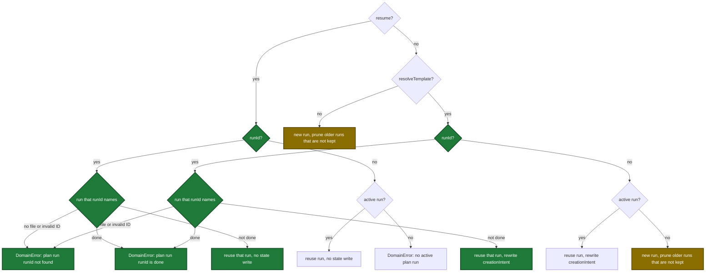

# Spec Delta

## MODIFIED Requirements

### Requirement: Input fields
The tool SHALL accept the input fields below. All fields are optional; a zero value means "not set".

| Field | Type | Required | Encoding | Meaning |
|---|---|---|---|---|
| `skipConfigCheck` | boolean | no | plain | Skip the config-version check |
| `fromOpenspec` | string | no | plain text | OpenSpec change name to validate and load, e.g. `add-widget` |
| `resolveTemplate` | boolean | no | plain | Resolve the active plan template and return `template` |
| `fromOpenspecDirect` | boolean | no | plain | Plan is built directly from an OpenSpec change |
| `openspecStage` | boolean | no | plain | Plan authors a new OpenSpec change and stages it, e.g. `true` |
| `lightweight` | boolean | no | plain | Request lightweight routing |
| `fileCount` | integer | no | plain | Expected number of files the change touches |
| `userPrompt` | string | no | plain text | The user's plan request; feeds discovery and is saved in the run |
| `resume` | boolean | no | plain | Post-compact recovery: reuse the run that `runId` names, else the active run, e.g. `true` |
| `runId` | string | no | plain text | Run ID from the first `plan_prepare` call of this session, e.g. `plan-main-20261026T084445Z`. Used only with `resolveTemplate` or `resume`; a first call ignores it |

- `openspecInlineGenerate` is removed from the input schema and is never read.

#### Scenario: Minimal call
- **WHEN** `plan_prepare({skipConfigCheck: true})` is called in a git repository with no OpenSpec, no config, and no plan template
- **THEN** `fromOpenspec` is null, `guardrails` is empty, `planTemplate.path` is null, `openspec.present` is `false`
- **AND** `errors` is empty

#### Scenario: Removed field
- **WHEN** the tool's input schema is listed
- **THEN** it has `openspecStage` and has no `openspecInlineGenerate`

#### Scenario: First call ignores runId
- **WHEN** `plan_prepare({skipConfigCheck: true, runId: "plan-main-20261026T084445Z"})` is called with no `resume` and no `resolveTemplate`
- **THEN** the call starts a new run with a new `runId`
- **AND** no error is returned

### Requirement: Run selection
The tool SHALL select or create the branch's plan run from the `resume`, `resolveTemplate` and `runId` inputs. An active run is the newest `plan-<branch-slug>-<timestamp>.json` in `<main-worktree>/.sdlc-v2/runs/` with an exact slug match, `planIntegrity.skillInvoked` set, and `planIntegrity.done` absent.

How one call picks its run:

| Call | Run | Result | `creationIntent` written |
|---|---|---|---|
| no `resume`, no `resolveTemplate` | any | new run; `runId` ignored | `{userPrompt, timestamp}` |
| `resolveTemplate` with `runId` | named run exists, not done | reuse that run | `{userPrompt, scope, routing, timestamp, flags}` |
| `resume` with `runId` | named run exists, not done | reuse that run, no state write | none |
| `resume` or `resolveTemplate` with `runId` | no file, or invalid ID | `DomainError` `plan run <runId> not found` | none |
| `resume` or `resolveTemplate` with `runId` | named run is done | `DomainError` `plan run <runId> is done` | none |
| `resolveTemplate` | active run | reuse | `{userPrompt, scope, routing, timestamp, flags}` |
| `resolveTemplate` | no active run | new run | `{userPrompt, scope, routing, timestamp, flags}` |
| `resume` | active run | reuse, no state write | none |
| `resume` | no active run | `DomainError` | none |

- A new run sets `planIntegrity.skillInvoked` to the current UTC time.
- A new run removes the branch's older `plan-<branch-slug>-*.json` files and `plan-<branch-slug>-*.evidence/` directories that are not kept by the keep rule below. The directory cleanup is best-effort.
- A call with `runId` never starts a new run and never selects the newest run of the branch.
- `flags` holds `fromOpenspec`, `fromOpenspecDirect`, `openspecInlineGenerate`, `lightweight`, `fileCount`.
- A run of another branch whose slug starts with this slug (for example `plan-feat-x-*` on branch `feat`) is never reused or changed.

Keep rule for an older run of the branch when this call writes its run. The first rule that matches applies:

| Rule | Older run | Result |
|---|---|---|
| 1 | has `planIntegrity.done` | kept |
| 2 | state file last written less than 24 hours ago | kept |
| 3 | has a non-empty `sessionId` that differs from the `sessionId` of the written run | kept |
| 4 | any other run | removed, with its `.evidence/` directory |

- The written run of a first call has no `sessionId`, because the hook stamps it after the call. An empty `sessionId` of the written run counts as different, so rule 3 keeps every older run that has a `sessionId`.
- The GC TTL sweep (7 days by default) removes a run that rule 3 keeps, when that run is not the newest run of the branch.

#### Scenario: First call replaces an older run
- **WHEN** branch `main` has the not-done run `plan-main-20200101T000000Z` whose state file was last written more than 24 hours ago
- **AND** that run has no `sessionId`
- **AND** `plan_prepare({skipConfigCheck: true})` is called
- **THEN** `runId` is a new ID
- **AND** only `<runId>.json` remains and the old `.evidence/` directory is gone

#### Scenario: Live sibling run kept
- **WHEN** branch `main` has a not-done run whose state file was written 1 hour ago
- **AND** that run has no `sessionId`
- **AND** `plan_prepare({skipConfigCheck: true})` is called
- **THEN** `runId` is a new ID
- **AND** the older run file and its `.evidence/` directory still exist

#### Scenario: Idle sibling of another session kept
- **WHEN** branch `main` has the not-done run `plan-main-20200101T000000Z` whose state file was last written more than 24 hours ago
- **AND** that run has `sessionId` `s-1`
- **AND** `plan_prepare({skipConfigCheck: true})` is called
- **THEN** `runId` is a new ID
- **AND** `plan-main-20200101T000000Z.json` and its `.evidence/` directory still exist

#### Scenario: Second call reuses the run
- **WHEN** a first call is followed by `plan_prepare({resolveTemplate: true, userPrompt: "fix the login bug", fileCount: 2})`
- **THEN** both calls return the same `runId` and one state file exists
- **AND** `creationIntent.scope` is `lightweight` and `creationIntent.flags.fileCount` is `2`

#### Scenario: Reuse by runId with a newer run
- **WHEN** branch `main` has active runs A and a newer B
- **AND** `plan_prepare({resolveTemplate: true, runId: "<runId of A>"})` is called
- **THEN** the call returns the `runId` of A
- **AND** the state file of B is byte-identical

#### Scenario: Resume with no active run
- **WHEN** `plan_prepare({resume: true})` is called and the branch has no run, or its newest run has `planIntegrity.done`
- **THEN** it returns the `DomainError` `no active plan run on branch <branch>`
- **AND** the suggestion is `call plan_prepare without resume to start a new plan run`

### Requirement: Resume mode
When `resume` is true and the run to reuse exists (the run that `runId` names and that is not done, or the active run when `runId` is absent), the tool SHALL treat `resolveTemplate` as true, SHALL restore saved inputs from the run, and SHALL skip discovery.

- A non-empty saved `creationIntent.userPrompt` replaces the input `userPrompt`.
- Each saved `creationIntent.flags` value replaces the matching input.
- Inputs stay unchanged when the run has no `creationIntent`.
- `explorePack` is its zero value: `manifestPath` and `outDir` null, no temp directory created.
- The state file is byte-identical after the call.

#### Scenario: Saved routing wins over input
- **WHEN** the run was saved with `fileCount: 12` and `plan_prepare({resume: true, fileCount: 1, lightweight: true})` is called
- **THEN** `template.routing.fileCount` is `12` and `template.pipelineMode` is `full`
- **AND** `explorePack.manifestPath` is null

#### Scenario: Resume alone resolves the template
- **WHEN** `plan_prepare({resume: true})` and `plan_prepare({resume: true, resolveTemplate: true})` are called on the same active run
- **THEN** both return the same `template`

#### Scenario: Resume by runId
- **WHEN** branch `main` has active runs A and a newer B
- **AND** `plan_prepare({resume: true, resolveTemplate: true, skipConfigCheck: true, runId: "<runId of A>"})` is called
- **THEN** the call returns the `runId` of A
- **AND** the state files of A and B are byte-identical after the call

### Requirement: Next text
The tool SHALL set `next` by call type.

| Call type | `next` |
|---|---|
| First call (no `resolveTemplate`, no `resume`) | `Print the context detection summary. Then run the gate check and complexity routing, and call plan_prepare again with resolveTemplate:true, the same userPrompt and the runId of this result.` |
| `resolveTemplate` | `Write template.headerMarkdown + template.skeletonMarkdown to the plan file, then call plan_mark with marker "plan-file", the plan path and runId. Pass runId on every later plan_mark call.` |
| `resume` | `Resume mode: run <runId> reused. Write template.headerMarkdown + template.skeletonMarkdown to the plan file only if the plan file is empty. Then call plan_support with action "evidence_digest" and runId "<runId>".` (also set as `template.next`) |

#### Scenario: First call next
- **WHEN** `plan_prepare({userPrompt: "p"})` succeeds on a branch
- **THEN** `next` starts with `Print the context detection summary.`
- **AND** `next` contains `the runId of this result`

#### Scenario: Template call next
- **WHEN** `plan_prepare({resolveTemplate: true, runId: "<runId>"})` succeeds
- **THEN** `next` contains `the plan path and runId. Pass runId on every later plan_mark call.`

### Requirement: Error cases
The tool SHALL return these tool errors and SHALL NOT return a partial payload with them.

| Condition | Class | Message / Suggestion (short) |
|---|---|---|
| Main worktree cannot be resolved | `InfraError` | `resolve main root: <cause>` / run inside a git repository |
| Active worktree cannot be resolved | `InfraError` | `resolve active root: <cause>` / run inside a git working tree |
| Branch unreadable on `resume` | `InfraError` | `could not determine current branch for resume` / run on a named branch |
| Plan state cannot be read (corrupt JSON, runs path not a directory) | `InfraError` | `plan state read failed: <path>` / delete the corrupt file or fix the directory |
| Plan state cannot be created or written | `InfraError` | `plan state write failed: <path>` / make `.sdlc-v2/runs/` writable |
| `guardrails.md` cannot be written | `InfraError` | `guardrails file write failed: <path>` / make `<runId>.evidence/` writable |
| `resume` with no active run | `DomainError` | `no active plan run on branch <branch>` / `call plan_prepare without resume to start a new plan run` |
| `resume` or `resolveTemplate` with a `runId` whose state file cannot be read or is not JSON | `InfraError` | `plan run <runId> state read failed` / `the plan state file is unreadable or corrupt: fix its permissions or delete it, then call plan_prepare again` |
| `resume` or `resolveTemplate` with a `runId` that is invalid or has no state file | `DomainError` | `plan run <runId> not found` / `Pass the runId that plan_prepare returned in this session. After a compaction, use the runId of the "Resume with:" line. If that run no longer exists, call plan_prepare with no runId to start a new run.` |
| `resume` or `resolveTemplate` with the `runId` of a done run | `DomainError` | `plan run <runId> is done` / `Start a new plan: call plan_prepare with no runId and no resume.` |

- The `runId` checks run in the table order above: read failure, then not found, then done.
- `plan_prepare`, `plan_mark` and `plan_support` `evidence_*` return the same class and message for the same `runId` state, except that only `plan_prepare` rejects a done run.

#### Scenario: Runs path is a file on a first call
- **WHEN** `<main-worktree>/.sdlc-v2/runs` is a regular file and `plan_prepare` is called without `resolveTemplate`
- **THEN** it returns an `InfraError` starting with `plan state write failed: `

#### Scenario: Corrupt state file on a second call
- **WHEN** the branch's newest `plan-main-*.json` holds invalid JSON and `plan_prepare({resolveTemplate: true})` is called
- **THEN** it returns an `InfraError` `plan state read failed: <that file's path>`

#### Scenario: Resume of a deleted run
- **WHEN** `plan_prepare({resume: true, resolveTemplate: true, skipConfigCheck: true, runId: "plan-main-20261026T084445Z"})` is called
- **AND** `plan-main-20261026T084445Z.json` does not exist
- **THEN** it returns the `DomainError` `plan run plan-main-20261026T084445Z not found`
- **AND** no new run is created

#### Scenario: Resume of a done run
- **WHEN** `plan_prepare({resume: true, runId: "<runId>"})` names a run that has `planIntegrity.done`
- **THEN** it returns the `DomainError` `plan run <runId> is done`

#### Scenario: runId of another kind
- **WHEN** `plan_prepare({resolveTemplate: true, runId: "ship-main-20261026T084445Z"})` is called
- **THEN** it returns the `DomainError` `plan run ship-main-20261026T084445Z not found`
