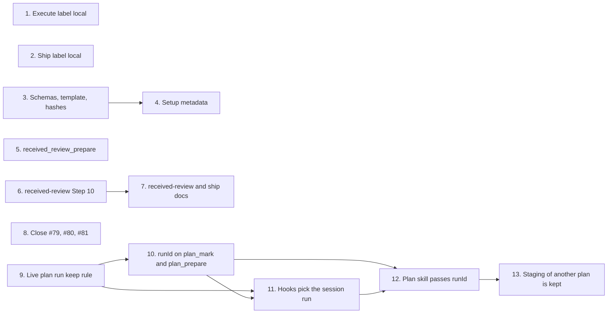

# Tasks

Group dependencies (groups with no path between them can run in parallel):

## 1. Execute source label local and high-risk warning rule (#78)

- [x] 1.1 Change the `auto`, `quality` and `highRiskAutoApprove` source labels to `local` and update the `Sources` and `HighRiskAutoApprove` descriptions in internal/tools/execute_state.go — verify: `go test ./internal/tools/ -run 'TestExecActionResolveConfig'` <!-- ref:1-1-change-the-auto-quality-and-highrisk-ce2da5 -->
- [x] 1.2 Update the source asserts to `local` and add the migrated-key assert in internal/tools/execute_config_test.go — verify: `go test ./internal/tools/ -run 'TestExecActionResolveConfig'` <!-- ref:1-2-update-the-source-asserts-to-local-a-779698 -->
- [x] 1.3 Change the high-risk warning rule to accept `"local"` or `"config"` in plugins/sdlc/skills/execute/SKILL.md — verify: `go test ./internal/skillcheck/...` <!-- ref:1-3-change-the-high-risk-warning-rule-to-319641 -->
- [x] 1.4 Add `TestExecuteSkillsHighRiskGateLabels` in internal/skillcheck/skillcheck_execute_test.go — verify: `go test ./internal/skillcheck/ -run TestExecuteSkillsHighRiskGateLabels` <!-- ref:1-4-add-testexecuteskillshighriskgatelab-f2fade -->
- [x] 1.5 Name the `local` and `config` source labels in the Configuration section of docs/skills/execute.md — verify: `grep -n 'reports local for these keys' docs/skills/execute.md` <!-- ref:1-5-name-the-local-and-config-source-lab-3e8f3c -->

## 2. Ship source label local (#78)

- [x] 2.1 Change the eight `[ship]` label sites, the `executeCommitWaves` compare and the `Sources` doc comment in internal/tools/ship.go — verify: `grep -n '= "config"$' internal/tools/ship.go` returns no line <!-- ref:2-1-change-the-eight-ship-label-sites-th-9b897e -->
- [x] 2.2 Update the asserts to `local` and add `TestShipPrepare_BumpFromLocal` and `TestShipPrepare_LocalBumpVersionPreReleaseWins` in internal/tools/ship_test.go — verify: `go test ./internal/tools/ -run 'TestShipPrepare|TestMergeShip'` <!-- ref:2-2-update-the-asserts-to-local-and-add-f9e506 -->

## 3. Schema files, template and hash values (#78, #82)

- [x] 3.1 Set the `alwaysFixSeverities` enum to the five values and update its description in plugins/sdlc/schemas/sdlc-local.schema.json — verify: `task check` <!-- ref:3-1-set-the-alwaysfixseverities-enum-to-9e4bd0 -->
- [x] 3.2 Name `local` in the `sources` description in plugins/sdlc/schemas/ship-state.schema.json — verify: `task check` <!-- ref:3-2-name-local-in-the-sources-descriptio-d4bf85 -->
- [x] 3.3 List the five valid items in the `alwaysFixSeverities` comment in plugins/sdlc/templates/local.toml — verify: the Task 3 survey grep finds only `internal/setupmeta/sections.go:238` <!-- ref:3-3-list-the-five-valid-items-in-the-alw-28aa48 -->
- [x] 3.4 Update the two schema hashes in internal/tools/scaffold_payloads_test.go — verify: `go test ./internal/tools/ -run TestPayloads_SchemaChecksums` <!-- ref:3-4-update-the-two-schema-hashes-in-inte-2dbe2b -->

## 4. Setup metadata for the severity setting (#82)

- [x] 4.1 Set `Options` to `dimensions.ValidSeverities` and replace the description, details, examples and purpose text in internal/setupmeta/sections.go — verify: `go test ./internal/setupmeta/...` <!-- ref:4-1-set-options-to-dimensions-validsever-65d630 -->
- [x] 4.2 Check the options in `TestReceivedReviewFieldOptions` in internal/setupmeta/sections_test.go — verify: `go test ./internal/setupmeta/ -run 'TestReceivedReviewFieldOptions|TestFieldOptions_AcceptedBySchema'` <!-- ref:4-2-check-the-options-in-testreceivedrev-7c56f1 -->

## 5. received_review_prepare reads the severity setting, PR number optional (#82)

- [x] 5.1 Make `pr` optional, add `alwaysFixSeverities`, `next` and the severity reader, and update the tool description in internal/tools/received_review.go — verify: `go test ./internal/tools/... && go test ./...` <!-- ref:5-1-make-pr-optional-add-alwaysfixseveri-536227 -->
- [x] 5.2 Add `TestReceivedReviewPrepare_NoPR`, `TestReceivedReviewPrepare_AlwaysFixSeverities`, `TestReceivedReviewPrepare_SeverityReadError` and `TestReceivedReviewPrepare_SameReadErrorAsReviewPrepare`, and limit `TestReceivedReviewPrepare_InvalidPR` to `-3`, in internal/tools/received_review_test.go — verify: `go test ./internal/tools/ -run TestReceivedReviewPrepare` <!-- ref:5-2-add-testreceivedreviewprepare-nopr-t-cfeead -->

## 6. received-review Step 10 split consent (#82)

- [x] 6.1 Change Step 1a to call `received_review_prepare` on every run, with `pr` only when a PR number exists, in plugins/sdlc/skills/received-review/SKILL.md — verify: `go test ./internal/skillcheck/...` <!-- ref:6-1-change-step-1a-to-call-received-revi-3d7c0f -->
- [x] 6.2 Add the Step 10 pre-approval rule, the split prompt and the partial-skip rule in plugins/sdlc/skills/received-review/SKILL.md — verify: `go test ./internal/skillcheck/...` <!-- ref:6-2-add-the-step-10-pre-approval-rule-th-7f4e4a -->
- [x] 6.3 Update the introduction, Scope, Step 11 precondition, Step 12 summary and ledger, Step 12 replies, Step 12.5, DO NOT, Error Recovery and Gotchas in plugins/sdlc/skills/received-review/SKILL.md — verify: `go test ./internal/skillcheck/ -run TestReceivedReviewSkillParity` <!-- ref:6-3-update-the-introduction-scope-step-1-3e44cf -->
- [x] 6.4 Add the `pre-approval rules` subtest with `receivedReviewSkillsPreApprovalRe` and `receivedReviewSkillsPartialSkipRe` in internal/skillcheck/skillcheck_received_review_test.go — verify: `go test ./internal/skillcheck/ -run TestReceivedReviewSkillParity` <!-- ref:6-4-add-the-pre-approval-rules-subtest-w-cf9ea4 -->

## 7. Docs for received-review and ship (#78, #82)

- [ ] 7.1 Add `## Consent and auto-apply severities` and the `skipped at Step 10` ledger term in docs/skills/received-review.md — verify: `grep -n '## Consent and auto-apply severities' docs/skills/received-review.md` <!-- ref:7-1-add-consent-and-auto-apply-severitie-ddfeb8 -->
- [ ] 7.2 Update the `sources` values and the pause rule in docs/skills/ship.md — verify: `grep -rn '"config' docs/skills/ship.md` shows only the `config (version.*)` labels <!-- ref:7-2-update-the-sources-values-and-the-pa-00b5f2 -->
- [ ] 7.3 Update the `sources` list and the pause rule in plugins/sdlc/skills/ship/reference.md — verify: `grep -n '"local"' plugins/sdlc/skills/ship/reference.md` <!-- ref:7-3-update-the-sources-list-and-the-paus-9638b4 -->
- [ ] 7.4 Change the `sources.steps` values to `local` in plugins/sdlc/skills/ship/config-format.md — verify: `go test ./internal/config/... ./internal/skillcheck/...` <!-- ref:7-4-change-the-sources-steps-values-to-l-e73df8 -->

## 8. Close #79, #80 and #81 with evidence comments

- [ ] 8.1 Confirm that `gh auth status --active` shows `rnagrodzki` before any post in rnagrodzki/sdlc-plugin — verify: `gh auth status --active` <!-- ref:8-1-confirm-that-gh-auth-status-active-s-53c81d -->
- [ ] 8.2 Close issue #79 as not planned with its evidence comment in rnagrodzki/sdlc-plugin — verify: `gh issue view 79 --repo rnagrodzki/sdlc-plugin --json state,stateReason` <!-- ref:8-2-close-issue-79-as-not-planned-with-i-96d4ab -->
- [ ] 8.3 Close issue #80 as not planned with its evidence comment in rnagrodzki/sdlc-plugin — verify: `gh issue view 80 --repo rnagrodzki/sdlc-plugin --json state,stateReason` <!-- ref:8-3-close-issue-80-as-not-planned-with-i-2f1e88 -->
- [ ] 8.4 Close issue #81 as not planned with its evidence comment in rnagrodzki/sdlc-plugin — verify: `gh issue view 81 --repo rnagrodzki/sdlc-plugin --json state,stateReason` <!-- ref:8-4-close-issue-81-as-not-planned-with-i-dc35b3 -->

## 9. Keep a live plan run when another run on the branch writes

- [x] 9.1 Add `PlanRunLiveWindow`, `keepPlanSibling`, `IsActivePlanRun` and `PlanRunForSession`, and use the keep rule (keep a done run, a run written inside `PlanRunLiveWindow`, or a run stamped by another session; delete any other run) in `keepSibling` and `PruneEvidenceDirs`, in internal/state/state.go — verify: `go test ./internal/state/... && go test ./...` <!-- ref:9-1-add-planrunlivewindow-keepplansiblin-03c511 -->
- [x] 9.2 Add `TestKeepPlanSibling` and `TestPlanRunForSession`, and set old file times in the three prune tests, in internal/state/state_test.go — verify: `go test ./internal/state/...` <!-- ref:9-2-add-testkeepplansibling-and-testplan-74b2bf -->
- [x] 9.3 Set the old run file time and add a fresh-run kept case in `TestPlanPrepare_FirstCallStartsNewRunAndPrunesOld` in internal/tools/plan_test.go — verify: `go test ./internal/tools/ -run TestPlanPrepare_FirstCallStartsNewRunAndPrunesOld` <!-- ref:9-3-set-the-old-run-file-time-and-add-a-bce1f5 -->

## 10. plan_mark and plan_prepare take a run ID

- [x] 10.1 Add the `runId` input, the run-by-ID lookup, the error rows, the `next` texts and the descriptions in internal/tools/plan.go — verify: `go test ./internal/tools/ -run 'TestPlanMark|TestPlanPrepare|TestPlanRunByID' && go test ./...` <!-- ref:10-1-add-the-runid-input-the-run-by-id-l-d09538 -->
- [x] 10.2 Route `evidenceLoadRun`, the digest `next` and the checkpoint Suggestion through the shared lookup in internal/tools/plan_evidence.go — verify: `go test ./internal/tools/ -run 'TestPlanRunByID'` <!-- ref:10-2-route-evidenceloadrun-the-digest-ne-d8b725 -->
- [x] 10.3 Update the `plan_prepare` example `next` text in docs/mcp-output-contract.md — verify: `grep -n 'the plan path and runId' docs/mcp-output-contract.md` <!-- ref:10-3-update-the-plan-prepare-example-nex-1a64e8 -->
- [x] 10.4 Add `TestPlanMark_RunIDTargetsOwnRun`, `TestPlanPrepare_ResumeByRunID`, `TestPlanPrepare_FirstCallIgnoresRunID` and `TestPlanRunByID_SameResultForEveryTool` in internal/tools/plan_test.go — verify: `go test ./internal/tools/ -run 'TestPlanMark|TestPlanPrepare|TestPlanRunByID'` <!-- ref:10-4-add-testplanmark-runidtargetsownrun-8e83b4 -->

## 11. Hooks find the plan run of their own session

- [x] 11.1 Stamp the session on the run named in the `plan_prepare` response in internal/hooks/mcp_invocation_record.go — verify: `go test ./internal/hooks/ -run TestRecordMCPInvocation_PlanSessionStamp` <!-- ref:11-1-stamp-the-session-on-the-run-named-bb0e47 -->
- [x] 11.2 Pick the run of this session, print `runId` in the `Resume with:` line and remove `planResumeMaxAge` in internal/hooks/session_start.go — verify: `go test ./internal/hooks/ -run TestPipelineResumePhase_PlanPostCompact` <!-- ref:11-2-pick-the-run-of-this-session-print-502922 -->
- [x] 11.3 Check the run of this session in `findPlanState` in internal/hooks/stop_hooks.go — verify: `go test ./internal/hooks/ -run TestFindPlanState_BySession` <!-- ref:11-3-check-the-run-of-this-session-in-fi-9074d2 -->
- [x] 11.4 Add the two-run cases and the new `Resume with:` text in internal/hooks/mcp_invocation_record_test.go, internal/hooks/session_start_test.go and internal/hooks/stop_hooks_test.go — verify: `go test ./internal/hooks/...` <!-- ref:11-4-add-the-two-run-cases-and-the-new-r-29a65f -->

## 12. Plan skill passes the run ID, docs describe parallel runs

- [ ] 12.1 Pass `runId` in every `plan_mark` call and every reuse call of `plan_prepare`, and fix the state-file lifecycle text, in plugins/sdlc/skills/plan/SKILL.md — verify: `go test ./internal/skillcheck/...` <!-- ref:12-1-pass-runid-in-every-plan-mark-call-79b5f0 -->
- [ ] 12.2 Add `runId` to the resume and `plan_mark` reference text in plugins/sdlc/skills/plan/state-format.md — verify: `grep -c 'runId' plugins/sdlc/skills/plan/state-format.md` is higher than before <!-- ref:12-2-add-runid-to-the-resume-and-plan-ma-871f58 -->
- [ ] 12.3 Describe the live-run keep rule and the run ID lookup in docs/plan-architecture.md — verify: `grep -n 'state.PlanRunLiveWindow' docs/plan-architecture.md` <!-- ref:12-3-describe-the-live-run-keep-rule-and-ab2abe -->
- [ ] 12.4 Update the evidence lifetime and resume lines of Recovery after compaction in docs/skills/plan.md — verify: `grep -n 'Resume with:' docs/skills/plan.md` <!-- ref:12-4-update-the-evidence-lifetime-and-re-521e6f -->
- [ ] 12.5 Add `TestPlanSkillCallsPassRunID` in internal/skillcheck/skillcheck_plan_test.go — verify: `go test ./internal/skillcheck/ -run TestPlanSkillCallsPassRunID` <!-- ref:12-5-add-testplanskillcallspassrunid-in-caea64 -->

## 13. Staging of another plan is kept

- [ ] 13.1 Refuse a stage whose existing `stage.json` names another plan file, with `ErrStagedByOtherPlan` and `stagedPlanPath`, before any write, in internal/openspec/stage.go — verify: `go test ./internal/openspec/...` <!-- ref:13-1-refuse-a-stage-whose-existing-stage-378067 -->
- [ ] 13.2 Map `ErrStagedByOtherPlan` to a `DomainError` and update the `openspec_stage` description in internal/tools/plan_support.go — verify: `go test ./internal/tools/ -run TestPlanSupportOpenspecStage` <!-- ref:13-2-map-errstagedbyotherplan-to-a-domai-821166 -->
- [ ] 13.3 Add `TestPlanSupportOpenspecStage_OtherPlan` in internal/tools/plan_support_test.go — verify: `go test ./internal/tools/ -run TestPlanSupportOpenspecStage_OtherPlan` <!-- ref:13-3-add-testplansupportopenspecstage-ot-745822 -->
- [ ] 13.4 Add the `staged by another plan` rule to Create-flow authoring item 3 in plugins/sdlc/skills/plan/SKILL.md — verify: `go test ./internal/skillcheck/...` <!-- ref:13-4-add-the-staged-by-another-plan-rule-49f687 -->
- [ ] 13.5 Describe the refusal in the OpenSpec staging section of docs/plan-architecture.md — verify: `grep -n 'names another .planPath.' docs/plan-architecture.md` <!-- ref:13-5-describe-the-refusal-in-the-openspe-486864 -->

## Workflow follow-up

- `/sdlc:ship` validates and archives this change after review; do not run `openspec archive` directly.
- The PR body holds `Closes #78` and `Closes #82`.
