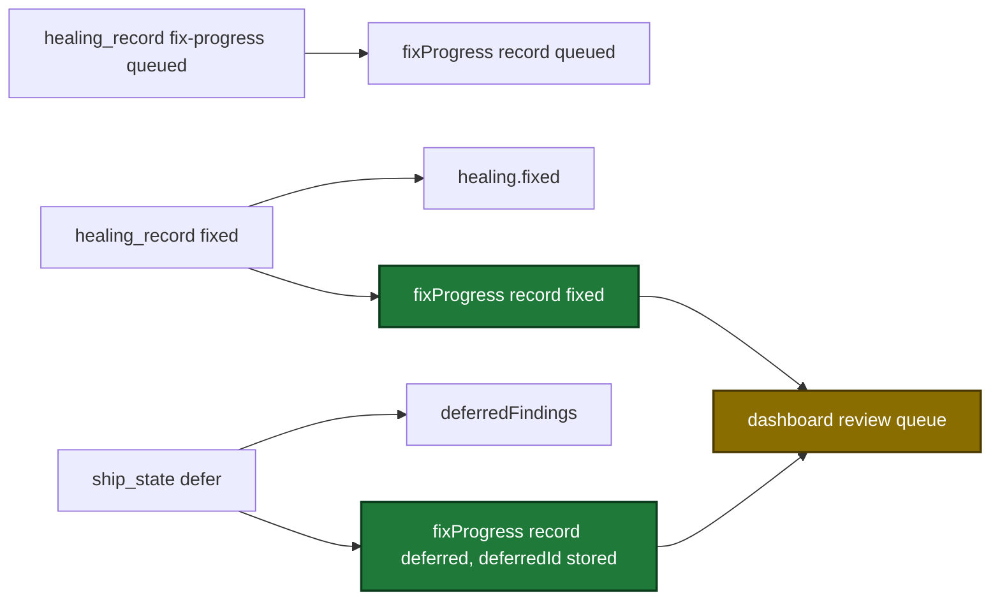

# Proposal

## Why

- Problem: the dashboard shows fixed findings as queued, and a second ship run on a branch deletes the state of an earlier completed run (issue #98).
- Evidence: the issue #98 run reports `88 fixed, 65 deferred`. The dashboard queue shows `0 of 158 fixed, 103 queued, 55 deferred`. The ship and execute state of the run of 2026-10-13 is gone.
- Why now: each new ship run of a branch hides the real fix result and deletes run history before GC can apply its age limit.

## What Changes

| Area | Before | After |
|---|---|---|
| `ship_state` `healing_record` kind `fixed` | appends to `healing.fixed` only | also sets the matching `healing.fixProgress` record to `fixed` |
| `ship_state` `defer` | writes `deferredFindings` only | also sets the matching `healing.fixProgress` record to `deferred` and copies `deferredId` onto it |
| `ship_state` `healing_record` `next` | only kind `fix-progress`, and kind `fixed` with `deferredId` | every kind returns `next` |
| Dashboard review queue | a deferred finding pairs with a fix record on the exact file, line and title | pairs on the same `deferredId`, else the exact file, line and title, else the only fix record on that file and line |
| State write of ship and execute runs | deletes every same-branch sibling, except a done plan run | also keeps a completed run that is not a dry-run, and a live run of another non-empty session id |
| `prunedOrphans` of `ship_prepare` and `ship_state` `init` | lists every older ship file of the branch | lists exactly the files that the write deletes |
| `plugins/sdlc/schemas/ship-state.schema.json` | a `fixProgress` item has no `deferredId` | optional `deferredId` |

Flow of one finding after the change:

## Capabilities

### New Capabilities

- (none)

### Modified Capabilities

- `tool-ship-state`: `healing_record` kind `fixed` sets the fix record and every kind returns `next`. `defer` sets the fix record. Legacy `init` keeps completed and other-session runs.
- `tool-ship-prepare`: state initialization keeps completed and other-session runs, and `prunedOrphans` lists exactly the deleted files.
- `tool-execute-state`: a state write keeps a completed run and a live run of another session.
- `pipeline-dashboard`: the review queue pairs a deferred finding with its fix record by `deferredId`, then by key, then by the only fix record on the file and line.

## Impact

| Path | Kind | Change |
|---|---|---|
| `internal/state/state.go` | MCP tool (internal package) | keep rule and `PruneTargets` |
| `internal/tools/ship.go` | MCP tool | `ship_prepare` uses `PruneTargets`, description |
| `internal/tools/ship_state.go` | MCP tool | `init`, `healing_record`, `defer`, descriptions |
| `internal/tools/execute_state.go` | MCP tool | `init` description |
| `internal/tools/dashboard_snapshot.go`, `internal/tools/dashboard_join.go`, `internal/tools/dashboard_review_queue.go` | MCP tool | queue pairing |
| `plugins/sdlc/schemas/ship-state.schema.json` | schema | optional `deferredId` on a `fixProgress` item |
| `internal/tools/scaffold_payloads_test.go` | CI | new pinned SHA-256 of the schema |
| `plugins/sdlc/skills/ship/state-format.md`, `plugins/sdlc/skills/ship/reference.md`, `plugins/sdlc/skills/ship/entry-modes.md` | doc | keep rule and fix-record updates |
| `docs/dashboard.md`, `docs/plan-architecture.md`, `docs/skills/received-review.md` | doc | keep rule, queue pairing, fix-record updates |
