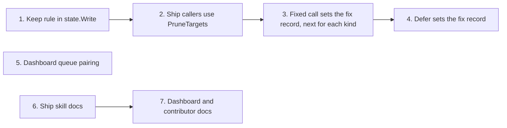

# Tasks

Task group dependencies:

## 1. Keep rule and prune-target list in state.Write

- [ ] 1.1 Add `PruneTargets`, `keepSibling`, `siblingMeta` and `siblingReadMax` in internal/state/state.go — verify: go test ./internal/state/ -run 'TestPruneTargets|TestKeepSibling' <!-- ref:1-1-add-prunetargets-keepsibling-sibling-de995e -->
- [ ] 1.2 Make `Write` delete only the `PruneTargets` set in internal/state/state.go — verify: go test ./internal/state/ -run 'TestWrite_|TestFind_LiveRunWinsOverKeptRun' <!-- ref:1-2-make-write-delete-only-the-prunetarg-c6ff96 -->
- [ ] 1.3 Add the keep, session, wrong-type, dry-run and readdir tests in internal/state/state_test.go — verify: go test ./internal/state/ <!-- ref:1-3-add-the-keep-session-wrong-type-dry-5e75a0 -->

## 2. Ship callers and tool descriptions use the shared prune-target list

- [ ] 2.1 Replace `existingShipStateFiles` with `state.PruneTargets` in internal/tools/ship.go and internal/tools/ship_state.go — verify: go build ./... and grep -rn existingShipStateFiles internal/ gives no match <!-- ref:2-1-replace-existingshipstatefiles-with-8e9ad2 -->
- [ ] 2.2 Update the `ship_prepare`, ship `init` and execute `init` descriptions in internal/tools/ship.go, internal/tools/ship_state.go and internal/tools/execute_state.go — verify: grep -c "It keeps a completed run" gives 1 or more for each file <!-- ref:2-2-update-the-ship-prepare-ship-init-an-734e1f -->
- [ ] 2.3 Extend the `prunedOrphans` fixture tests in internal/tools/ship_test.go and internal/tools/ship_state_test.go — verify: go test ./internal/tools/ -run 'TestShipPrepare_Prune|TestShipState_Init' <!-- ref:2-3-extend-the-prunedorphans-fixture-tes-ebccc0 -->

## 3. Fixed call sets the fix record, and next for each healing_record kind

- [ ] 3.1 Add `healingMatchFix`, `healingFixTransition` and `healingSetFixStatus` in internal/tools/ship_state.go — verify: go test ./internal/tools/ -run TestHealingMatchFix <!-- ref:3-1-add-healingmatchfix-healingfixtransi-3afdd1 -->
- [ ] 3.2 Call `healingSetFixStatus` from the `fixed` case and add `healingNarrRowFixed` in internal/tools/ship_state.go — verify: go test ./internal/tools/ -run 'TestShipStateHealingRecord_Fixed' <!-- ref:3-2-call-healingsetfixstatus-from-the-fi-39edd5 -->
- [ ] 3.3 Set `next` for every kind in `healingNarration` in internal/tools/ship_state.go — verify: go test ./internal/tools/ -run 'TestShipStateHealingRecord_KindNext|TestShipStateHealingRecord_EchoesRecord|TestShipStateHealingRecord_FixedWithoutDeferredIDNext' <!-- ref:3-3-set-next-for-every-kind-in-healingna-8f550c -->
- [ ] 3.4 Update the `healing_record` description and doc comments in internal/tools/ship_state.go — verify: go test ./internal/tools/ -run 'TestShipStateHealingRecord_FixProgress' <!-- ref:3-4-update-the-healing-record-descriptio-c99f6b -->

## 4. Defer call sets the fix record to deferred and stores the deferred id

- [ ] 4.1 Add `shipDeferSetFixRow` and call it before `state.Write` in internal/tools/ship_state.go — verify: go test ./internal/tools/ -run TestShipState_Defer <!-- ref:4-1-add-shipdefersetfixrow-and-call-it-b-56b18c -->
- [ ] 4.2 Add `deferredId` to the `fixProgress` item in plugins/sdlc/schemas/ship-state.schema.json and update the SHA-256 in internal/tools/scaffold_payloads_test.go — verify: go test ./internal/tools/ -run 'TestPayloads_SchemaChecksums|TestShipStateHealingRecord_Schema' <!-- ref:4-2-add-deferredid-to-the-fixprogress-it-e48051 -->
- [ ] 4.3 Update the `defer` description in internal/tools/ship_state.go — verify: go test ./internal/tools/ -run TestShipState_Defer <!-- ref:4-3-update-the-defer-description-in-inte-6ac5cb -->

## 5. Dashboard queue pairs a deferred entry with its fix record

- [ ] 5.1 Add `DeferredID` to `DashboardFix` in internal/tools/dashboard_snapshot.go and copy it in internal/tools/dashboard_join.go — verify: go test ./internal/tools/ -run 'TestDashboardJoin_FixCarriesDeferredID|TestDashboardFix_DeferredIDNotInJSON' <!-- ref:5-1-add-deferredid-to-dashboardfix-in-in-8b7bde -->
- [ ] 5.2 Pair by `deferredId`, key, then the only fix record on file and line in internal/tools/dashboard_review_queue.go — verify: go test ./internal/tools/ -run TestDashboardReviewQueue <!-- ref:5-2-pair-by-deferredid-key-then-the-only-44e25a -->

## 6. Ship skill docs for the keep rule and the fix-record updates

- [ ] 6.1 Update plugins/sdlc/skills/ship/state-format.md, plugins/sdlc/skills/ship/reference.md and plugins/sdlc/skills/ship/entry-modes.md — verify: go test ./internal/skillcheck/... ./internal/config/ <!-- ref:6-1-update-plugins-sdlc-skills-ship-stat-ff501a -->

## 7. Dashboard and contributor docs for the keep rule and the fix-record updates

- [ ] 7.1 Update docs/dashboard.md, docs/plan-architecture.md and docs/skills/received-review.md — verify: grep -rniE "prune-on-write|prunedOrphans|deletes? .*ship-" docs plugins/sdlc README.md gives the 10 expected hits <!-- ref:7-1-update-docs-dashboard-md-docs-plan-a-90c2a3 -->

## Workflow follow-up

- Run `task check`, then `task deploy`, then `/reload-plugins` before a manual tool call.
- /sdlc:ship archives the change after validation passes.
