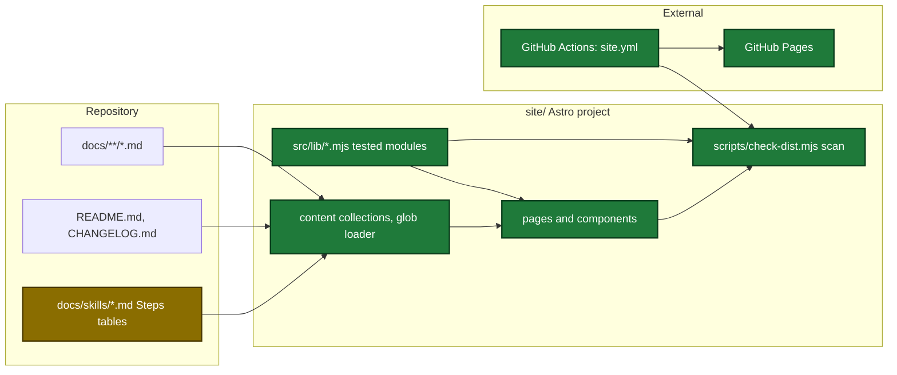
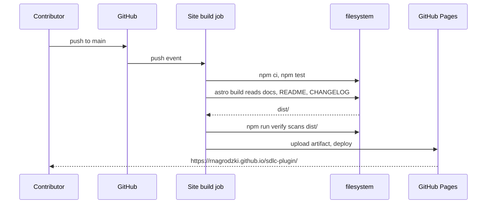

# Design

## Context

- Motivation: see proposal.md - Why.
- The repository has no Node project. CI uses Node 20 with `node --test` for release scripts.
- Docs pages have no front matter. The title is the first heading. Links are relative `.md` links.
- A workflow with a `paths:` filter cannot be a required check, because it does not report on other pull requests.
- The approved design reference lives in `docs/internal/site-design/` after the copy.

## Goals / Non-Goals

**Goals:**
- Keep one source of the docs text: the repository Markdown.
- Put every branch of site logic in `site/src/lib/*.mjs` modules with `node --test` tests.
- Stop the build on a broken link, a bad Steps table or an unknown asset.

**Non-Goals:**
- No search and no sidebar tree.
- No CI screenshots with a headless browser.
- No new review dimension for the site.
- No change to `go.mod` or `task check`.

The touched parts of the repository and how the site build reads them:



The main runtime flow, from a push to main to the published page:



The change adds no persisted runtime state. The data files `site/src/data/assets.json` and `site/src/data/step-times.json` change only by hand.

Data file shape (`site/src/data/assets.json` entry):

| Field | Type | Encoding | Example |
|---|---|---|---|
| `id` | string | plain text | `dashboard-main` |
| `kind` | string | `image` or `video` | `image` |
| `file` | string | repository path or `/media/` path | `src/assets/dashboard.png` |
| `version` | string | plugin version | `0.4.12` |
| `captured` | string | `YYYY-MM-DD` | `2026-11-13` |
| `alt`, `caption` | string | plain text | `The dashboard during a ship run` |

New plan guardrail in `.sdlc-v2/config.toml`:

```diff
+[plan.guardrails.feature-change-updates-site-pages]
+severity = "error"
+description = """A plan that adds, removes or changes a user-facing feature ... must include a task that updates ... site/src/data/features.mjs and the docs page ..."""
```

## Decisions

| Decision | Chosen | Rejected alternatives | Reason |
|---|---|---|---|
| Site tool | plain Astro 6 | Starlight | Starlight brings its own theme, which conflicts with the approved design |
| Docs source | glob loader from `../docs` | copies of the docs | one source of the text |
| Link checks | local remark plugin and a scan of `dist/` | a link package | stops the build on a broken link, adds no dependency |
| Diagrams | Mermaid in the browser, loaded only on pages with a block | build-time render with Playwright | CI has no browser, Home has no diagram |
| CI shape | one job with a change gate | a `paths:` filter | the check reports on every pull request and can be required |
| Lighthouse | median of 3 runs on `astro preview` | best run with `staticDistDir` | the preview serves the base path, the median is stable |
| Fonts | self-hosted Geist | Google Fonts | faster first paint, no visitor IP to Google |
| Steps tables | hand-written in the docs pages | generated from SKILL.md | SKILL.md step names are not parseable |
| Script logic | `site/src/lib/*.mjs` modules with tests | logic in `.astro` and `.ts` files | the guardrail `test-coverage-required` needs tests for each branch |

## Risks / Trade-offs

| Risk | Impact | Mitigation |
|---|---|---|
| A broken site build blocks merges | contributors | the build steps run only on site paths, releases do not wait for the check |
| Docs and site differ | readers | the site deploys on each push to `main`, the scan fails on a missing route |
| Claims do not match features | evaluators | each claim links a docs anchor, the scan fails on a missing anchor |
| Stale or private images | evaluators, maintainer | a version on each image, a review check, a capture checklist |
| Unstable Lighthouse score | contributors | median of 3 runs |
| Mermaid 12 API change | diagrams | `mermaid` stays on major 11; a move is a separate change |

## Migration Plan

- Before the first merge: the user sets the Pages source to GitHub Actions.
- After the first deploy: the user sets the repository homepage with the `rnagrodzki` account.
- After the first green run: the user marks `Site build` as a required check of `main`.
- Rollback: revert the merge. Pages keeps the last deploy until the next one.
