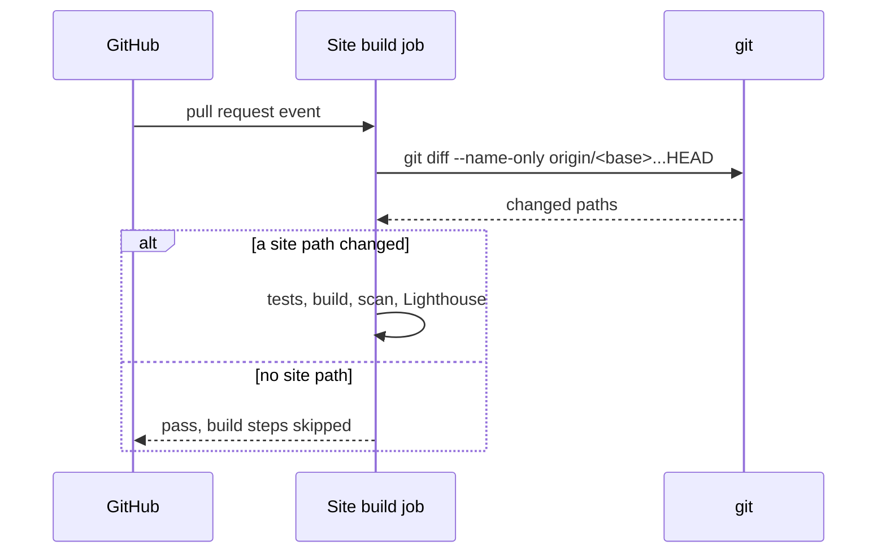

# Spec Delta

## Purpose

The CI check and the deploy of the public site. The check reports on every pull request, and a push to main publishes the site to GitHub Pages.

## ADDED Requirements

### Requirement: The site check reports on every pull request
The workflow `Site` SHALL run the job `Site build` on every pull request. It SHALL run tests, build, scan and Lighthouse only when a site path changes: `docs/**`, `README.md`, `site/**` or `.github/workflows/site.yml`.

#### Scenario: Go-only pull request
- **WHEN** a pull request changes only `internal/tools/plan.go`
- **THEN** `Site build` passes and the build steps show as skipped

#### Scenario: Docs pull request
- **WHEN** a pull request changes `docs/skills/ship.md`
- **THEN** `Site build` runs tests, build, scan and Lighthouse

#### Scenario: Lookalike path
- **WHEN** a pull request changes only `docsx/a.md`
- **THEN** the build steps are skipped

#### Scenario: git diff fails
- **WHEN** `git diff` fails in the change gate
- **THEN** `Site build` fails and does not report the site as unchanged

### Requirement: Deploy on push to main
The workflow SHALL build and deploy the site to GitHub Pages on each push to `main` and on a manual run on `main`. It SHALL NOT deploy from any other branch.

#### Scenario: Push to main
- **WHEN** a commit is pushed to `main`
- **THEN** the site is built, scanned and deployed to GitHub Pages

#### Scenario: Manual run on another branch
- **WHEN** the workflow runs by `workflow_dispatch` on a branch other than `main`
- **THEN** the site is built and not deployed

### Requirement: Lighthouse bar on Home
The pull request check SHALL fail when the median of 3 Lighthouse runs on Home is below 0.95 in performance, accessibility, best practices or SEO.

#### Scenario: Score below the bar
- **WHEN** the median accessibility score is 0.93
- **THEN** `Site build` fails
