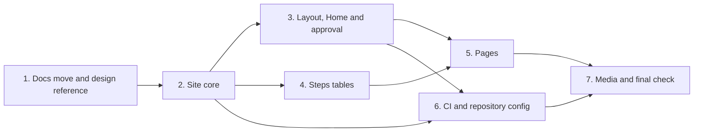

# Tasks

Task group dependencies (groups with no path between them can run in parallel):

## 1. Docs move and design reference

- [ ] 1.1 Copy the design reference into docs/internal/site-design/ — verify: shasum -a 256 -c matches, git status hides sdlc-site-looks.html <!-- ref:1-1-copy-the-design-reference-into-docs-3422a5 -->
- [ ] 1.2 Move the 5 internal pages and fix the docs links in docs/internal/ — verify: go test ./... <!-- ref:1-2-move-the-5-internal-pages-and-fix-th-f84432 -->
- [ ] 1.3 Update moved-doc path text in plugins/sdlc/ — verify: go test ./... <!-- ref:1-3-update-moved-doc-path-text-in-plugin-02d5d0 -->
- [ ] 1.4 Update moved-doc path text in AGENTS.md, openspec/ and .sdlc-v2/review-dimensions/ — verify: go test ./... and openspec validate --specs <!-- ref:1-4-update-moved-doc-path-text-in-agents-ac136d -->
- [ ] 1.5 Update moved-doc path text in Go comments in internal/ and tests/ — verify: go vet ./... and go test ./... <!-- ref:1-5-update-moved-doc-path-text-in-go-com-e04179 -->

## 2. Site core

- [ ] 2.1 Create the Astro scaffold in site/ — verify: cd site && bun install --frozen-lockfile && bunx astro build <!-- ref:2-1-create-the-astro-scaffold-in-site-ve-467df2 -->
- [ ] 2.2 Add the docs link rewrite in site/src/lib/doc-links.mjs — verify: node --test src/lib/doc-links.test.mjs <!-- ref:2-2-add-the-docs-link-rewrite-in-site-sr-134165 -->
- [ ] 2.3 Add the Steps table parser and step shares in site/src/lib/steps-table.mjs — verify: node --test src/lib/steps-table.test.mjs src/lib/timing.test.mjs <!-- ref:2-3-add-the-steps-table-parser-and-step-37529a -->
- [ ] 2.4 Add the output scan in site/src/lib/dist-check.mjs — verify: node --test src/lib/dist-check.test.mjs <!-- ref:2-4-add-the-output-scan-in-site-src-lib-e39d2e -->
- [ ] 2.5 Add the contrast check in site/src/lib/contrast.mjs — verify: node --test src/lib/contrast.test.mjs <!-- ref:2-5-add-the-contrast-check-in-site-src-l-174c4c -->
- [ ] 2.6 Build the design tokens in site/src/styles/tokens.css — verify: node --test src/lib/tokens.test.mjs <!-- ref:2-6-build-the-design-tokens-in-site-src-056b25 -->
- [ ] 2.7 Load docs, README and changelog as content in site/src/content.config.ts — verify: bunx astro build <!-- ref:2-7-load-docs-readme-and-changelog-as-co-9554bc -->

## 3. Layout, Home and approval

- [ ] 3.1 Build the base layout, nav and footer in site/src/layouts/BaseLayout.astro — verify: node --test src/lib/copy-command.test.mjs and bun run build <!-- ref:3-1-build-the-base-layout-nav-and-footer-e0b86e -->
- [ ] 3.2 Build the Home page in site/src/pages/index.astro — verify: node --test src/lib/assets.test.mjs and bun run build <!-- ref:3-2-build-the-home-page-in-site-src-page-cd8833 -->
- [ ] 3.3 Build the dashboard product page in site/src/pages/features/[slug].astro — verify: bun run build <!-- ref:3-3-build-the-dashboard-product-page-in-e347bd -->
- [ ] 3.4 Get the user approval of the look in the browser — verify: the user approves Home and the dashboard page at 1440px and 390px <!-- ref:3-4-get-the-user-approval-of-the-look-in-6c4bf0 -->

## 4. Steps tables

- [ ] 4.1 Add Steps tables to docs/skills/ship.md, plan.md, preplan.md and execute.md — verify: go test ./... and the scan filter for these routes <!-- ref:4-1-add-steps-tables-to-docs-skills-ship-2d3106 -->
- [ ] 4.2 Add Steps tables to docs/skills/commit.md, review.md, received-review.md, pr.md and verify-pipeline.md — verify: go test ./... and the scan filter for these routes <!-- ref:4-2-add-steps-tables-to-docs-skills-comm-564527 -->
- [ ] 4.3 Add Steps tables to docs/skills/harden.md, setup.md, dashboard.md, deferred.md and jira.md — verify: go test ./... and the scan filter for these routes <!-- ref:4-3-add-steps-tables-to-docs-skills-hard-941373 -->
- [ ] 4.4 Add the skill map, handovers and docs/skills/error-report.md — verify: go test ./... and the scan filter for these routes <!-- ref:4-4-add-the-skill-map-handovers-and-docs-5ee0a3 -->

## 5. Pages

- [ ] 5.1 Build the skill pages in site/src/pages/skills/[skill].astro — verify: node --test src/lib/sequence-state.test.mjs and bun run build <!-- ref:5-1-build-the-skill-pages-in-site-src-pa-c475c9 -->
- [ ] 5.2 Build the all-skills page in site/src/pages/skills/index.astro — verify: node --test src/lib/selection.test.mjs src/lib/loop-motion.test.mjs and bun run build <!-- ref:5-2-build-the-all-skills-page-in-site-sr-980a31 -->
- [ ] 5.3 Build the docs pages and release notes in site/src/pages/docs/ and site/src/pages/releases.astro — verify: node --test src/lib/mermaid-blocks.test.mjs and bun run build <!-- ref:5-3-build-the-docs-pages-and-release-not-a31923 -->
- [ ] 5.4 Add the other 3 product pages and screenshots in site/src/data/features.mjs — verify: bun run build and the user checks each screenshot <!-- ref:5-4-add-the-other-3-product-pages-and-sc-aee088 -->
- [ ] 5.5 Create the Open Graph image in site/public/og/default.png — verify: 1200x630 PNG of 300 KB or less <!-- ref:5-5-create-the-open-graph-image-in-site-d6d989 -->

## 6. CI and repository config

- [ ] 6.1 Add the site workflow in .github/workflows/site.yml — verify: node --test src/lib/site-paths.test.mjs and bunx lhci autorun <!-- ref:6-1-add-the-site-workflow-in-github-work-e28b9d -->
- [ ] 6.2 Add the plan guardrail in .sdlc-v2/config.toml — verify: validate action guardrails returns no finding <!-- ref:6-2-add-the-plan-guardrail-in-sdlc-v2-co-aa3c10 -->
- [ ] 6.3 Extend the documentation-review dimension in .sdlc-v2/review-dimensions/documentation-review.md — verify: validate action dimensions returns no finding <!-- ref:6-3-extend-the-documentation-review-dime-bf5d60 -->
- [ ] 6.4 Link the site in README.md and .claude-plugin/marketplace.json — verify: claude plugin validate . <!-- ref:6-4-link-the-site-in-readme-md-and-claud-3b8075 -->

## 7. Media and final check

- [ ] 7.1 Add the ship run recordings in site/public/media/ — verify: bun run build and the scan filter for broken-media <!-- ref:7-1-add-the-ship-run-recordings-in-site-daf13b -->
- [ ] 7.2 Verify the whole site in site/ — verify: task site:build, bunx lhci autorun, go test ./... and the old-path sweep return clean <!-- ref:7-2-verify-the-whole-site-in-site-verify-8ed00b -->

## Workflow follow-up

- The user sets the Pages source to GitHub Actions before the first merge.
- The user sets the repository homepage with the `rnagrodzki` account after the first deploy.
- The user marks `Site build` as a required check of `main` after the first green run.
- `/sdlc:ship` archives the change after validation passes.
