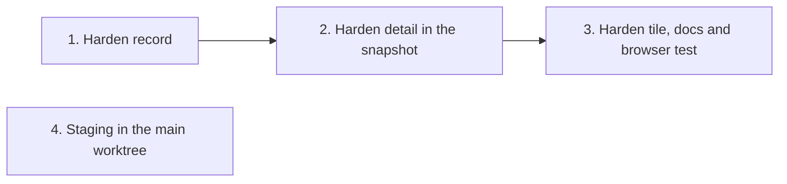

# Tasks

Task group dependencies; groups with no path between them can run in parallel.

## 1. Harden record

- [ ] 1.1 Store `rationale`, `patch` (cut at 1536 bytes with `patchCut`) and `held[]` in the `hardened` record, with the schema, the state-format doc and the Suggestions (plan Task 1), in internal/tools/ship_state.go — verify: `go test ./internal/tools/ -run 'TestShipStateHealingRecord|TestShipStateReport|TestPayloads_SchemaChecksums'` <!-- ref:1-1-store-rationale-patch-cut-at-1536-by-49190d -->
- [ ] 1.2 Send `rationale`, the written patch (`writtenPatch`) and `held[]` from harden step 5e, and add the Ship state record section to docs/skills/harden.md (plan Task 2), in plugins/sdlc/skills/harden/SKILL.md — verify: `go test ./internal/skillcheck/` <!-- ref:1-2-send-rationale-the-written-patch-wri-7ca84f -->

## 2. Harden detail in the snapshot

- [ ] 2.1 Add the mapper `hardenFindingsFromShip` from ship state to cluster findings (plan Task 3), in internal/tools/ship_harden_clusters.go — verify: `go test ./internal/tools/ -run TestHardenFindingsFromShip` <!-- ref:2-1-add-the-mapper-hardenfindingsfromshi-168a84 -->
- [ ] 2.2 Build the `harden` step detail with its limits, labels and issues, and attach it in `dashboardShipDetail` (plan Task 4), in internal/tools/dashboard_harden.go — verify: `go test ./internal/tools/ -run 'TestDashboardHarden_'` <!-- ref:2-2-build-the-harden-step-detail-with-it-809fdf -->
- [ ] 2.3 Add a full harden detail to the `identity-service` harden step and `harden` to `dashboardKinds` (plan Task 5), in internal/dashboard/web/testdata/snapshot.fixture.json — verify: `go test ./internal/tools/ -run 'TestDashboardFixture|TestDashboardContract'` <!-- ref:2-3-add-a-full-harden-detail-to-the-iden-fe4549 -->

## 3. Harden tile, docs and browser test

- [ ] 3.1 Port the harden tile from the draft with `sectionMeta`, `isWideSection` and the guard test on `view.js` (plan Task 6), in internal/dashboard/web/static/render.js — verify: `node --test internal/dashboard/web/testdata/view.test.cjs && go test ./internal/dashboard/web/` <!-- ref:3-1-port-the-harden-tile-from-the-draft-bf5932 -->
- [ ] 3.2 Document the harden tile, the `steps[].detail.harden` row, its issues and the old record form (plan Task 7), in docs/dashboard.md — verify: `grep -n 'steps\[\].detail.harden' docs/dashboard.md` gives one row <!-- ref:3-2-document-the-harden-tile-the-steps-d-319889 -->
- [ ] 3.3 Add `TestBrowserE2E_HardenTile` with the seed `browserSeedHardenShip` (plan Task 8), in internal/dashboard/web/browser_e2e_test.go — verify: `go test -tags integration ./internal/dashboard/web/ -run 'TestBrowserE2E'` <!-- ref:3-3-add-testbrowsere2e-hardentile-with-t-897160 -->

## 4. Staging in the main worktree

- [ ] 4.1 Make `Stage` and `Materialize` take a staging root with the fallback read, and pass the main root from every caller (plan Task 9), in internal/openspec/materialize.go — verify: `go test ./internal/openspec/ ./internal/tools/` <!-- ref:4-1-make-stage-and-materialize-take-a-st-ee0850 -->
- [ ] 4.2 Resolve the main root in `openspec_save` through `openspecSaveRoots` and update the stage descriptions and the Suggestion (plan Task 10), in internal/tools/openspec_save.go — verify: `go test ./internal/tools/ -run 'TestOpenspecStaging|TestOpenspecSave|TestPlanSupport|TestExecuteInitMaterialize|TestShipPrepareMaterialize'` <!-- ref:4-2-resolve-the-main-root-in-openspec-sa-e1b028 -->
- [ ] 4.3 Update the skill and doc texts to the main-worktree staging dir and the `<MAIN_ROOT>` rule (plan Task 11), in plugins/sdlc/skills/plan/SKILL.md — verify: `go test ./internal/skillcheck/ ./internal/paths/` and `grep -rn "active-worktree>/.sdlc-v2/openspec-staging" plugins docs internal` gives no hit <!-- ref:4-3-update-the-skill-and-doc-texts-to-th-1d09a5 -->

## Workflow follow-up

- Run `task check` and `node --test internal/dashboard/web/testdata/view.test.cjs` on the whole branch.
- Archive the change through `/sdlc:ship`, not `openspec archive`.
