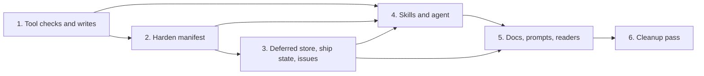

# Tasks

Group dependencies:

## 1. Tool checks and writes

- [ ] 1.1 Add `scopeIds`, `remove` candidates, dimensions `file` scope and `guardrailDescMaxBytes` in internal/tools/validators.go — verify: go test ./internal/tools/ -run TestValidate <!-- ref:1-1-add-scopeids-remove-candidates-dimen-27ee7d -->
- [ ] 1.2 Delete a guardrail table on a JSON null in internal/tools/setup_write.go and internal/config/splice.go — verify: go test ./internal/tools/ ./internal/config/ -run 'TestSetupWrite|TestSplice' <!-- ref:1-2-delete-a-guardrail-table-on-a-json-n-37db30 -->

## 2. Harden manifest

- [ ] 2.1 Write pre-flight findings to the harden manifest in internal/tools/harden.go and internal/tools/guardrails.go — verify: go test ./internal/tools/ -run 'TestHardenPrepare|TestPrepareOrchestrator' <!-- ref:2-1-write-pre-flight-findings-to-the-har-4a222c -->
- [ ] 2.2 Add `ToolNames` and `ToolActions` in internal/mcpserver/register.go — verify: go test ./internal/mcpserver/ <!-- ref:2-2-add-toolnames-and-toolactions-in-int-08877c -->
- [ ] 2.3 Add the dead-reference scan in internal/tools/harden_deadrefs.go — verify: go test ./internal/tools/ -run 'TestHardenDeadRefs|TestHardenPrepare' <!-- ref:2-3-add-the-dead-reference-scan-in-inter-b9fd36 -->

## 3. Deferred store, ship state, issues

- [ ] 3.1 Add `MergeOrAddDeferred`, the 8 MiB bound and the atomic write in internal/history/history.go — verify: go test ./internal/history/ ./internal/tools/ -run 'TestDeferred|TestShipStateDefer' <!-- ref:3-1-add-mergeoradddeferred-the-8-mib-bou-8205ee -->
- [ ] 3.2 Store `deferredId` and `fixedInRun` in internal/tools/ship_state.go and plugins/sdlc/schemas/ship-state.schema.json — verify: task check <!-- ref:3-2-store-deferredid-and-fixedinrun-in-i-b3ba80 -->
- [ ] 3.3 Split fix-now findings in internal/tools/ship_harden_clusters.go — verify: go test ./internal/tools/ -run TestShipStateHardenClusters <!-- ref:3-3-split-fix-now-findings-in-internal-t-8019bd -->
- [ ] 3.4 Return `similarIssues` in internal/tools/error_report.go and internal/ghx/ghx.go — verify: go test ./internal/tools/ ./internal/ghx/ -run 'TestErrorReport|TestIssueList' <!-- ref:3-4-return-similarissues-in-internal-too-b4b74a -->

## 4. Skills and agent

- [ ] 4.1 Add actions, the generic-rule gate and model sonnet in plugins/sdlc/agents/harden-orchestrator.md — verify: go test ./internal/skillcheck/... <!-- ref:4-1-add-actions-the-generic-rule-gate-an-c357a3 -->
- [ ] 4.2 Add repairs, removals, the --auto table and pending items in plugins/sdlc/skills/harden/SKILL.md — verify: go test ./internal/skillcheck/... <!-- ref:4-2-add-repairs-removals-the-auto-table-9e5cbd -->
- [ ] 4.3 Record fix-pass fixes by deferred id in plugins/sdlc/skills/received-review/SKILL.md — verify: go test ./internal/skillcheck/... <!-- ref:4-3-record-fix-pass-fixes-by-deferred-id-3e31fd -->
- [ ] 4.4 Add the fix pass to the harden step in plugins/sdlc/skills/ship/SKILL.md — verify: go test ./internal/skillcheck/... <!-- ref:4-4-add-the-fix-pass-to-the-harden-step-b44591 -->
- [ ] 4.5 Read `similarIssues` in error-report Step 6b in plugins/sdlc/skills/error-report/SKILL.md — verify: go test ./internal/skillcheck/... <!-- ref:4-5-read-similarissues-in-error-report-s-5803b5 -->
- [ ] 4.6 Add the harden-pending branch in plugins/sdlc/skills/deferred/reference.md — verify: go test ./internal/skillcheck/... <!-- ref:4-6-add-the-harden-pending-branch-in-plu-d24fb2 -->

## 5. Docs, prompts, readers

- [ ] 5.1 Update harden, ship, received-review and dashboard docs in docs/skills/ and docs/dashboard.md — verify: grep -rin 'strengthen-only' docs/skills/harden.md docs/skills/ship.md docs/skills/received-review.md gives 0 hits <!-- ref:5-1-update-harden-ship-received-review-a-5c22af -->
- [ ] 5.2 Update the harden config description and the G17 prompt in plugins/sdlc/schemas/sdlc-config.schema.json and plugins/sdlc/skills/plan/g17-dimension-coverage-prompt.md — verify: task check <!-- ref:5-2-update-the-harden-config-description-2dbc1c -->
- [ ] 5.3 Skip `fixedInRun` entries in every reader in internal/tools/ship.go, internal/tools/ship_report.go and internal/tools/execute_state.go — verify: task check <!-- ref:5-3-skip-fixedinrun-entries-in-every-rea-ad7af0 -->

## 6. Cleanup pass

- [ ] 6.1 Record the deferred item harden-cleanup-pass with ship_state deferred_add — verify: ship_state deferred_list shows harden-cleanup-pass open <!-- ref:6-1-record-the-deferred-item-harden-clea-b55eff -->

## Workflow follow-up

- After release, run the harden cleanup pass from the deferred item harden-cleanup-pass, then resolve it.
- After archive, change the strengthen-only sentence in the Purpose of openspec/specs/skill-harden/spec.md.
