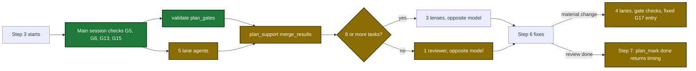

# Proposal: plan-verification-speed

## Why

- Problem: a `/sdlc:plan` run is slow. The median of the last 5 runs is 163 minutes (99, 157, 163, 165, 271).
- Evidence: Step 3 starts 6 lane agents, and some lanes only count and look up facts that Go can compute (`.sdlc-v2/preplan/2026-10-23-plan-verification-speed.md`). The run history keeps no time for each step (`.sdlc-v2/history/runs.jsonl`).
- Why now: long runs reach context compaction. The developer waits 1.5 to 4.5 hours before execute can start.

## What Changes

| Area | Before | After |
|---|---|---|
| Count and lookup gates G3, G4, G8, G9, G10, G12 | lane agents judge them | the new `validate` action `plan_gates` checks them |
| G18 floor (a Contract with no code block, table or diagram) | the `content-coverage` lane | `plan_gates` reports it. The lane keeps the G18 judgement. |
| `file-existence` lane | one of 6 lanes | removed. `plan_prepare` returns 5 lanes. |
| Warning gates G5, G6, G13, G15 | the `content-coverage` lane | the main session checks them inline, before the lane dispatch |
| `plan_prepare` output | `lanes`, `lensReviewers` | also `gateChecks`: the `go-gates` and `inline-checks` entries |
| G17 lane in round 2 and later | starts again on a material change | does not start. A fixed G17 entry with no issues goes to `merge_results`. |
| Step 5 reviewers | 3 lenses at 5 or more tasks, else 1 reviewer on any model | 3 lenses at 8 or more tasks, else 1 reviewer on the opposite model |
| Evidence writer file | `updatedAt` only | also `startedAt`, the time of the first write |
| Plan state | no step times | top-level `stepTimes` list, 64 entries or fewer |
| `plan_mark` `done` | no `next`, no timing | returns `timing` (the report) and `next` |
| Plan file read | no size limit | `plan_format`, `plan_style` and `plan_gates` refuse a file over 8 MiB |

## Capabilities

### New Capabilities

None.

### Modified Capabilities

- `skill-plan`: Step 3 runs 5 lanes, the `plan_gates` call and the inline check. Round 2 and later skip the G17 lane. The lens limit is 8 tasks. Step 7 prints the timing report.
- `tool-plan-prepare`: the `file-existence` lane goes away, and the output gets `gateChecks`.
- `tool-validate`: the new `plan_gates` action and the 8 MiB plan read limit.
- `tool-plan-mark`: `checkpoint` records `stepTimes`, and `done` returns `timing` and `next`.
- `tool-plan-support`: `evidence_record` stamps `startedAt` on the first write of a writer.

## Flow after the change

Step 3 to Step 7 of a plan run after the change, with new and changed steps marked:

## Impact

| Path | Kind | Change |
|---|---|---|
| `internal/tools/plan_gates.go` | MCP tool | new: the `plan_gates` checks |
| `internal/tools/validators.go` | MCP tool | action enum, dispatch, active root, shared Verify check, 8 MiB read limit |
| `internal/tools/execute_waves.go` | MCP tool | uses the shared Files parser |
| `internal/tools/plan.go` | MCP tool | 5 lanes, `gateChecks`, `stepTimes`, `done` timing |
| `internal/tools/plan_timing.go` | MCP tool | new: step times and the timing report |
| `internal/tools/plan_evidence.go` | MCP tool | writer `startedAt` |
| `internal/tools/plan_support.go` | MCP tool | `evidence_record` description |
| `plugins/sdlc/skills/plan/SKILL.md` | skill | Steps 1, 3, 4, 5, 7 |
| `plugins/sdlc/skills/plan/lane-file-existence-prompt.md` | skill | deleted |
| `plugins/sdlc/skills/plan/lane-static-structural-prompt.md`, `lane-content-coverage-prompt.md` | skill | shorter gate lists |
| `plugins/sdlc/skills/plan/plan-reviewer-prompt.md`, `lens-*-prompt.md` | skill | 8-task limit, opposite model |
| `internal/skillcheck/skillcheck_plan_test.go` | CI | prompt hash pins |
| `plugins/sdlc/skills/plan/state-format.md` | doc | `stepTimes`, `startedAt` |
| `docs/plan-architecture.md`, `docs/skills/plan.md` | doc | lanes, gate checks, limits, timing report |
