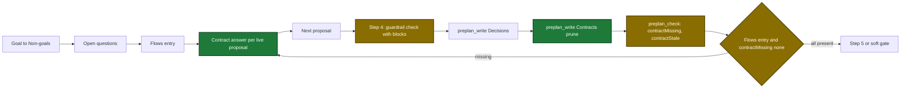

# Proposal

## Why

- Problem: a preplan topic file records no contract shapes (URL, payload, field list, config key). The reviewer cannot judge the approach before `/sdlc:plan` starts.
- Evidence: 0 of the 7 topic file sections hold a contract shape (`preplanSections` in `internal/tools/plan_support.go`). The plan topic block names no Contracts section (`plugins/sdlc/skills/plan/SKILL.md:338-352`).
- Why now: the user finds this gap in each topic file review where a proposal adds an endpoint or a config key.

## What Changes

| Area | Before | After |
|---|---|---|
| Topic file skeleton | 7 sections | 8 sections: `## Contracts` between `## Flows` and `## Decisions` |
| `preplan_context` repair | adds the 7 skeleton headings | adds the 8 skeleton headings, `## Contracts` included |
| `preplan_write` | refuses the section name `Contracts` | accepts `Contracts`. Rule P12 checks the body form |
| `preplan_check` output | `emptySections` | also `contractMissing` and `contractStale` |
| preplan Step 3 | no contract question | asks one contract answer for each live proposal |
| preplan Step 4 | route to the handoff needs a `## Flows` entry | also prunes `## Contracts`, and the route needs `contractMissing` = `(none)` |
| `/sdlc:plan` | drops the topic contracts | each live block gives a Key Decisions bullet and an R-item. The task copies the shape |
| `/sdlc:verify-requirements` | reads no contract | each live block is one requirement statement |
| Docs | 7 sections, rules P1-P11 | 8 sections, rules P1-P12 |

Preplan dialogue and Step 4 after the change:

## Capabilities

### New Capabilities

- None.

### Modified Capabilities

- `tool-plan-support`: 8-section skeleton and repair, rule P12 for `## Contracts`, and the `preplan_check` fields `contractMissing` and `contractStale`.
- `skill-preplan`: the contract question, the block forms, the guardrail check with blocks, the Step 4 write order and prune, and the contract gate before the handoff.
- `skill-plan`: topic contracts give Key Decisions bullets and R-items, and bind the task Contract shapes.
- `skill-verify-requirements`: each live contract block is a requirement statement.

## Impact

| Path | Kind | Change |
|---|---|---|
| `internal/tools/plan_support.go` | MCP tool | section list, field descriptions, `contractMissing`, `contractStale`, `next` text |
| `internal/tools/preplan_format.go` | MCP tool | rule P12, label and no-contract patterns |
| `internal/tools/preplan_format_test.go`, `internal/tools/plan_support_test.go`, `internal/tools/plan_support_write_integration_test.go`, `internal/tools/verify_requirements_context_test.go`, `internal/tools/dashboard_preplans_test.go`, `tests/integration/preplan_context_test.go` | MCP tool | P12 cases, contract gap cases, 8-section fixtures |
| `plugins/sdlc/skills/preplan/SKILL.md` | skill | contract question, Contracts rule, Step 4 prune and route |
| `plugins/sdlc/skills/plan/SKILL.md`, `internal/skillcheck/skillcheck_plan_test.go` | skill | Contracts bullet of the topic file block and its pin |
| `plugins/sdlc/skills/verify-requirements/SKILL.md`, `internal/skillcheck/skillcheck_verify_requirements_test.go` | skill | contract statements and their pin |
| `docs/skills/preplan/topic-file.md`, `docs/skills/preplan/dialogue.md`, `docs/skills/preplan.md`, `docs/skills/plan/topic-file.md`, `docs/skills/verify-requirements/checks.md` | doc | 8 sections, P12, contract answer |
| `.claude/skills/dashboard-design/SKILL.md` | skill | one mapping row for `## Contracts` |
| `internal/dashboard/web/browser_e2e_test.go` | doc | comment `P1 to P12` |

- No schema, template, CI, `site/` or changelog change.
