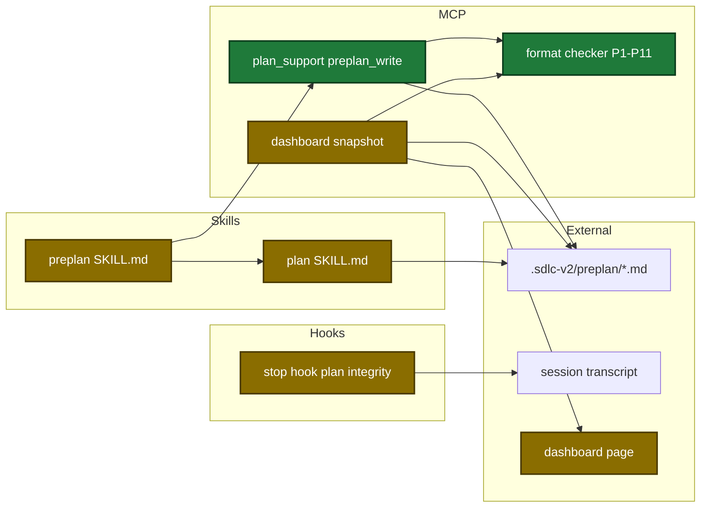
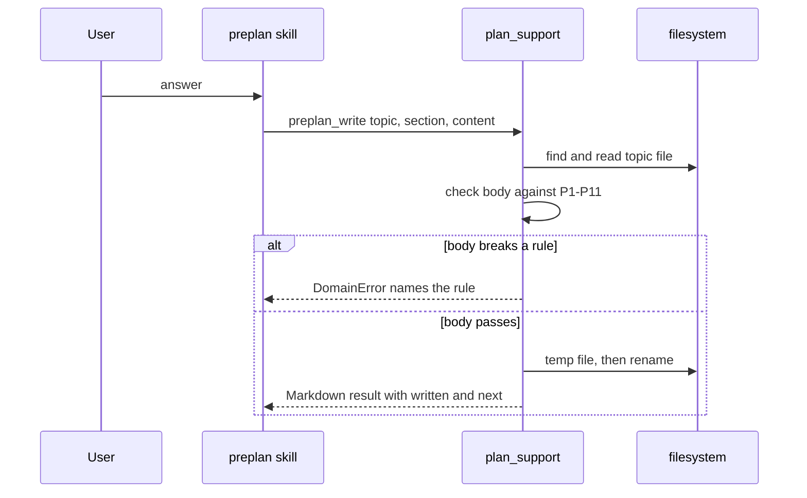
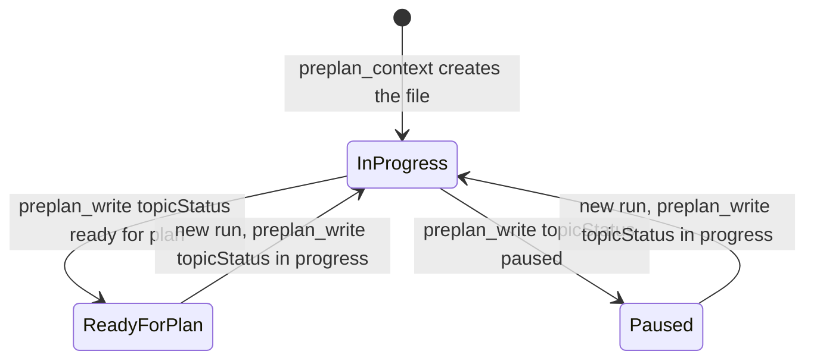

# Design

## Context

- See proposal.md - Why.
- `plan_support` is `ReadOnly:true` under the documented plan-tools exception, so plan mode permits its writes (`docs/mcp-tool-annotations.md:19`).
- `preplan_context` and `preplan_check` already find, read and write the topic file through one path (`internal/tools/plan_support.go:2077`, `:2189`, `:1990`).
- The dashboard collector reads only a 4 KiB head of each topic file (`internal/tools/dashboard_preplans.go:55`).
- The stop hook reads a 64 KiB transcript tail. The preplan command record is near the start of the transcript.

## Goals / Non-Goals

**Goals:**

- One format checker serves the write action and the dashboard summary.
- No skill step needs a file edit of the topic file.

**Non-Goals:**

- No change to the 4 KiB head read, the Preplans tab or the status route.
- No full topic-file viewer in the dashboard.

## Architecture

Touched parts and their links:

Main runtime flow of one answer:

Topic file status (persisted in the Status line):

## Data contracts

`PlanSupportIn` and `PlanSupportOut` additions:

| Field | Type | Encoding | Example |
|---|---|---|---|
| `section` | string | plain text, one of 9 section names | `Decisions` |
| `content` | string | Markdown, at most 65536 bytes | `- Who owns the cut?` |
| `topicStatus` | string | enum `in progress`, `ready for plan`, `paused` | `ready for plan` |
| `written` | list of string | section name and/or `Status`, `(none)` when empty | `Decisions` |
| `readyTopicFiles` | list of string | absolute paths, this file first, at most 4 | `/repo/.sdlc-v2/preplan/2026-10-29-a.md` |
| `readyLeftOut` | int | count of ready files not listed | `2` |

`DashboardPreplan` additions:

| Field | Type | Encoding | Example |
|---|---|---|---|
| `goal` | string | first Goal sentence, redacted, 120 runes | `Start the dashboard at login.` |
| `live`, `kept`, `dropped` | int | Decisions row counts | `3`, `1`, `1` |
| `lastCheckAt` | string | RFC 3339 UTC, `""` when unread | `2026-10-29T07:58:25Z` |
| `openQuestions` | int | bullet count | `1` |
| `gaps` | list of string | empty sections, `[]` when none | `["Flows"]` |
| `smallestCut` | string | `set` or `not set` | `set` |
| `unread` | list of string | field names that failed the check | `["lastCheck"]` |

## Decisions

| Decision | Chosen | Rejected alternatives | Reason |
|---|---|---|---|
| Write unit | full body of one section for each call | line patches, row edits | one call shape covers nine edit kinds, and a repeated call gives the same file |
| Checker owner | one Go checker for write and summary | separate rules in the skill text | a dashboard field shows a value only when its section passes the same rules |
| Status field | new `topicStatus` field | reuse `status` | `status` already has the enum `running, done` for `evidence_record` |
| Summary read | separate 256 KiB read after the 4 KiB head | raise the head limit | the status writer and `preplan_check` keep the 4 KiB head |
| Stop hook skip | scan the whole transcript up to 64 MiB for the preplan record | per-turn session state | no hook state for preplan exists, and one sequential read fits the 3000 ms timeout |
| Ready list | `preplan_write` returns it with `ready for plan` | skill lists the folder | deterministic file work belongs in the tool |
| Handoff pick | current file first, at most 4 | all ready files | AskUserQuestion allows 4 options at most |
| Missing Status line | `preplan_write` inserts it | DataError as in the dashboard writer | in plan mode the skill cannot add the line with a file edit |

## Risks / Trade-offs

| Risk | Impact | Mitigation |
|---|---|---|
| The checker refuses a valid body | the user loses an answer, or the skill stops | each rule has a pass and a fail test; the error names the rule; 3 refusals go to the cancel step, which keeps the file |
| A summary field shows wrong content | the user picks the wrong topic file | a field shows a value only when its section passes the checker; otherwise it shows `unreadable` |
| A transcript scan hides a real warning | gates bypass is not reported | a read error counts as no preplan, so the warning shows |
| A large transcript slows the hook | the stop hook times out | the scan stops at 64 MiB; a benchmark records the time |
| Merge of several topic files misses a requirement | the plan is incomplete | R-items are numbered across files; each conflict gets one question |
