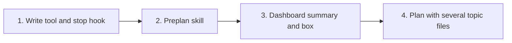

# Tasks

Group dependencies:

## 1. Write tool and stop hook

- [ ] 1.1 Add the topic-file format checker P1-P11 and the summary parsers in internal/tools/preplan_format.go — verify: go test ./internal/tools/ -run 'TestPreplanFormat|TestPreplanFenceStep' -v <!-- ref:1-1-add-the-topic-file-format-checker-p1-8c6fdf -->
- [ ] 1.2 Add the preplan_write action, its fields, errors, next texts and ready list in internal/tools/preplan_write.go and internal/tools/plan_support.go — verify: go test ./internal/tools/ -run 'TestPlanSupportPreplanWrite|TestPreplanContextCheckParity|TestPreplanToolDescription|TestPreplanWriteFieldDescriptions|TestUnknownAction_NamesBinaryAndAdvisesUpdate' -v <!-- ref:1-2-add-the-preplan-write-action-its-fie-32b026 -->
- [ ] 1.3 Skip the plan-integrity warning for a preplan session in internal/hooks/stop_hooks.go and update docs/plan-architecture.md and plugins/sdlc/skills/plan/state-format.md — verify: go test ./internal/hooks/ -run 'TestStopPlanIntegrity_Preplan|TestTranscriptHasPreplan' -v <!-- ref:1-3-skip-the-plan-integrity-warning-for-382e5b -->
- [ ] 1.4 Wire preplan_write into internal/tools/annotations_test.go, docs/mcp-tool-annotations.md, docs/plan-architecture.md and tests/integration/preplan_context_test.go — verify: go test -tags integration ./tests/integration/ -run TestMCPStdio_PreplanWrite <!-- ref:1-4-wire-preplan-write-into-internal-too-74c1c7 -->

## 2. Preplan skill

- [ ] 2.1 Replace every topic-file edit with a plan_support call and add the three-option handoff in plugins/sdlc/skills/preplan/SKILL.md, internal/skillcheck/skillcheck_preplan_test.go and docs/skills/preplan.md — verify: go test ./internal/skillcheck/... -run TestPreplanSkillNoFileEdits -v <!-- ref:2-1-replace-every-topic-file-edit-with-a-569fa4 -->

## 3. Dashboard summary and box

- [ ] 3.1 Add the summary pass and the 9 row fields in internal/tools/dashboard_preplans.go, internal/tools/dashboard_snapshot.go and internal/dashboard/web/testdata/snapshot.fixture.json — verify: go test ./internal/tools/ -run TestDashboardPreplanSummaries -v <!-- ref:3-1-add-the-summary-pass-and-the-9-row-f-9b84eb -->
- [ ] 3.2 Add the Activity tab Preplans box in internal/dashboard/web/static/view.js, render.js and app.css — verify: node --test internal/dashboard/web/testdata/view.test.cjs <!-- ref:3-2-add-the-activity-tab-preplans-box-in-3589fc -->
- [ ] 3.3 Add the browser steps A1-A3 for the box in internal/dashboard/web/browser_e2e_test.go — verify: go test -tags integration ./internal/dashboard/web/ -run TestBrowserE2E -v <!-- ref:3-3-add-the-browser-steps-a1-a3-for-the-7637b6 -->
- [ ] 3.4 Document the summary fields, warnings and box in docs/dashboard.md and docs/skills/dashboard.md — verify: grep -n "The collector reads the first 4 KiB of each file." docs/dashboard.md finds no line <!-- ref:3-4-document-the-summary-fields-warnings-6e56f9 -->

## 4. Plan with several topic files

- [ ] 4.1 Accept two or more preplan topic files in plugins/sdlc/skills/plan/SKILL.md, docs/skills/plan.md, internal/skillcheck/skillcheck_plan_test.go and internal/tools/plan_test.go — verify: go test ./internal/skillcheck/... && go test ./internal/tools/ -run TestOpenspecSourceChangeFromPlan -v <!-- ref:4-1-accept-two-or-more-preplan-topic-fil-94ce7e -->
