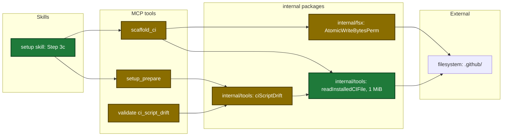
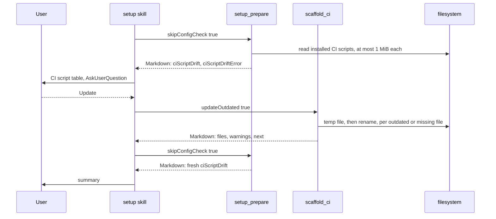

# Design

## Context

- Motivation: see proposal.md - Why.
- The drift data, the write code and an atomic write helper already exist (`internal/tools/scaffold.go:125-235`, `internal/fsx/fsx.go:24-45`).
- `scaffold_ci`, `setup_prepare` and `validate` share one read of each installed CI file (`scaffoldEntryVersions`).
- `setup_write_sections` calls `scaffoldCI(root, false)` and must not change (`internal/tools/setup_write.go:713-718`).
- The setup skill keeps no state between calls. Step 3b already calls `setup_prepare` again after a write.

## Goals / Non-Goals

**Goals:**
- One new tool mode that never rewrites a current CI script.
- One consent point in `/setup` before any CI file write.
- The same outcome for one file state in all three readers.

**Non-Goals:**
- No backup of overwritten files. Git keeps the old version of each committed file.
- No content compare. "Current" means the version marker (user choice).
- No new setup flag. No change to the `setup_write_sections` call.
- No persisted state change. A state diagram therefore does not apply.

## Architecture

The touched parts and their calls:

## Runtime flow

The main runtime flow of an update from `/setup`:

## Data contracts

| Field | Type | Encoding | Example |
|---|---|---|---|
| `ScaffoldCIIn.updateOutdated` (new) | bool | JSON boolean, optional, default `false` | `true` |
| `ScaffoldCIIn.force` (description changed) | bool | JSON boolean, optional, default `false` | `false` |
| `SetupPrepareOut.ciScriptDriftError` (new) | string | plain text, omitted when empty | `check installed version of CI script .github/workflows/release-on-main.yml: ... The installed file is larger than 1 MiB, ...` |

## Decisions

| Decision | Chosen | Rejected alternatives | Reason |
|---|---|---|---|
| Update scope | New input `updateOutdated` | Reuse `force: true` | `force` rewrites all 8 CI scripts and loses edits in current ones |
| Trigger | Ask when a CI script is outdated or missing | Outdated only | User choice |
| Both inputs true | `DomainError`, nothing read or written | Use one input and ignore the other | Two overwrite rules in one call have no clear meaning |
| Test hook | `scaffoldCIWith(root, opts, execRun)`. `scaffoldCI` stays as a wrapper. | Change every caller | `setup_write_sections` stays unchanged. Tests pass a fake exec function. |
| Check after an update | `setup_prepare` again | Trust `files[]` or a flag set by the skill | The update step must not grade its own result |
| Write method | Temp file plus rename for every write | `os.WriteFile` | A failed write keeps the old file |
| Read limit | 1 MiB per installed file, `DataError` above it | No limit | The largest bundled file is 36421 bytes |
| Size error in three readers | One helper inside the shared read | A mapping in each reader | One outcome and one text for all readers |
| Drift check error | `ciScriptDriftError` field in `setup_prepare` | Keep `[]` with no error | An empty list with no error looks like "all current" |

## Risks / Trade-offs

| Risk | Impact | Mitigation |
|---|---|---|
| Update loses local edits in an outdated script | User work lost | Step 3c says so before it asks. Git keeps each committed file. |
| A failed migration write leaves neither the `.js` nor the `.cjs` file | Release workflow breaks until the next run | Same order as `force` today. The next run creates the missing file. |
| The atomic rename replaces a symlink with a regular file | A linked CI script stops following its target | Stated in the plan parity table. CI scripts are rarely links. |
| The question shows on each run in a project without release CI | Extra question | The user picks Skip. User choice. |
| An installed CI file above 1 MiB now fails `force` too | `force` no longer overwrites that file | The DataError Suggestion says to restore or delete it. |
