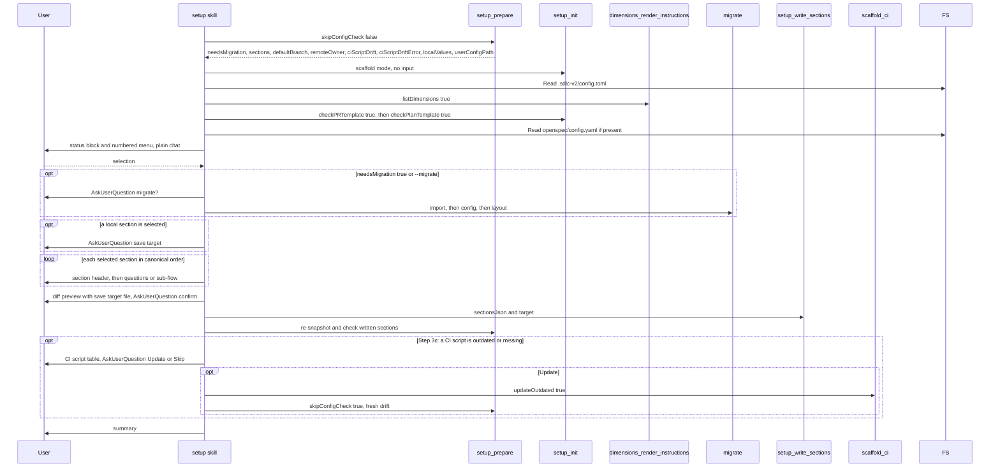
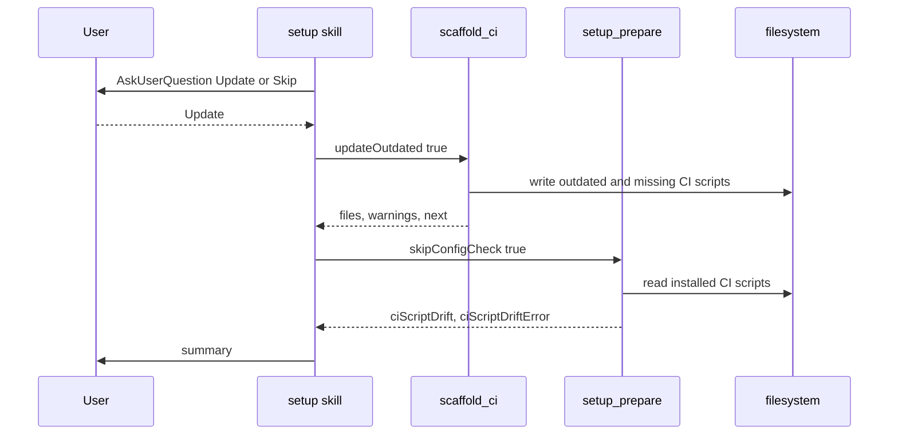

# Spec Delta

## MODIFIED Requirements

### Requirement: Main flow and pre-flight order
The skill SHALL call `setup_prepare({ skipConfigCheck: false })` first, then `setup_init({})` once, then take a config snapshot, before it shows the menu or asks any question.

Main `/setup` flow without direct-entry flags:

Snapshot contents:

| Item | Source |
|---|---|
| `projectConfig` | Read `.sdlc-v2/config.toml` (absent = `{}`) |
| `localValues`, `userConfigPath` | `setup_prepare` output; the skill does not read `.sdlc-v2/local.toml` or the user file itself |
| Installed dimension count and names | `dimensions_render_instructions({ listDimensions: true })` |
| PR template exists | `setup_init({ checkPRTemplate: true })` |
| Plan template exists | `setup_init({ checkPlanTemplate: true })` |
| Managed-block version | Line `# BEGIN MANAGED BY sdlc-v2 (v<N>)` in `openspec/config.yaml` — the same begin marker `openspec_enrich` writes |

Version detection for the `version` section:

- First existing file in this order sets `versionFile` and `fileType`: `package.json`, `Cargo.toml`, `pyproject.toml`, `pubspec.yaml`, `plugin.json`.
- `tagPrefix` is the common leading non-digit part of recent `git tag --list` tags; default `v` when there are no tags or no common prefix.

#### Scenario: Migration flag read before scaffold
- **WHEN** `.sdlc-v2/config.json` exists without `config.toml`
- **THEN** the skill receives `needsMigration: true` from `setup_prepare`
- **AND** only then calls `setup_init({})`

#### Scenario: No version file
- **WHEN** none of the five version files exist
- **AND** the repo has no tags
- **THEN** no `versionFile` is detected
- **AND** `tagPrefix` is `v`

#### Scenario: Local values from setup_prepare
- **WHEN** the skill takes the snapshot
- **THEN** it gets the local values from `localValues` of `setup_prepare`
- **AND** it does not read `.sdlc-v2/local.toml`

### Requirement: Menu reply parsing
The skill SHALL resolve the reply to a set of section ids as below, and SHALL allow at most 3 retries on invalid input.

| Reply | Selected ids |
|---|---|
| empty | all 18 |
| `all` | all 18 |
| `not-set` | rows with state `not-set` |
| `none` or `cancel` | none; prints `No sections selected — no config changes.` and goes to the CI script update step, then the summary |
| Numbers and `M-N` ranges, comma- or space-separated | union of the rows at those positions |

- Invalid token: print `Invalid input: "<token>" is not a number, range, or known keyword. Try again.`, then re-print the menu and prompt.
- After 3 failed retries: print `No valid input after 3 attempts — no changes made.` and exit.

#### Scenario: Range reply
- **WHEN** the user replies `1-3,7`
- **THEN** the selected ids are rows 1, 2, 3, and 7

#### Scenario: Out of range
- **WHEN** the user replies `42`
- **THEN** the skill prints `Invalid input: "42" is not a number, range, or known keyword. Try again.`
- **AND** re-prints the menu

#### Scenario: No section selected with an outdated CI script
- **WHEN** the user replies `none`
- **AND** one `ciScriptDrift` entry has `action: "outdated"`
- **THEN** the skill prints `No sections selected — no config changes.`
- **AND** the skill asks `Update the CI scripts listed above?` before the summary

### Requirement: Summary and learning capture
The skill SHALL end with a `Setup complete` summary that lists only the config files, content, and migrations that were created, updated, or migrated, and SHALL log a learning with `learnings_log({ action: "append", entry })`.

- Learning entry heading: `## YYYY-MM-DD — setup: <brief summary>`.
- The summary SHALL also show a `CI scripts needing an update:` block built from `ciScriptDrift` of the latest `setup_prepare` call (the CI script update step's call when it ran): one line per entry whose `action` is not `current`, as `<script> — <action> (installed v<installedVersion>, current v<currentVersion>)`, followed by the fix `Fix: run /setup again and choose Update, or call scaffold_ci({ updateOutdated: true }).` The block is omitted when `ciScriptDrift` is empty or every entry is `current`.
- When `ciScriptDriftError` of that call is not empty, the summary SHALL print `CI script check failed: <ciScriptDriftError>` in place of the block.

#### Scenario: Only jira configured
- **WHEN** only `jira` was written
- **THEN** the summary lists `.sdlc-v2/config.toml`
- **AND** omits the content and migration groups

#### Scenario: Outdated CI script shown
- **WHEN** the latest `setup_prepare` returns `ciScriptDrift` with one `outdated` entry and one `current` entry
- **THEN** the summary has a `CI scripts needing an update:` block with one line, for the `outdated` script
- **AND** the block names `scaffold_ci({ updateOutdated: true })` as the fix

#### Scenario: All CI scripts current
- **WHEN** every `ciScriptDrift` entry has `action: "current"`
- **THEN** the summary has no `CI scripts needing an update:` block

#### Scenario: Drift check failed
- **WHEN** the latest `setup_prepare` returns a non-empty `ciScriptDriftError`
- **THEN** the summary prints `CI script check failed: <ciScriptDriftError>`
- **AND** the summary has no `CI scripts needing an update:` block

## ADDED Requirements

### Requirement: CI script update question
The skill SHALL run a CI script update step (Step 3c) before the summary on every route that reaches the summary, and SHALL ask one AskUserQuestion only when a `ciScriptDrift` entry has `action` `outdated` or `missing`.

- An absent `ciScriptDrift` counts as empty. Any other `action` value counts as `current`.
- Setup `--force` and `--only` select sections, not files. They do not skip the question.

#### Scenario: Outdated script asks
- **WHEN** the latest `setup_prepare` returns one `ciScriptDrift` entry with `action: "outdated"`
- **THEN** the skill prints a table with the script, its state, the installed version and the current version
- **AND** the skill asks `Update the CI scripts listed above?` with the options `Update (Recommended)` and `Skip`

#### Scenario: All scripts current
- **WHEN** every `ciScriptDrift` entry has `action: "current"`
- **THEN** the skill asks no CI script question
- **AND** the skill does not call `scaffold_ci`

#### Scenario: Unknown action value
- **WHEN** a `ciScriptDrift` entry has `action: "stale"`
- **THEN** the entry counts as `current`
- **AND** the skill asks no CI script question for it

#### Scenario: Force flag still asks
- **WHEN** `/setup --force` runs
- **AND** one `ciScriptDrift` entry has `action: "missing"`
- **THEN** the skill asks `Update the CI scripts listed above?`

### Requirement: CI script update answers
The skill SHALL call `scaffold_ci({ updateOutdated: true })` only after the user picks Update, SHALL then call `setup_prepare({ skipConfigCheck: true })` again, and SHALL build the summary drift block from that second call.

Order of calls after the user picks Update:

#### Scenario: Update succeeds
- **WHEN** the user picks `Update (Recommended)`
- **AND** `scaffold_ci` returns a result
- **THEN** the skill prints each `files` entry with `action` `created`, `overwritten` or `migrated`, then each warning and `next`
- **AND** the skill calls `setup_prepare({ skipConfigCheck: true })` before the summary

#### Scenario: Update writes nothing
- **WHEN** the user picks `Update (Recommended)`
- **AND** `scaffold_ci` returns no `files` entry with `action` `created`, `overwritten` or `migrated`
- **THEN** the skill prints `No CI file needed a change.`

#### Scenario: Update fails
- **WHEN** the user picks `Update (Recommended)`
- **AND** `scaffold_ci` returns an error
- **THEN** the skill prints the error and its Suggestion
- **AND** the skill prints `Some CI files can already be written. Run git status to see them, then run /setup again.`
- **AND** the skill calls `setup_prepare({ skipConfigCheck: true })` before the summary

#### Scenario: Skip
- **WHEN** the user picks `Skip`
- **THEN** the skill does not call `scaffold_ci`

#### Scenario: Other answer
- **WHEN** the user answers with free text or dismisses the question
- **THEN** the skill treats the answer as `Skip`
- **AND** the skill does not call `scaffold_ci`

#### Scenario: No question tool
- **WHEN** AskUserQuestion is not available
- **THEN** the skill treats the answer as `Skip`
- **AND** the skill does not call `scaffold_ci`

### Requirement: CI script check failure
The skill SHALL print `CI script check failed: <ciScriptDriftError>` and SHALL ask no CI script question when the latest `setup_prepare` returns a non-empty `ciScriptDriftError`.

#### Scenario: Check failed
- **WHEN** the latest `setup_prepare` returns `ciScriptDriftError` with a size error
- **THEN** the skill prints `CI script check failed: ` followed by the error and its Suggestion
- **AND** the skill does not call `scaffold_ci`
