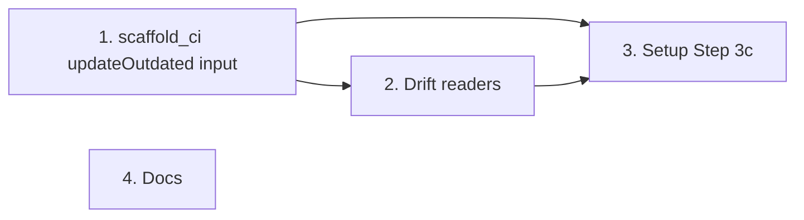

# Tasks

Group order (2 and 3 wait for 1; 3 also waits for 2; 4 runs in parallel):

## 1. scaffold_ci updateOutdated input

- [ ] 1.1 Add the `updateOutdated` input, `scaffoldCIWith`, the conflict error, the atomic write, the 1 MiB read limit and the new texts in internal/tools/scaffold.go — verify: go test ./internal/tools/ -run 'TestScaffold|TestCIScriptDrift|TestOptionalInputFieldsNotRequired|TestMCPToolParameterDescriptions|TestFuncErrorLiteralsHaveRealSuggestions' <!-- ref:1-1-add-the-updateoutdated-input-scaffol-a87310 -->

## 2. Drift readers

- [ ] 2.1 Add `ciScriptDriftError` in internal/tools/setup.go and change the drift messages in internal/tools/validators.go — verify: go test ./internal/tools/ -run 'TestValidate.*Drift|TestSetupPrepare_CIScriptDrift|TestCIDriftErrorText' <!-- ref:2-1-add-ciscriptdrifterror-in-internal-t-a3c97f -->

## 3. Setup Step 3c

- [ ] 3.1 Add Step 3c and its routes in plugins/sdlc/skills/setup/SKILL.md — verify: go test ./internal/skillcheck/ <!-- ref:3-1-add-step-3c-and-its-routes-in-plugin-3fd020 -->

## 4. Docs

- [ ] 4.1 Describe Step 3c and both inputs in docs/skills/setup.md — verify: task site:build <!-- ref:4-1-describe-step-3c-and-both-inputs-in-89d9e9 -->
