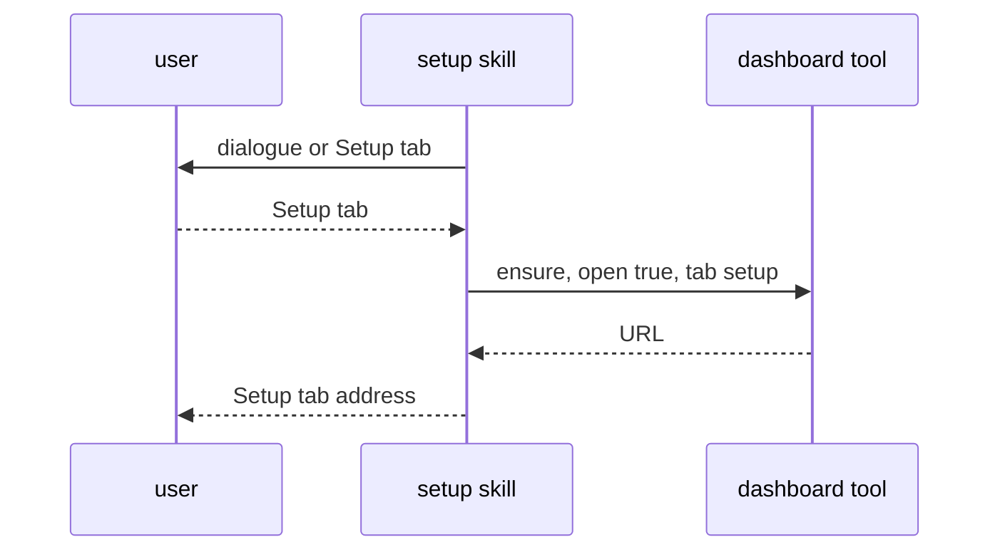

# Spec Delta

## ADDED Requirements

### Requirement: Setup tab question on a fresh repo
The skill SHALL ask once, after the section menu, whether to change the selected form sections in the dialogue or in the dashboard Setup tab, only when all 5 conditions hold: this run created a config file, no `--only`, `--force` or direct-entry flag, a form section is selected, the main worktree is active, and no migration runs.

#### Scenario: Tab answer
- **WHEN** the user answers `Setup tab`
- **THEN** the skill calls `dashboard` with `action:"ensure"`, `open:true` and `tab:"setup"`
- **AND** the form sections leave the selection of this run

#### Scenario: Dialogue answer
- **WHEN** the user answers `Dialogue`, answers with free text, or dismisses the question
- **THEN** the selection stays unchanged

#### Scenario: Dashboard error
- **WHEN** the `dashboard` call returns an error
- **THEN** the skill prints the error in a `text` fence
- **AND** the form sections stay in the selection

#### Scenario: No section left
- **WHEN** the tab answer leaves no section
- **THEN** the skill prints `No sections left for this run.`
- **AND** the run goes to the CI script step, then the summary

#### Scenario: Legacy config
- **WHEN** a JSON-era config needs migration, or `--migrate` is passed
- **THEN** the skill does not ask the question

#### Scenario: Second run
- **WHEN** the config files already exist before the run
- **THEN** the skill does not ask the question

### Requirement: Setup tab pointer at the end
The summary SHALL end with a pointer to the dashboard Setup tab, from `dashboard` with `action:"status"`, on every run that reaches the summary.

#### Scenario: Server running
- **WHEN** `status` reports `running:true`
- **THEN** the pointer names `<url>#setup`

#### Scenario: Server not running
- **WHEN** `status` reports `running:false`
- **THEN** the pointer names `/sdlc:dashboard`

#### Scenario: Status error
- **WHEN** the `status` call returns an error
- **THEN** the skill prints the error in a `text` fence and the `running:false` pointer

#### Scenario: Linked worktree
- **WHEN** the run is in a linked worktree
- **THEN** the pointer also says that the Setup tab changes the config of the main worktree
