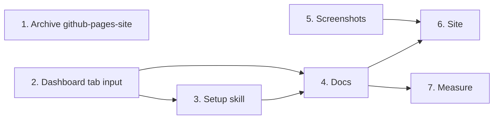

# Tasks

## 1. Archive github-pages-site

- [ ] 1.1 Tick the 31 boxes and archive the change in openspec/changes/github-pages-site — verify: openspec validate --specs <!-- ref:1-1-tick-the-31-boxes-and-archive-the-ch-9f602f -->

## 2. Dashboard tab input

- [ ] 2.1 Add the tab input to the dashboard tool in internal/tools/dashboard.go — verify: task check <!-- ref:2-1-add-the-tab-input-to-the-dashboard-t-5c7526 -->

## 3. Setup skill

- [ ] 3.1 Add Step 1b and the Step 4 pointer in plugins/sdlc/skills/setup/SKILL.md — verify: go test ./internal/skillcheck/... <!-- ref:3-1-add-step-1b-and-the-step-4-pointer-i-fc8d3b -->

## 4. Docs

- [ ] 4.1 Mirror Step 1b and Step 4 in docs/skills/setup.md — verify: task site:test <!-- ref:4-1-mirror-step-1b-and-step-4-in-docs-sk-3bc798 -->
- [ ] 4.2 Write the fresh-repo path and owner table in docs/getting-started.md — verify: go test ./internal/skillcheck/... <!-- ref:4-2-write-the-fresh-repo-path-and-owner-6de03e -->

## 5. Screenshots

- [ ] 5.1 Capture the 5 tab images in site/src/assets/ — verify: user approves each image <!-- ref:5-1-capture-the-5-tab-images-in-site-src-413773 -->
- [ ] 5.2 Capture the 4 detail and setup dialog images in site/src/assets/ — verify: user approves each image <!-- ref:5-2-capture-the-4-detail-and-setup-dialo-c078dd -->

## 6. Site

- [ ] 6.1 Add the setup block and the gallery in site/src/pages/index.astro — verify: task site:test site:build <!-- ref:6-1-add-the-setup-block-and-the-gallery-82e195 -->

## 7. Measure

- [ ] 7.1 Count the user actions of the new setup path in .sdlc-v2/learnings/log.md — verify: learnings_log entry exists <!-- ref:7-1-count-the-user-actions-of-the-new-se-02e281 -->
