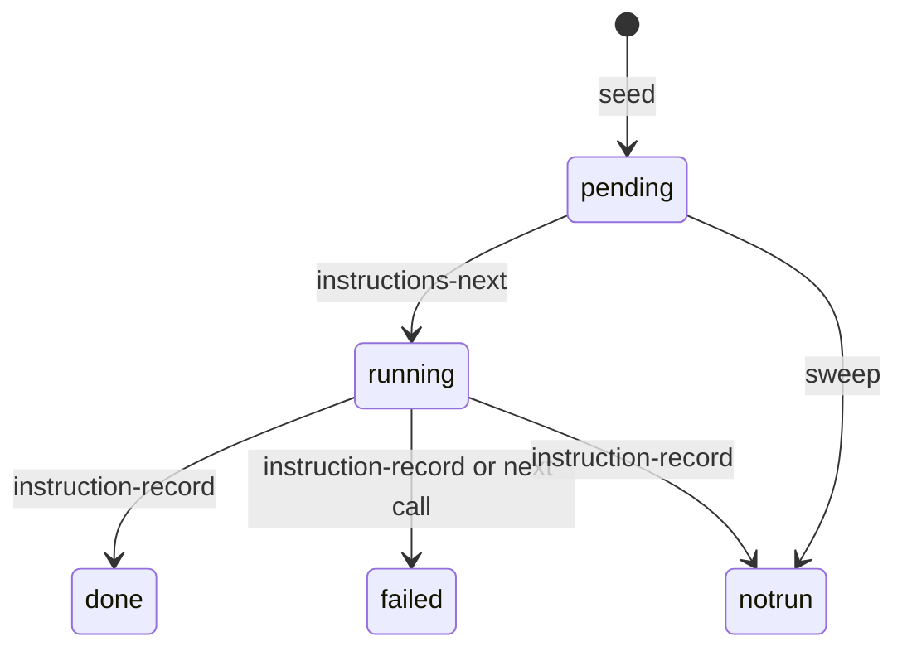

# Spec Delta

## ADDED Requirements

### Requirement: instructions-next action
The action SHALL take `detail.key`, SHALL mark each running record of the key failed with the outcome `result not recorded, not run again`, then SHALL mark the first pending record running and return it with `remaining` and `runMode`.

#### Scenario: Next record
- **WHEN** the key `pr` has a pending record 2
- **THEN** the action returns `pr #2` and `next` says `Do instruction pr #2, then call instruction-record.`

#### Scenario: No open record
- **WHEN** the key has no pending record
- **THEN** the action returns `(none)` and `next` says `No open instruction for <key>. Continue with the next step.`

#### Scenario: Run mode not boolean
- **WHEN** `flags.auto` is not a boolean
- **THEN** `runMode` is `--auto` and `warnings` has `flags.auto is not a boolean`

### Requirement: instruction-record action
The action SHALL take `detail.key`, `detail.instructionStatus` (done, failed, not run), and `detail.instructionNumber` or `detail.instructionAll: true`, with an optional `detail.instructionOutcome` of at most 1000 characters. A closed record SHALL NOT change.

Record states:

#### Scenario: Closed record
- **WHEN** the record is `done`
- **THEN** the action returns DomainError `instruction pr #1 is closed (done)`

#### Scenario: Outcome required
- **WHEN** the status is `failed` and the outcome is blank
- **THEN** the action returns DomainError `outcome is required for failed and not run`

#### Scenario: Record key with another action
- **WHEN** `complete-step` gets `detail.instructionNumber`
- **THEN** the action returns DomainError `detail.instructionNumber is valid only with instruction-record`

### Requirement: Record sweeps
The `fail`, `skip` and `cleanup-pipeline` actions SHALL close the open records with the outcomes `step failed or stopped`, `step skipped` and `step did not run`.

#### Scenario: Skip
- **WHEN** the harden step is skipped
- **THEN** each open harden record is `not run` with the outcome `step skipped`

### Requirement: Open records keep the run in flight
A started run that is not completed SHALL count as in flight when a step blocks or a record is pending or running.

#### Scenario: End list open
- **WHEN** every step is done and a `ship` record is pending
- **THEN** the run is in flight

#### Scenario: Fresh run
- **WHEN** no step started
- **THEN** the run is not in flight

### Requirement: Commit-check push
When `commit-check` completes the commit step itself, it SHALL push the branch, best effort, and SHALL add any push warning to `warnings` with no change to `stepCompleted`.

#### Scenario: Nothing to commit
- **WHEN** the tree is clean
- **THEN** `stepCompleted` is true and `next` says `Commit step completed. Skip 7c2 and 7d. Run the 7g instruction loop for key commit, then go to the next step.`
