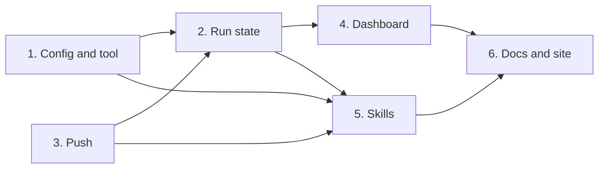

# Tasks

Group dependencies:

Each code group lands its tests. The docs of group 6 describe the whole flow, so they follow the skills. Group 6 ends with the full GitHub Pages site check.

## 1. Config and tool

- [ ] 1.1 Add the instructions loader, key sets, schemas and templates in internal/config/instructions.go — verify: go test ./internal/config/ -run 'TestReadInstructions|TestInstructionKeysMatchSchema|TestInstructionKeysCoverCanonicalSteps|TestLocalSchemaSync' <!-- ref:1-1-add-the-instructions-loader-key-sets-56c840 -->
- [ ] 1.2 Add the instruction record helpers in internal/tools/instruction_records.go — verify: go test ./internal/tools/ -run TestInstr <!-- ref:1-2-add-the-instruction-record-helpers-i-1d7f41 -->
- [ ] 1.3 Add the MCP tool instructions_resolve in internal/tools/instructions_resolve.go — verify: go test ./internal/tools/ -run TestInstructionsResolve <!-- ref:1-3-add-the-mcp-tool-instructions-resolv-9493bc -->

## 2. Run state

- [ ] 2.1 Check the section and seed records in internal/tools/ship.go — verify: go test ./internal/tools/ -run TestShipPrepare <!-- ref:2-1-check-the-section-and-seed-records-i-e7034b -->
- [ ] 2.2 Add instructions-next, instruction-record, sweeps and the in-flight rule in internal/tools/ship_state.go — verify: go test ./internal/tools/ -run 'TestShipStateInstruction|TestShipStateSweep|TestShipRunInFlight' <!-- ref:2-2-add-instructions-next-instruction-re-700bef -->
- [ ] 2.3 Add the instructions section to the ship report in internal/tools/ship_report.go — verify: go test ./internal/tools/ -run TestShipReport <!-- ref:2-3-add-the-instructions-section-to-the-eeaada -->
- [ ] 2.4 Add the instruction actions for standalone execute in internal/tools/execute_state.go — verify: go test ./internal/tools/ -run 'TestExecuteStateInstruction|TestInstructionActionsParity' <!-- ref:2-4-add-the-instruction-actions-for-stan-554a86 -->

## 3. Push

- [ ] 3.1 Add the push helpers and error kinds in internal/gitx/gitx.go and internal/tools/push.go — verify: go test ./internal/gitx/ ./internal/tools/ -run 'TestPush|TestHasRemote' <!-- ref:3-1-add-the-push-helpers-and-error-kinds-71a850 -->
- [ ] 3.2 Add the optional push to commit_apply in internal/tools/commit.go — verify: go test ./internal/tools/ -run TestCommitApply <!-- ref:3-2-add-the-optional-push-to-commit-appl-50c3e8 -->
- [ ] 3.3 Push when commit-check completes the step in internal/tools/ship_state.go — verify: go test ./internal/tools/ -run TestShipStateCommitCheck <!-- ref:3-3-push-when-commit-check-completes-the-a2f17d -->
- [ ] 3.4 Push with a lease in pr_apply in internal/tools/pr.go — verify: go test ./internal/tools/ -run TestPRApply <!-- ref:3-4-push-with-a-lease-in-pr-apply-in-int-301667 -->

## 4. Dashboard

- [ ] 4.1 Add instruction rows to the snapshot in internal/tools/dashboard_snapshot.go — verify: go test ./internal/tools/ -run TestDashboard <!-- ref:4-1-add-instruction-rows-to-the-snapshot-248496 -->
- [ ] 4.2 Render instruction rows and the end group in internal/dashboard/web/static/render.js — verify: node --test internal/dashboard/web/testdata/view.test.cjs <!-- ref:4-2-render-instruction-rows-and-the-end-6fe2f8 -->

## 5. Skills

- [ ] 5.1 Write the shared procedure in plugins/sdlc/skills/ship/instructions-run.md — verify: go test ./internal/skillcheck/ -run TestInstructionsRunProcedure <!-- ref:5-1-write-the-shared-procedure-in-plugin-ca50f0 -->
- [ ] 5.2 Run the list in the commit and pr skills in plugins/sdlc/skills/commit/SKILL.md and plugins/sdlc/skills/pr/SKILL.md — verify: go test ./internal/skillcheck/ <!-- ref:5-2-run-the-list-in-the-commit-and-pr-sk-e90c8c -->
- [ ] 5.3 Run the list in the review and received-review skills in plugins/sdlc/skills/review/SKILL.md and plugins/sdlc/skills/received-review/SKILL.md — verify: go test ./internal/skillcheck/ <!-- ref:5-3-run-the-list-in-the-review-and-recei-bcccea -->
- [ ] 5.4 Run the list in the execute, harden and verify-pipeline skills in plugins/sdlc/skills/execute/SKILL.md — verify: go test ./internal/skillcheck/ <!-- ref:5-4-run-the-list-in-the-execute-harden-a-41187c -->
- [ ] 5.5 Run step lists and the end list in plugins/sdlc/skills/ship/SKILL.md — verify: go test ./internal/skillcheck/ <!-- ref:5-5-run-step-lists-and-the-end-list-in-p-1ef0c9 -->

## 6. Docs and site

- [ ] 6.1 Write the reference page and entry docs in docs/instructions.md — verify: task site:install site:test site:build <!-- ref:6-1-write-the-reference-page-and-entry-d-c996ed -->
- [ ] 6.2 Update the ship, commit, pr and execute overview and reference pages in docs/skills/ — verify: task site:install site:test site:build <!-- ref:6-2-update-the-ship-commit-pr-and-execut-bb2551 -->
- [ ] 6.3 Update the review, received-review, harden and verify-pipeline overview and reference pages in docs/skills/ — verify: task site:install site:test site:build and go test ./internal/skillcheck/ -run 'TestHarden|TestReview' <!-- ref:6-3-update-the-review-received-review-ha-9c41a4 -->
- [ ] 6.4 Update the dashboard and state pages in docs/dashboard.md and plugins/sdlc/skills/ship/state-format.md — verify: task site:install site:test site:build <!-- ref:6-4-update-the-dashboard-and-state-pages-4b32d0 -->
- [ ] 6.5 Add the home page benefit and run the full site check in site/src/data/benefits.mjs — verify: task site:install site:test site:build <!-- ref:6-5-add-the-home-page-benefit-and-run-th-0816b2 -->

## Workflow follow-up

- Ship archives the change after verify-openspec passes.
