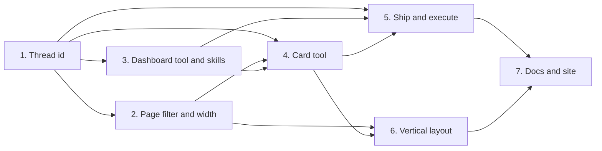

# Tasks

Group dependencies (groups with no path between them can run in parallel):

The docs group is last on purpose: its text copies the limits that plan Task 11 records in T3 Code. Each earlier group lands its own tests.

## 1. Thread id

- [ ] 1.1 Add the T3 detection package and test isolation in internal/t3/ — verify: go test ./internal/t3/ <!-- ref:1-1-add-the-t3-detection-package-and-tes-96ca0e -->
- [ ] 1.2 Stamp t3ThreadId into new run state in internal/state/state.go and both state schemas — verify: go test -tags integration ./internal/state/ ./internal/tools/ <!-- ref:1-2-stamp-t3threadid-into-new-run-state-8a1c60 -->
- [ ] 1.3 Add t3ThreadId to the dashboard snapshot in internal/tools/dashboard_snapshot.go — verify: go test -tags integration ./internal/tools/ ./internal/dashboard/web/ <!-- ref:1-3-add-t3threadid-to-the-dashboard-snap-2889e6 -->

## 2. Page filter and width

- [ ] 2.1 Add the thread filter, thread chip and pending run hash in internal/dashboard/web/static/ — verify: node --test internal/dashboard/web/testdata/view.test.cjs <!-- ref:2-1-add-the-thread-filter-thread-chip-an-c03376 -->
- [ ] 2.2 Fit the header and History at 600 px in internal/dashboard/web/static/app.css — verify: go test -tags integration -run TestBrowserE2E_Narrow ./internal/dashboard/web/ <!-- ref:2-2-fit-the-header-and-history-at-600-px-a38099 -->

## 3. Dashboard tool and skills

- [ ] 3.1 Return previewUrl and accept runId in internal/tools/dashboard.go — verify: go test ./internal/tools/ -run Dashboard <!-- ref:3-1-return-previewurl-and-accept-runid-i-fe4db1 -->
- [ ] 3.2 Open the T3 preview tab in plugins/sdlc/skills/dashboard/SKILL.md and plugins/sdlc/skills/setup/SKILL.md — verify: go test ./internal/skillcheck/ <!-- ref:3-2-open-the-t3-preview-tab-in-plugins-s-75e25e -->

## 4. Card tool

- [ ] 4.1 Add the MCP App registration path in internal/mcpserver/ — verify: go test ./internal/mcpserver/ <!-- ref:4-1-add-the-mcp-app-registration-path-in-262b67 -->
- [ ] 4.2 Add the dashboard_card tool and card view in internal/tools/dashboard_card.go — verify: go test ./internal/tools/ -run DashboardCard and node --test on card_view.test.cjs <!-- ref:4-2-add-the-dashboard-card-tool-and-card-0fb339 -->
- [ ] 4.3 Register dashboard_card and update the tool registry in internal/tools/ and cmd/sdlc/ — verify: go test -tags integration ./... <!-- ref:4-3-register-dashboard-card-and-update-t-27a1b7 -->
- [ ] 4.4 Check the card and the run panel in T3 Code and record the result in the plan — verify: the recorded result table has a pass for each row <!-- ref:4-4-check-the-card-and-the-run-panel-in-734557 -->

## 5. Ship and execute

- [ ] 5.1 Return t3ThreadId, shipDispatched and runId in internal/tools/ship.go, execute_state.go and ship_state.go — verify: go test -tags integration ./... <!-- ref:5-1-return-t3threadid-shipdispatched-and-acb6cd -->
- [ ] 5.2 Add the run panel, start card and end card in plugins/sdlc/skills/ship/SKILL.md and plugins/sdlc/skills/execute/SKILL.md — verify: go test ./internal/skillcheck/ <!-- ref:5-2-add-the-run-panel-start-card-and-end-096cb4 -->

## 6. Vertical layout

- [ ] 6.1 Add the 640 px vertical layout in internal/dashboard/web/static/app.css, setup.css and render.js — verify: go test -tags integration -run 'TestBrowserE2E_(Narrow|Vertical)' ./internal/dashboard/web/ <!-- ref:6-1-add-the-640-px-vertical-layout-in-in-064bcb -->

## 7. Docs and site

- [ ] 7.1 Document the T3 Code dashboard in docs/dashboard.md, docs/skills/, state-format.md files and site/src/data/features.mjs — verify: task site:test and links_validate on docs/dashboard.md <!-- ref:7-1-document-the-t3-code-dashboard-in-do-b122aa -->

## Workflow follow-up

- Archive the change through /sdlc:ship after validation passes.
