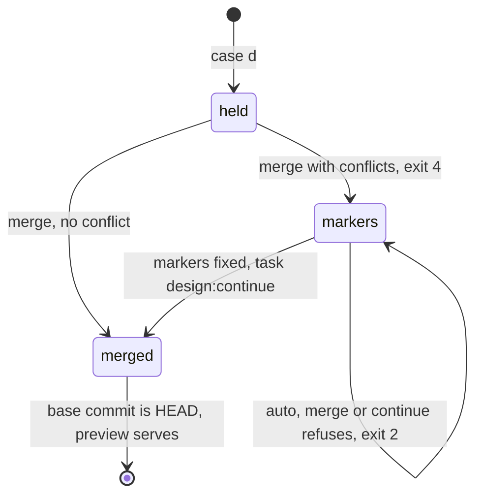

# dashboard-design-preview Specification

## Purpose
Lets a developer design the dashboard page in a local draft with the live data of the real dashboard, and bring shipped page changes into that draft without loss of the own design work.

## Requirements

### Requirement: Read-only API proxy
The preview SHALL pass each `GET /api/*` request to the dashboard with the same path and query string, the event stream and the detail routes included, and SHALL answer any other method with 405 and code `PREVIEW_READ_ONLY`.

#### Scenario: Run detail through the preview
- **WHEN** the draft page requests `GET /api/run-detail?repo=%2Fr&id=x`
- **THEN** the dashboard gets `repo=/r` and `id=x`
- **AND** the draft page gets the 200 body of the dashboard

#### Scenario: Write method
- **WHEN** the draft page sends `POST /api/run-detail`
- **THEN** the response is 405 with code `PREVIEW_READ_ONLY`

#### Scenario: Stream opened again
- **WHEN** the draft page closes `/api/events` and opens it again
- **THEN** the new stream starts with the current snapshot event

### Requirement: Merge mode
The preview SHALL accept `-mode merge` (`task design:merge`). Merge SHALL copy `design/dashboard/static/` to a new `design/dashboard/static.bak-<UTC time>-<random>` folder before its first draft write, then SHALL do a three-way merge of each page file from the base commit, the draft and HEAD.

#### Scenario: Clean merge
- **WHEN** the draft and HEAD change different lines of one page file
- **THEN** the output has `design preview: merge — merged <n> files. Base commit <sha>. Backup <path>.`
- **AND** `design/dashboard/base.json` holds the HEAD commit
- **AND** the preview serves the merged draft

#### Scenario: Merge with conflicts
- **WHEN** the draft and HEAD change the same line of `app.js`
- **THEN** the output has `design preview: merge — 1 conflicts. Backup <path>.` and `design preview: conflict — design/dashboard/static/app.js`
- **AND** `design/dashboard/base.json` is unchanged
- **AND** the process ends with exit 4

#### Scenario: Nothing to merge
- **WHEN** the shipped page did not change since the base commit
- **THEN** the output has `design preview: merge — nothing to merge` and the preview serves

#### Scenario: Binary file changed on both sides
- **WHEN** the draft and HEAD both change a font file
- **THEN** the file is a conflict and keeps the draft version

#### Scenario: Two merges in one second
- **WHEN** two merges start in the same second
- **THEN** each merge gets its own backup folder

#### Scenario: Request log
- **WHEN** a merge ends
- **THEN** `design/dashboard/requests.md` and `design/dashboard/dependencies.json` are unchanged

### Requirement: Conflict marker refusal
The `auto`, `merge` and `continue` modes SHALL refuse a draft that has a line that starts with `<<<<<<< ` or `>>>>>>> `, with exit 2 and the line `design preview: error — the draft has conflict markers in <files>. Fix them, then run task design:continue.` The `fresh` mode SHALL discard such a draft.

#### Scenario: Continue with markers
- **WHEN** `app.js` in the draft has a line `<<<<<<< draft` and the developer runs `task design:continue`
- **THEN** the process ends with exit 2
- **AND** `design/dashboard/base.json` is unchanged

#### Scenario: Auto with markers
- **WHEN** the draft has markers and the developer runs `task design`
- **THEN** the preview refuses the draft before case d

#### Scenario: Marker inside a line
- **WHEN** a draft line holds `<<<<<<<` after other text
- **THEN** the line is not a marker

#### Scenario: Large text file
- **WHEN** a draft text file is larger than 8 MiB
- **THEN** the process ends with exit 2 and the line names the file

### Requirement: Merge failure keeps the draft
A failed read, write or `git merge-file` call during a merge SHALL leave `design/dashboard/static/` and `design/dashboard/base.json` as they were before the merge, and SHALL end with exit 2. When a restore step also fails, the error SHALL hold `Restore the draft: copy <backup path> to design/dashboard/static.`

#### Scenario: Base write fails
- **WHEN** the write of `design/dashboard/base.json` fails after a clean merge
- **THEN** the draft holds its content from before the merge
- **AND** the process ends with exit 2

#### Scenario: Restore fails
- **WHEN** the restore rename also fails
- **THEN** the error line names both errors and the backup path

### Requirement: Merge refuses symlinks
The `merge` mode SHALL refuse a `design/dashboard/static/` that is a symlink or holds a symlink, with exit 2 and the text `the draft holds a symlink. Merge cannot keep it. Replace it with a file, then run task design:merge again.`

#### Scenario: Symlink in the draft
- **WHEN** the draft holds a symlink and the developer runs `task design:merge`
- **THEN** the process ends with exit 2 and the draft is unchanged

### Requirement: Mode names
The preview SHALL accept the modes `auto`, `fresh`, `continue` and `merge`, and the case d next line SHALL name `task design:merge`.

| Event | Line |
|---|---|
| unknown mode `x` | `unknown mode "x". Allowed: auto, fresh, continue, merge.` |
| case d | `design preview: next — run task design:merge (merge the shipped changes into the draft), task design:fresh (discard the draft) or task design:continue (keep the draft).` |

#### Scenario: Unknown mode
- **WHEN** the developer runs the preview with `-mode x`
- **THEN** the process ends with exit 2 and prints `unknown mode "x". Allowed: auto, fresh, continue, merge.`

### Requirement: Skill merge route
The `dashboard-design` skill SHALL offer Merge (Recommended), Override, Keep and Cancel in case d, and SHALL offer Fix with me (Recommended), Override and Cancel after a merge with conflicts or a refused draft with markers. The skill SHALL show the backup path as text.

#### Scenario: Merge picked
- **WHEN** the user picks Merge in case d
- **THEN** the skill runs `task design:merge`

#### Scenario: Conflicts fixed
- **WHEN** the user picks Fix with me and every marker is gone
- **THEN** the skill runs `task design:continue`

#### Scenario: Markers left
- **WHEN** `task design:continue` refuses the draft
- **THEN** the skill shows the conflict files again
